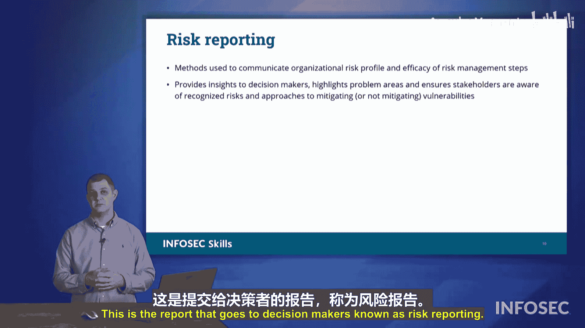

# 【Infosec】CompTIA安全 701认证 ｜ CompTIA Security+ 701 p58 11_01_06_risk-management -BV1LRr5BTEow_p58-

In this section， we're going to look at ways that we can manage risk at our organization。This topic。

 risk management is going to dive into ways that we can calculate the types of risk that we've got。

Within risk management there are several different factors to look at the first is risk identification we want to go through and identify what sort of risks or vulnerabilities that we have present on our network。

 recall that we have vulnerabilities， threats and risks。Vulnerabilities are a weakness。

 threats are a weakness with a threat actor， and then risk is when we begin to quantify the potential of damage that would cause to our organization。

So in this section we're looking at how do we identify risks。

 we're going to do this through our vulnerability scanning process， carrying out penetration tests。

 running our security audits， doing some self- checkckouts。

 and then also carrying out that being aware of threat intelligence and seeing what sort of information is available out there。

These are ways that we can identify risk， then what we can do is we can start to look at risk assessment。

 how does that risk affect our organization， we have these different types of risk assessments to be carried out。

We have an ad hoc assessment， this is where you just create an assessment as needed。Really。

 it comes down to just as needed， the reason you would carry one of these out might be if you're switching insurance providers for cyber insurance or some new certification for your organization might require that you have an ad hoc assessment performed or it might require that you have a risk assessment performed and then with ad hoc you're just going to do it whenever it comes up。

You might also do this as a one time assessment if you jump down a little bit。

A one time assessment this just be we're going to do it once because we just need this happening one time。

 we're not going to do it again， we just run it once and we're done。

We could also move into the second bullet point here， recurring assessment。

 we're going to do this on a recurring cycle， we're going to do this every three months， six months。

 annually， whatever the case may be， what we have it on some sort of a regular recurring cycle。

Or we could just do it all the time some organizations are so risk aware that they are continually carrying out different assessments。

 so whenever you need an assessment you just go pull the latest one we've got one generated every single day we're just pulling it out it's constantly generating these risk assessments so the moment you need it you've got one ready to go。

Next， let's look at how do we calculate risk， how do we a fixed a dollar amount to a particular risk。

To a particular event。And the way we do this is by looking at the single loss expectancy。

 the annualized rate of occurrence， and the annualized loss expectancy Wecome to the only math you're going to have to do on the security plus exam。

The single loss expectancy， combined with the annualized rate of occurrence。

 gives us our annualized loss expectancy。The numbers are going to be very round。

 so you're not going to have to do a whole whole lot of math。

 the numbers is going to be very easy to calculate。First， let's look at the single loss expectancy。

 this is how much it costs with a single event if a single event was to occur。

 what would it cost our organization to repair or replace that particular asset？

Do we have a laptop that got dropped， broken or stolen， or in this example。

 we've got a broken window。Let's say that window costs a00。To replace it might cost$1，00。 therefore。

 our single loss expectancy is。You got it $1000。Our annualized rate of occurrence is answering the question。

How often is this happening？How often are we having laptops dropped or broken。

 how many laptops a year get stolen or how often are we breaking windows。

 Is it happening once a year or twice a year？That's going to be our annual rate of occurrence。

Are number of times that this is occurring。Then what we can do with those two。Values。

 we multiply them together， and that's going to give us and yield the annualized loss expectancy are ALE。

This right here in the middle is the formula for calculating your ALE。

 it's just your SLE times your ARO single loss expectancy times your annualized rate of occurrence。

 and that tells you in a year how much you can expect to drop on a particular event occurring because it's going to be happening as many times as your ARO dictates。

So in this case， if we have $1，000 window and it happens twice a year。

Our annualized loss expectancy is going to be $2，000。

$1000 for the window happening twice a year you can see how round these numbers are going to be they're going to be something in the value of hundreds of dollars or $100 dollars or maybe possibly $250 times four that might be the extent of how difficult the math is very round numbers nothing to worry about then that's the only math you're going to have to do on the exam。

Next we're going to look at once we've calculated that value。

 how do we list those values out we're going to see this show up on our risk register。

 this is where we list out the various risks to our organization。

 we might sort them based on how risky they are or how much they cost us we're going to categorize them differently based on how our organization values these things。

We might also see that we have a risk threshold， there might be a certain point at which we cross and we say okay yeah。

 we're dropping too much money on stolen lost laptops。

 let's come up with another way to deal with that so we're not just throwing money out the window。

And so with the risk register， we're going to list the most expensive or the most frequently occurring risks that come up and how we handle those。

In the bottom right over here， you see the risk matrix。

 this ranks based on likelihood and the amount of impact you have across the horizontal axis and you start to see at how frequently is this going to happen or how likely is this going to happen？

Combined with what are the consequences， how are we going to feel this is this going to be catastrophic for our organization or is it going to be kind of like meh。

 kind of an insignificant amount of impact that we've got taken together where those two where that row and column meets it's going to tell us if we have extreme level of risk。

 high level of risk， moderate or medium level of risk， and then finally a low level of risk。

 the colorized graphic you see over here is known as the risk matrix。

Then what we can do is we can identify from our risk register， what do we do about these issues？

These risks that come up， we have four choices of action that we can do， there's only four。We can。

 first of all， we can just do something about the problem， we can at the bottom here。

 we can mitigate whatever the risk is whenever we go to mitigate the risk。

 we're putting in security controls to stop that from happening。

 we're putting in passwords or we're putting in some sort of new technology that's going to stop that thing from happening。

Or we could avoid it all and we could say this is a problem， I don't want this to occur。

 so I'm just going to avoid this from happening to begin with if it involves one of our systems that is internet facing。

Maybe we're going to avoid that level of risk and just say， yeah， you know what。

 let's not put this system internet facing， let's avoid that altogether。Or we could say。Yeah。

 this is going to be a problem if it happens here， such as let's say if we were to lose power at our primary data center。

 if we're running our own data center and we lose power， that would be catastrophic。

If we lose internet service at our data center， that would be catastrophic。

And so what we're going to do is we might contract with a data center operator。

And what we're going to do is we're going to put on them。

That laying awake at night going oh I wonder if our power is gonna to go out tonight。

 I hope it doesn't go out or I hope I've got enough mitigations in place that stops this from happening。

 that's something they're gonna to have to worry about but we're not going to have to worry about it So if we look at our strategies we're going to see that we've got one of four options to take and in this case we can actually take our risk and we can transfer it to someone else we can transfer that level of risk to a data center operator we're transferring that risk it's still our problem but they're the ones that are having to worry about it We're paying them for that service。

 It's still our problem if it comes to pass and we lose our internet or power at that data center。

 but we're not the ones in charge of it but we've transferred that risk to them。

The fourth option that we have here is acceptance， you can just accept the risk， you just be like。

 yeah， that's a risk I'm willing to take， that's something that you know it comes with the territory。

 that's something I'm just going to have to deal with。

Under acceptance we have exemptions and exceptions we talked about those terms in terms of how we accept it we're documenting look。

 I know this is。A problem。 and here's why I'm allowing to exist。

 I've accepted the risk with this one， and so we're going to write out exemptions and exceptions to say。

 I'm aware of it， and this is why I'm going to accept this risk。

That level of risk acceptance might fall under risk tolerance。Look。

 it's a level of risk we have this is the problem， it's costing us this much money。

 but in order to mitigate that it might be a $10，000 response and it's only a $500 a year annual。

Annualized loss expectancy。It's not worth spending $10，000 to save $500。

 so we'll just have to eat that $500 every year until we find a cheaper easier way to mitigate that this is part of risk tolerance it's a calculated dollar accounting decision that's made to look at how much is it going to cost us to。

Bear the brunt of this loss versus what's going to cost us to mitigate that so that we're not losing that money sometimes they're not they're out of whack and it might be too expensive to actually mitigate that and like I like to say。

The juice ain't worth the squeeze， it's just not worth the effort to try to save $500 by spending $10。

000。This is all part of an organization's risk appetite。

 how much risk is an organization willing to accept because there's a certain level of risk with each of these choices that we make and at some point you have so much risk in place that you might be very。

 very risky by what you're doing， but you might be doing that with a purpose in mind。

 you might be growing and so you might have an expansionary risk appetite。

We're willing to risk it for the biscuit， we're going out there and we're really trying to go after some new business and so we're going to lay it on the line。

 we're going to be a little risky in what we're doing because if we can make it work where it's going to hit paid dirt。

But this expansionary does leave us more exposed。Other organizations may not be so growth oriented。

 they might be more conservative in what they're doing。

 and so they're just going to kind of button things up， not reduce。

 not tolerate much risk and they're just going to stay put they're happy where they're at this is a conservative risk appetite。

And then the third option is kind of a balance between the two， this is a neutral riskic appetite。

 we're not growing， we're not seeking to grow by leaps and bounds。

 nor are we complacent and just ready to just stay put。We're going to grow a little bit。

 so we're willing to tolerate a little bit of risk。

 but we're not going to really put it out there in order to grow。

 so we're just going to kind of balance this and have more of a neutral risk appetite。Lastly。

 for decision makers in your organization you will need to report to them some level of risk that you've got this is listing out look here are the problems this is what we're doing about it and this is how we are still exposed this is the report that goes to decision makers known as risk reporting this in other terms are some of the things we can expect to see coming up on our security plus exam。

