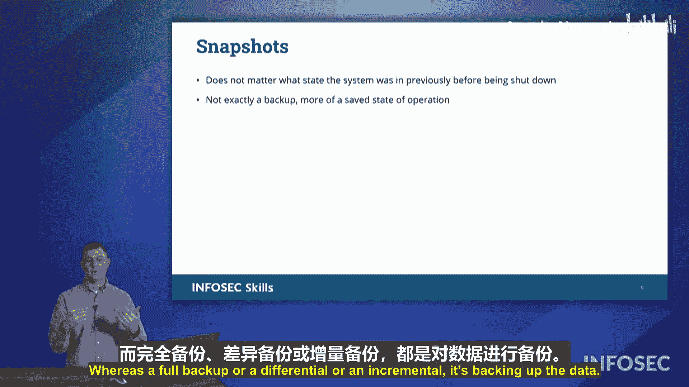

# 【Infosec】CompTIA安全 701认证 ｜ CompTIA Security+ 701 p59 12_01_01_back-ups -BV1LRr5BTEow_p59-

Backups， let's talk about the important part of this security control that allows us to put things back the way they were we're going to have a corrective control putting back。

Information， if it's been lost， corrupted， damaged， etc cetera。

Backups are an important part of any security。Profile。

So we have three types of backups that we'll run through on the security Plus， there' is the full。

 the differential and the incremental。The the full is probably the easiest type to think about it's what most people。

Gravitate toward when we start talking about backups so a full backup it backs up everything regardless of whether or not it's been backed up previously。

 regardless of when it was backed up previously， the full backup backups all of the data。

The thing to know about a full backup is that it has the highest。Back up time。

 meaning it takes the longest to actually run， it takes the longest to run because it's backing up all the things。

It is， however， on the exam in Comptia land is referred to as having the lowest restoration time。

 meaning if I have a bare bones。Bear metal computer。

 and I'm going to restore all of the information on that system。

 I'm going to restore everything from it。Well， on this exam。

 they're saying that the full backup takes the least amount of time。

And I know for those of you practitioners that have experience with full back， if you're like， no。

There's no way it takes the least amount of time， but when you consider that the other。

Data backup types that we have their restoration time is dependent on the full backup well in that case it is the lowest restoration time because they are dependent on the full so however long the full takes well it's going to take that long plus some other to restore the other backup types this is the full data backup against probably the easiest one to think about because it is what most of us gravitate toward。

This is the full backup next is we have the。Differential backup。

The differential backs up anything that is different。Since the last full backup of any kind。

So the last full backup is what the differential backup。

Looks up so anything that has changed since last weekend or since last week or since last month。

 however often you do a full backup， the differential backup will be backing up everything going back to that date。

For this reason， the differential backup is not exactly quick because it could be doing several days or even weeks worth of data。

But。It has a medium restoration time， so it doesn't take as long as the full backup to actually run because it't doesn't have to do everything。

 only those things that have changed and so it has a medium backup time and when it comes to restoring things again from that bare metal state。

It takes the full backup and then the medium backup on top of that。

So the differential backup is kind of this middle ground， it's a medium backup time。

 medium restoration time。Remember that the differential is anything that is different。

Since the last full backup。Another way to remember this is that there are Fs。

The letter F inside differential， so it's the last thing since the full backup。

And then the third option that we've got here is the incremental backup。

 This is going to do things in tiny little increments。

Tiny little increments of data will be backed up since the last backup。Of any kind。火。Differential。

Other incremental backups， it doesn't matter， it's going to increment each of those so you're going to have little bits of data that get restored along the way。

The incremental backup runs very， very quick， it takes very little amount of time。But again。

 for the exam， think of it as having the highest。Restoration time because it is dependent on the full。

The differential。And then any subsequent incremental backups you might have。

 and so it's going to do tiny little increments。And so these are going to be the shortest to run。

 so think about how tiny an increment might be， and then you' can have a tiny backup time。It is also。

 but it has the highest backup time because it are dependent on the other types of backups on here。

So again， to recap， we have the full backup backing up all the data。

The differential with the F in there relating it back to the full backup is going to restore or it's going to back up any data going back to the last full backup。

And then the incremental， you've got tiny little backups。

 and that's going be just a little bit of information that has changed since the last backup incremental backups could be in the range of。

Hours。Or even like every 30 minutes， maybe you're on incremental backup。

 get little snap backups throughout the day， and I need to be careful but whenever I said it because I almost let it slip that I said。

Snapshots。Be careful with snapshots， snapshots are not backups， not according to the exam again。

 some of your practitioners are like oh， but we use snapshots a lot with our workplace。Maybe so。

 but on the exam， a snapshot is not a true backup because it is more of a。

 it's capturing the state of that computer or that system that's running。

It's freezing it in that state and then holding on to that it's not backing up all the data per se。

 it's just the state of that system。Whereas a full backup or a differential or incremental。

 it's backing up the data， the snapshot is gathering up the operation of that system。

 so just be on the lookout for on the exam that a snapshot is not actually a backup。

 it's just a frozen state of a system。

In just a moment， we'll dive in deeper on some ways that we can use backups。

