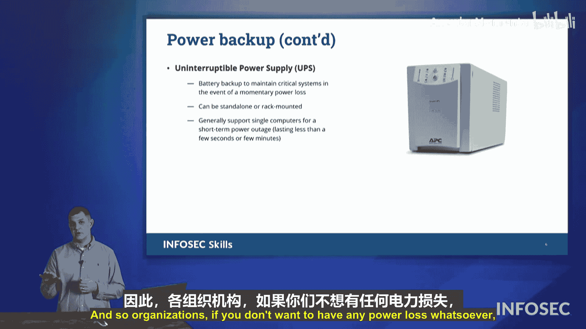

# 【Infosec】CompTIA安全 701认证 ｜ CompTIA Security+ 701 p60 12_01_02_back-up-topics -BV1LRr5BTEow_p60-

Some other concepts to think about whenever we're talking about backups。

 the first thing to know is whenever you are storing your information。

 you want to make sure you're storing that information off site。

I can't tell you how many times whenever I was working in the field that I would go to different businesses and they would have their backup stored on some Mylar tape。

 I don't know if that ages me， but they would have backup tapes and it was stored right on top of the computer。

What are you doing， people， if there's a problem with your computer， if there's a flood， a fire。

Theft， if。Bill comes in and spills his coffee。It's going to trash your backup。

 you want to make sure that your data is safe elsewhere。

 so keeping your data safe and stored offsite very， very important。At a company used to work out。

 we would run our backups and we had a giant automated tape backup machine and it would feed new tapes into that backup we would let it run and we would do a full backup every Friday afternoon we would start it and it would run all night。

 Friday into Saturday， all day， Saturday into Sunday and then sometimes Sunday evening it would finish。

Monday morning， it was myself and a coworker that would meet down there and we would meet in the morning and we would just go through and start pulling tapes。

And Renee and I would go through and we you just knew to meet each other at the freight elevator。

 we wouldn't even say hide each other in the morning we would just kind of stand there because we're still kind of both half awake and we just kind of give good morning grunt to each other。

 go in there， do our work in silence， we're boxing everything up when we're done we close these tubs。

 put a security tag on it， take it to the loading dock。

Because we had a company that was going to combine in a box truck， pick that up and haul it away。

And then we go back to the。Not the freight elevator。 We go the more civilized elevator this time。

 And as at that point the he and I were pretty much awake and then we were like， hey， how's it going。

 He good to see you。 And so then we start talking。 But the reason we would take it to the loading dock that truck would take it away。

 It was important for。😊，the company we were working for to store our data back just as it should be the same with any company。

Another form of backing up information that we can talk about is journaling。

And a journaling file system。Keeps track of data that' is moving around the system。

Think about what happens。Whenever you are moving data from one location in the system to another。

 if you're going to move that data from one location to the next and it goes into RA， for example。

 and then you have a power loss event， you lose power and your system goes down。

What happened to your data？It's gone。And so what we can do with a journaling file system is before the data gets moved from its source to its destination。

A journal entry of sorts is made and it says， I'm moving data from here to here。

And then the process can begin and then it can start to move that data if a power loss event occurs in the midst of that。

When the system boots back up， it looks at the journal says， oh。

 I was in the middle of a data move operation going from here to here Oh。

 there's the old data it's still in it its。Original source Now I can move it to its destination。

 once it's there， then I can remove it from the journal。

 The journal keeps track of operations in the event of a power loss so the operations can continue。

 This too， is a form of a corrective control。 even though you had a power loss event happen。

 the journal is able to bring things back up online。These days。

 we don't oftentimes keep a lot of our backups local， like I was referring to earlier。

 a lot of organizations are backing up data to the cloud。

You can also have backup sites that you can replicate data to。

How often you do that is the distinction between synchronous or asynchronous as you're replicating data from one data center to another。

 from one cloud to another。This is data replication synchronous data replication as you're making changes on your network。

 synchronous is keeping things synchronous so every time you make a change that change is propagated across your network that's in a that's。

Different than asynchronous， what happens every so often as it is changing then every so often you've got a little snapshot that that gets transferred and I should be careful about using the word snapshot。

 right？Because the snapshot is not a backup we remember this so asynchronous is as data is changing you're getting a quick update on what that is asynchronous is happening every minute。

 five minutes， 15 minutes， 30 minutes， even an hour you're replicating that data across sites that is asynchronous versus doing everything real time with synchronous。

Also， when we're talking about keeping backups and worrying about power loss events。

Another topic that that gets listed out on the objectives is。

These sort of backup power generation systems， so we've got a backup generator picture here is a Col backup generator。

 these are giant massive oftentimes diesel engines， sometimes natural gas or propane。

But these generators are a very very powerful engine， you know V12 engines or not。

 when they start up， you know they're starting up usually they let off a big beltl of black smoke and it sounds like a jet engine taking off they're very。

 very loud and what they're doing is they're getting the generator turning to generate enough power to power the office building that it's supporting or the data center that it's supporting the hospital that airport you name it。

A lot of facilities have these backup generators， they oftentimes will run on diesel fuel or if diesel fuel is not a valid option for you because of either climate conditions or run time concerns。

 because that diesel fuel can run down， it can run out。

 cold climates might have issues you can also have these that run on natural gas which is seen as a much more longlived fuel supply。

So why don't organizations run onel natural gas anyways。

 because diesel fuel and combustible fuels like diesel and gasoline give more bank for the buck ounce per ounce。

 but natural gas is a more consistent flow of supply that you can get brought into you via pipeline。

Maybe a little bit smaller if power generation a power generator is not suitable to your organization is that you can get into having an uninterruptible power supply。

 this is what a lot of us have on desktop systems in the office。

 this is usually sitting kind of down at your feet by the computer and what it is oftentimes a large battery that is providing power to your computer and then if commercial mains power is lost。

 you continue to running on that battery for。A few minutes。

 maybe up to an hour depending on the size of the battery and the amount of load that your computer is pulling off of that and then when power is restored it starts recharging that battery again and so this is an uninterrupttable power supply you're always running on battery and then it's just the commercial means that is keeping that topped off。

UPSs and generators to be used in conjunction because it may take 20。

 30 seconds for those generators to come online， start things up， and so organizations。

 if you don't want to have any power loss whatsoever。

 you need to rely on either a UPS or a whole building battery supply and those can be very。

 very large indeed， but generators unable power supplies are ways that we can provide power backups to our organizations。

