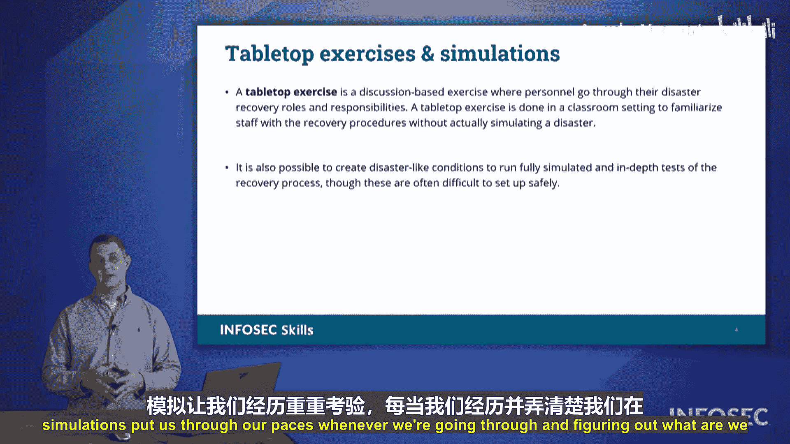

# 【Infosec】CompTIA安全 701认证 ｜ CompTIA Security+ 701 p61 12_01_03_continuity-of-operations-coop -BV1LRr5BTEow_p61-

In every organization， there are going to be business disruptions。

 you're going to have good days and you're going to have bad days。When those bad days happen。

 you need to make sure you have a plan。 And in this case。

 we want to make sure that we're going to be able to maintain。Continuity of operations or coup。

In this section， we're talking about CoP and some of the concepts that come along with it。

So continuity of operations is about making sure that we can continue our operations in the face of adversity。

And so we need to come up with some sort of a alternative business practice。

 we need some way to continue to make our bottom line when things go awry。

Once one time we were at a farmer's market and there was this item that we were wanting to buy from a gentleman that had made it and we were really excited about getting this for our son and we're really just wanting to like okay how much do you want for it。

 he told us the price and I was like do you take Venmo or Paypal can I send you money he's like oh I'm not too fancy with that？

He's like but I have this credit card reader but it's not working on my phone his credit card reader on his mobile device you know had like a square reader on there that wasn't working he's like well hold on a minute。

 let me get something and he came out of his truck with one of the old credit card Rick wreck machines have you seen these things's a you put a piece of like carbon paper on there the credit card the carbon paper and then it rolls across there and it makes a copy of the credit card number on a sheet of paper。

And then you're supposed to write in the dollar amount。

 this is how credit card payments used to be processed。And I was like。

Maybe we hold off on this and he's like， no， it's fine。I was like you say it's fine， first of all。

 no it's not fine I don't want to give you my credit card number that way further my credit card number doesn't even have embossed digits on it so it's not even going to work even if we wanted it to。

His alternate business process was to use this Rick rack machine and make a copy of the credit card and does like。

 that's not going to work this way anymore。Another example is during COVID。

Bed Ba and beyond a store that made their name basically on browsing through their store。

 you would go into the store， you smell the saches， you marvel at their towers of towels。

And they were hoping that you would just stumble into something and kind of impulse by some kitchen or household gadget that you didn't think you needed or that you didn't know that you needed。

And so。In this store business model that they had。When COVID hit， a lot of people stayed home。

And they were not able to go into the store B Bath andBeyond really。

 really took it hard and they were not able to survive their alternate business practice was to have their hourly employees got furloughed。

 they didn't have enough need of the people in the store。

 their salaried store managers took to fulfilling online orders。

A lot of customers were not used to placing orders with bed Ba and beyond online。

 it was more of an impulse by a kind of store。And so the alternate business practice of Bbath and beyond of fulfilling online orders wasn't really enough to sustain them they had other business pressures that were weighing on them as well and not too long after COVID they actually went under。

All of their merchandise was liquidated， their stores have been sold off。

 and now their intellectual property is owned by one of their former competitors。

Their ultimate business practices were not able to sustain them。With continuity operations。

 we want to make sure that we're able to serve our users and so this is going to come up in the form of having redundant operations if you need backup power you've got a backup generator。

 if you need if you cannot afford to have any internet downtime even if your primary internet service goes down。

 you've got a fallback， you've got some sort of an alternate setup and we're going to be able to roll over into that。

So even in the case of there's an outage， you're still able to maintain operations。

When we're looking at what are we able to do， what are we able to accomplish？Well。

 under normal circumstances， we're able to accomplish this。

 but in a situation where we may lose electricity or we might lose heating and cooling in our facilities or we might lose。

You know， any normal service that we've got we're going to have be operating at a reduced capacity so you want to figure out what are the things that would might that light holds back what are the things we can still accomplish you want to do this through examining your people。

Your technology and the infrastructure that you have what can your infrastructure support you in doing what is your technology able to support you in doing and what are your people capable of doing in a situation under normal circumstances they can do this and under adverse conditions they can accomplish something else do your people need additional training do you need some sort of new technology to augment what you already have or do we need some more or stronger infrastructure in order to support resiliency at our operation This is all part of capacity planning。

And then when you have a plan， you want to make sure that your people know how to respond to that。

 The next thing we have in continuity of operations is making sure that we。

Can train our people and our people know what to accomplish and what should be done in a situation。

 we will oftentimes go through tabletop exercises。And we'll run through simulations。

A tabletop exercise is where。You come up with some kind of scenario。

 the whole team comes and sits around the conference table and someone says。Okay。

 here's the situation， this is happening。You're on vacation， you're not here。

 so no answers from you too。This whole team， you're away at a conference or you're busy doing something else。

 so this side of the table。What do you do in this situation。

 this is the tabletop exercise we're going to talk through what should happen。

Do you know what the plan is， what is your plan in this situation Do you know what the plan is。

 where do you go for more information Does everyone on the team know how to respond in case everyone else ist not able to respond When everybody knows the plan we're able to accomplish it faster Ttop exercises simulations put us through our paces whenever we're going through and figuring out what are we able to withstand in the face of adversity This helps us with our continuity of operations and these are some terms we might see on this subject in the security plus exam。

