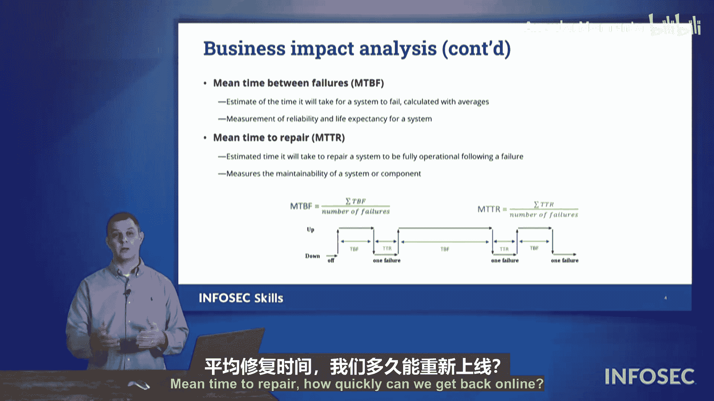

# 【Infosec】CompTIA安全 701认证 ｜ CompTIA Security+ 701 p62 12_01_04_business-impact-analysis-bia -BV1LRr5BTEow_p62-

When evaluating how harmful a risk might be to our organization。

 we might need to carry out a business impact analysis。In this section。

 we're going to look at some of the terms used when discussing business impact analysis。

These are the four terms that Comptia wants us to be aware of on the exam related to business impact analysis。

 recovery， time objective， recovery point objective。Meantime to repair。And meantime between failures。

Looking at the first two， recovery time objective and recovery point objective。

As you can see on the graphic below， we have recovery point objective， the RPO。

 the recovery point objective is in the past。If P is in the past。

 this will help you remember and differentiate between RPO in the past and RTO dealing with time in the future as well。

The recovery point objective is how far in the past you want to go I'm emphasizing the P here to make sure that it sticks in your head when you go to take the exam。

The recovery point objective。Considers how far in the past we need to go in order to recover our data。

Look at it this way， let's say we have an event that occurs。

How far do we need to go into the past to pull that back up to restore someteorative data。

 and so how far in the past we go is determined by our recovery point objective？

The recovery time objective involves how long does it take for us to restore that data the RTO considers the overall amount of time that we're going to lose。

To put it another way。Let's say we have the event that occurs。

 we're going to consider how far in the past we have gone。When that point has occurred。

 we're going to look at how many days of productivity。Of new data that we've generated。

 how much of that new data has been lost because our backup cycle was not in sequence。

Our backup cycle was not frequent enough。And so that's going to dictate how far in the past we can go。

 and then we start to look at， well， how far can we run in the past， how much productivity loss？

Can we as an organization tolerate before it dramatically undermines our business？

And so that total amount of。Of outage time is going to be your recovery time objective。

So the whole time that we have to recover from this incident is going to involve how far in the past we restore our data and then how far in the future it's going to take to restore that information because your backup exists in the past。

 but then your RTO is going to take you a certain amount of time to restore those backups it can take you several hours to do so and so taken together both your RO and the amount of restoration time is going to be your total RTO。

Beyond the lookout for these terms on the exam， Comptia really likes to talk about RPO。

That's your recovery point objective and your RTO recovery time objective。

Another thing to look at when we're evaluating our business impact analysis is our mean time to repair and our mean time between failures。

Consider this graphic。This graphic it looks very technical and mathematic。

 but it it's quite easy to look at and understand what it's trying to convey you have a certain amount of uptime and down time you can see that the line goes up whenever you're in operation and it's down whenever you're offline。

How long are you in operation for？Divided by the number of outages that you've got on average。

You're going to come up with your mean time between failures how long do you run on average before you have a failure？

Are you going to have a failure every six months， then your your mean between failure is going to be six months。

 that means that you have one year， you'll have two outages in that year。

And then when you're offline， how long does it take for you to bounce back to come back online？

That' is your mean time to repair。Let's say that we have a hard drive failure on average once every other year。

So our mean time between failures is。Two years。Every other year we have a failure。

How long are we offline for well if we have a hard drive at the ready， I can grab that hard drive。

 put it into operation and we're ready to go we're back online。

But let's say we don't have one and we need to order one， we need to order a new hard drive。

 It might take a couple days to get to us。 how long are we offline for。

Our mean time to repair is going to shoot up by it's going to do lengthen by two days and so whenever you take your average it's going to really elongate that。

A decision maker at your organization might say， why are we offline for two days or we're waiting on shipping to get us this hard drive is going to take us some time。

Why don't we stockpile some of these hard drives， keep them on hand， let's shorten。

And reduce our mean time to repair Metime between failures is how long do we run before we have a failure。

 Meantime repair。 How quickly can we get back online。

 Some of the terms to be on the lookout for coming up on your security plus exam。

