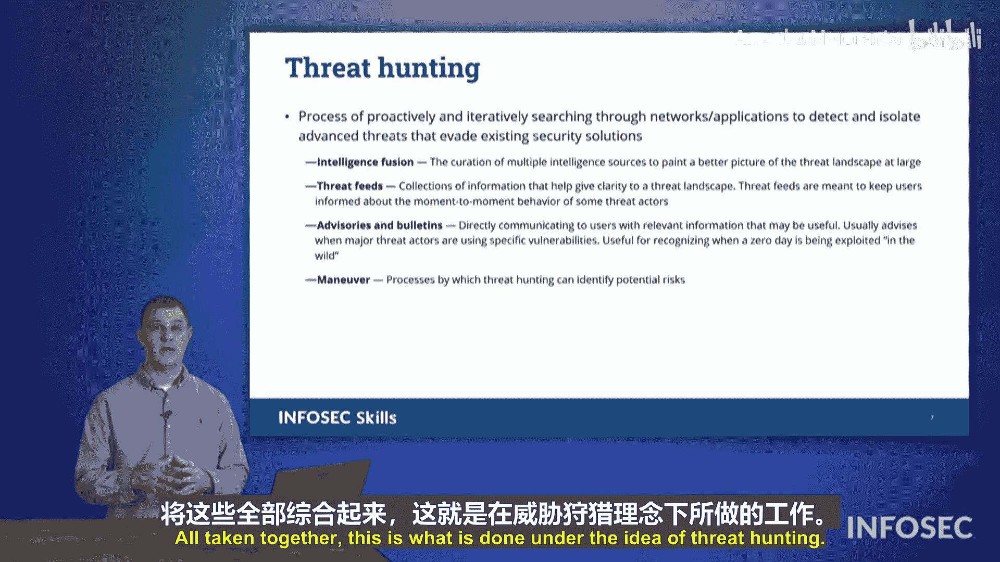

# 【Infosec】CompTIA安全 701认证 ｜ CompTIA Security+ 701 p63 12_01_05_incident-response -BV1LRr5BTEow_p63-

At any organization you're going to have good days and you're going to have bad days you need to make sure that in those bad days。

 whenever you have some sort of cyber incident that pops up you want to make sure you've got a plan in this section on incident response we're going to be looking at the incident response process these are six steps that we can look at about how we handle incidents。

So to begin we're going to be looking at the preparation phase in preparation。

 this is you getting ready for the day that something happens。

 then you move into detection analysis where you're watching for something to occur。

And you make the decision， is this something to be worried about or is this nothing to be alarmed about if it is something to be taking action about。

 then you can move into the containment， eradication and recovery phase。

At which point you return back to your detection analysis and carry on from there。

You also will then kick off some lessons learned or post incidentcident activity where you document your findings about what happened with this that will then inform what you do in preparation for the preparation phase of the next cycle and you continue on in this manner。

By doing this， you're able to learn and grow from prior activities about how best to handle various incidents。

Looking at each of these steps further， we have the preparation phase。Currently。

 you are in the preparation phase for your employer or future employer when it comes to cybersecurity。

 you are preparing yourself， believe it or not， for the day some cyber event pops off you're going to be able to know and detect what's going on。

 you're going to be aware of what sort of technologies are in play and what different solutions might be out there on the market for us to have some sort of response。

You prepare your assistance by doing system hardening， you go through exercises and drills。

 making sure your people are ready， you're allocating resources。

 budgeting and purchasing new technologies to keep things safe and developing policies for your employees to follow when those things occur。

These are all in preparation for the big day when something bad happens。

You move into the detection and analysis phase where you're constantly monitoring and watching what is happening on our network。

 is this something to be alarmed of or not， and whenever you have detected something you're going to analyze it and say what's going on with this。

 who is this affecting， what's causing this， and then is this something malicious on our network？

If you think it's malicious， then you move into the containment phase， you want to stop the spread。

 you want to limit how much damage that malware can do to the rest of the network。

 you're going to contain it。Then once you've contained the threat by cutting off internet access or you've segmented the network so that it can't spread out beyond that or your're cutting off connection for some。

Predetermined amount of time， you want to make sure that you've contained that and it's not going to spread you want to have a short term and a long term plan。

Once you've done that， then you go through the eradication process， if there's malware on a system。

 maybe you reimage that system， you burn down that system and reimage it， bring it back up。

 using your secure baseline。This is all part of the containment process and then eradication is completely snuffing it out。

 you're going to completely tear down that system， you're going to change it out the hard drive。

 change out the hardware， whatever the case may be。

Then you can move into the recovery phase and with the recovery phase。

 what you're looking at is how do I get the data back to a restored state where my users have access to it or I'm going to restore the operating system on the affected machine。

 whatever the case may be， this is your recovery process， the recovery phase。

At this point you can go back to the detection analysis phase。

 but you're also going to kick off this review and lessons learned to activity where you start to document okay。

 what did we do on this event， how did we respond， what caused it。

 how can we prevent that in the future and so you want to go through and dive into all this。

With your lessons learned report。You want to document exactly what you did。

You don't want to play the blame game don't say well， you know Carl did this or Cindy did that。

 you're not blaming anyone about what's going on with this instead you're just saying look I did this。

 Mike did this and Agatha did this so we're just going to lay out what our team did in order to accomplish our goal。

It doesn't matter that Steve didn't show up and didn't do anything for the job。

 it just matters that we got the job done in the end and what did we do that worked。

So with these lessons learned， we're capturing what actually transpired。

 your writing for your future self。Put on your journalist hat， put on your historian hat。

 your writing for your future self。Avoid any mention。Of dollar amounts， don't say， well。

 this cost us this much money。Dollar amounts aren't really going to age very well。

 Your future self is going to look back and go， man。

 I cannot believe how cheap things were back then we had it so good back then。Instead。

 write about how many working hours were spent on that。

 how much productivity was lost because of this， don't measure it in dollars and cents because that's not going to age very well。

In fact， I usually kind of joke about this and say， imagine some， you know。

 if there was like some lessons learned document from 100 years ago and someone said， well， you know。

 this cost us $5。43。This day and age， you'd be like， five bucks。

I'll give you five bucks to just not bother me with it。

That's the kind of things that it's not going to age very well it may have mattered back then and then it's going to be trivial later on What does count is if you say yeah we lost 38 working hours on this that's going to speak volumes because you're like oh I've been there I know what that's like and so capturing how many working hours are spent that does track that is going to age。

So don't worry about laying blame on someone。 Don't offer up any opinions or conjecture。 Well。

 you know what we could do better next time。 We should have done this， or we should have done that。

 Forge about all that。 Fo on the facts and focus on what happened。

 How did you put out that fire Because your future self is going to come back and pull up this document and say oh geez。

 what what's going on with this system。 How can we fix this Oh。

 here's the same situation we had before。That's what we did that's how we fixed it Okay。

 don't worry about playing the blame beam， don't worry about money and don't worry about opinions and conjecture just the facts tell us what happened。

Also， when writing up your incident response process or when writing up an incident and document it for future purposes。

 you want to perform a root cause analysis。With a root cause analysis you're going through and saying what actually caused this event to occur。

 you're going down and looking at the individual thing that occurred and then with the root cause analysis you're saying。

 yep， there was the problem with a root cause analysis， you're pointing out what that issue is。

Avoid any conjects， be like， you know what we could do better next time with that。

You're just identifying what was the cause of that。

We can all see what the problem is and then we'll come up with solutions for that。

 but in your root cause analysis you just want to state just the facts， this is what occurred。

 this is what transpired。Further， as part of our way to stay proactive with these issues is to perform threat hunting。

With threat hunting what we're doing is we're going to assimilate a lot of intelligence coming in。

 we're going to have intelligence feeds from other organizations， other learning communities。

 information sharing and analysis centers， security information exchanges。

 we're going to bring all this information together along with feeds from our different threat feeds and so we're going to get information from different providers about what sort of threats and vulnerabilities are existing in the workplace right now。

 and then we're going to be able to take that into consideration along with advisories and bulletins put out by various vendors。

congealing all of that so that we can then consider where might these vulnerabilities be present on our network and then looking at maneuvers about how various threat actors are exploiting those vulnerabilities and grabbing those maneuvers and exploiting them on our network all taken together。

 this is what is done under the idea of threat hunting。

Be on the lookout for these terms， be familiar with the incident。Process。

 incident handling process here on the security+ exam。

