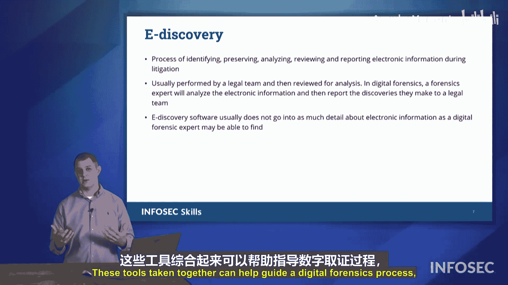

# 【Infosec】CompTIA安全 701认证 ｜ CompTIA Security+ 701 p64 12_01_06_digital-forensics -BV1LRr5BTEow_p64-

After an incident， we might have to conduct a forensics investigation with digital forensics。

 there's a few terms that we might see reflected on the security+ exam。

The first term that we're going to see is a legal hold you or your organization might be party to a lawsuit and so you might receive a letter issuing a legal hold this means don't delete any information don't destroy any information you need to hold onto that because there's going to be an investigation going forward your organization might not be party to that lawsuit but one of your former employees or executives might be part of a lawsuit and that information needs to be held onto for investigation。

We also when conducting a。Digital investigation， we want to protect the chain of custody。

 the chain of custody outlines who had access to the information， who had access to the data。

 who had access to the evidence during this investigation。

 the chain of custody outlines who collect the information and then each party that was able to lay their hands on the evidence。

The chain of custody is important that we protect it。

If you're ever watching some movie or crime show， you might see an investigator carefully picking up with a pen or something。

 the murder weapon， they put it into a bag， they close the bag。

 and at that point the camera moves away from them。

What you don't see is that investigator checking the time and writing on that。

Evidence collection bag， the time and location where they collected it。

 and then putting their name on it。They're not going to then take that evidence hand it off to some you know police explorer volunteer and say。

 we you go put this in that evidence box over there， no。

 they're going to place that in the evidence box themselves。

And they're not going to take that box and hand it off to someone else to go put this in my squad car。

 No， instead， they're going to keep that on their person and they will go and secure that evidence。

 They are in charge of that evidence and that is in their possession。 This is the chain of custody。

Anytime someone else deals with that evidence， they need to sign off on that。

So the first thing that happens whenever you hand this off to someone else for them to work with this evidence。

 it might be a hard drive out of a computer or something。

They're going to sign their name and then someone will then initial that they're giving it over to them look I don't want you to touch the evidence without me signing off on it because it's in my possession and you might do something maybe boneheaded that's going to jeopardize that evidence I don't want that blowing back on me so the first thing we do when I hand this off to you is protecting the chain of custody and we sign that log protecting the chain of custody very very important。

When collecting the actual information off of that supposed hard drive， for example。

 we're going to use a right blocker and what a right blocker does is it prevents the right operation from occurring on some storage media is going to prevent that information those digital signals from performing that right operation this prevents any sort of accidental evidence tampering that might occur when gathering evidence off of a computer。

These right blockers are regularly tested and certified to say these signals are being blocked on this device。

Next is we'll grab the evidence off of the drive itself， we'll make an image of that drive。

And so we'll collect the whole image bit for bit off of that drive， we'll have a file of it。

 and then we're going to hash that information once you've collected that drive image。

 you're going to go through and create a file hash proving that this is the data that came off of that hard drive and those two hash digests match。

 we know this is an exact copy of this data because the hash values match。

The evidence then is going to be provided to both the prosecution and the defense。

And both parties will then be able to look at the drive data。

 see that those hash values are the same this way when it actually comes to a court hearing。

 for example， that one party or the other cannot say hey。

 you tampered with that evidence you changed that no no， no。

 that's the same hash value that we started with that's the same digest that we started with hashing very。

 very important to keeping this information intact and free of any sort of changes。

 remember hashing protects integrity。The next thing we're going to do after we performed a digital investigation is we're going to report our findings reporting is very。

 very important because you are the subject matter expert carrying out this digital forensics investigation。

You've collected all this information and to a layperson they may not understand what it is that you have done and so we need to break it down and put it as simply as possible so that the parties's listening will be able to understand what it is being told to them reporting it needs to be free of any conjecture。

 any alluss or any sort of analogies that could be broken down。

 you want to steer clear of any generalizations， state the facts as simply as possible without any additional language reporting is very。

 very important because it's going to be taking our evidence that we've collected the processes that we've done to do it and is turning it over to scrutiny by both parties。

Reporting is part of that， and then we also need to make sure that we are preserving。Our evidence。

 making sure that any evidence we've collected in this。

Investigation is being preserved long term sometimes these court cases can take years and years and years and if there's an appeals process that comes up that can further drag out the court case and so data preservation very。

 very important if you're keeping old data backups on mylar tape there's a shelf life for that mylar tape if you're recording it to the old CDR recordable CDs there's a shelf life for that consultant archive is to find find out what is the best way to preserve data long term。

And then finally， we have E discovery。E discoveryy software is where a party might approach your organization and say。

 we need all records that you have about timing and they're going to tell you， you know。

This is Tommy's information and here's how we're going to pull all of this we need every email every slackck message he ever sent。

 every file he ever created， we need all of that that could take a lot of effort on your part if you ever to go through and look at individually every one of these with edicovery software it's going to go through and perform that search based on the criteria that you provide for it I want all information from about Tommy from this date until this date edicovery software can do that these tools taken together can help guide a digital forensics process and these are some of the terms we might see on the security plus exam。

