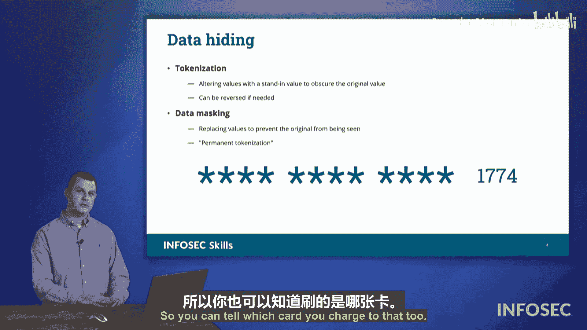

# 【Infosec】CompTIA安全 701认证 ｜ CompTIA Security+ 701 p65 13_01_01_data-protection -BV1LRr5BTEow_p65-

Data protection we oftentimes need to utilize our data。

 but we also want to protect it from prying eyes， and so there's a number of different protections that we can do with our data to keep it safe。

The first one to talk about is this funny word called obfuscation obfuscation is one of these terms that I haven't really heard a lot outside of computing Basically what you're doing is you're just making something hard to read。

For example， I have a little snippet of some of the JavaScript below that comes from the game from the New York Times called Wordtle。

If you know anything about Wtle， it was created sometime during the pandemic。

 maybe a little bit before。And the author got a check for I think it was like a cool million dollars that he got for it New York Times saw this game going viral and they were like we're going to cut you a check for this And so how about a million dollars to protect their investment New York Times。

😊，Took the source code， brought it back in， and then they wanted to obfuscate this code。

If you are familiar with JavaScript， you can go through here and look at this and see that。

Even if you know JavaScript and you are a programmer， you still look at this go。

That is very hard to read granted I'm not showing the entire body of code here。

 the entire body of code is actually on the New York Times website。

One giant long one liner it's a big， big big file， but they have made it impossibly hardened to read you can't go through there and make sense of that code because they've just jumbled at all variable names like E and a and V and T。

It's just nonsense to us humans。The computer has no problem reading that。

 and so your computer must receive all the source code for JavaScript。

 but in order to protect their investment， New York Times obfuscates their code。

 they have to give it to you but they're not going to make it easy to read obfuscation is that process。

Another term that we see on the exam is steganography。Stegganography。Stgano， hidden， graphy writing。

 it means hidden writing。Steganography is the act of taking one file and taking another file and then hiding it inside of the other。

So for example， you could have some sort of sensitive information hidden inside of an image file to that pass by。

 they're going to look at your file and think。That looks like it's just a cat picture or some funny meme。

 whereas inside that file is hidden some sensitive documents。

Steagonography is a way of hiding or obscuring information。

Different organizations treat steography differently。

It is actually something to be on the lookout for because it can be a data loss avenue。

 it can be a way that an adversary is trying to exfiltrate data from your organization again they might see a funny cat picture or some meme but in reality inside of it it contains。

Maybe your secret recipe or the source code to some special program that can be hidden inside of this image。

 there are data loss prevention tools we're going to talk about and these solutions can actually be on the lookout for stganography files hidden within files。

Another way that we can access information， but we want to keep it safe from prying eyes is through data hiding。

So in this setup， what we're talking about is there's tokenization and data masking。

Consider the scenario where we might have a call center running and we don't really know every one of the employees that's working at our call center。

But they need to interact with our customer base to keep our customers engaged with our products or they're going to provide customer support。

 whatever it is。For example， if they are calling and they're needing to place an order for some more products that we have。

 maybe we don't want to share all 16 digits of， say。

 a credit card number with some of our employees that are working the phone banks。

And so instead what we're going to do is we're going to tokenize it you'll see here i've got some funny little graphics of different tokens Think about like some game tokens you're going to cover up something I can have all of the numbers visible but I don't want。

😊，These employees being able to access the full credit card number of our clients。

 and so instead what I do is I tokenize them， I use some tokens。

As the analogy would go and I cover up each of these values。

 the reason we call this tokenization or what tokenization does is it covers up each of those digits we're not able to see those values underneath there but we can reverse it if we need to。

Take again for the example of having this credit card number。

We need to keep that credit card number on file。So that we can run that credit card number when the customer is ready to place an order。

 but we don't want that to be shown to the individuals and so we cover it up with these tokens。

Tokenization is reversible data hiding。Or we can make the permanent。

Change where if we uncover the numbers again， we can permanently go through and do it through data masking and so with data masking what we're doing is we're permanently replacing each of those digits in this case with some asterisks。

These little stars that we're going to covered up with。

Replace the data we no longer have this information available to us all we see are the last four of their credit card number we don't have the ability to run this credit card number because we don't have a copy of it anymore it's permanently been removed。

The reason we would want to do this is because you can look at this and see， well。

 I see that there's a total of 16 characters here put into four groups of four that looks like a traditional 16 digit credit card number and in this case it's the one ending in 1774。

So you might see like a purchase history， for example， in that purchase history。

 they don't want to expose your full 16 digit credit card number instead they leave you with just the last four so you can tell which card you charge to that too。

Data masking is irreversible， you cannot do it， it's a permanent tokenization。

Think again about how you use the tokens to cover up。

 but you can go back and pull up those tokens on each of those numbers。And then for masking。

The analogy isn't completely perfect they don't think too deeply into it。

 but masking tape or better yet， let's talk about some duct tape。

 some duct tape is really good stuff or if you really know your tape you know that gaff tape is really really strong and if you were to write the number on a piece of paper and then use something really。

 really strong like some good gaff tape。And you were try to peel that tape back。

 you're going to destroy that paper， you cannot see what is underneath that tape。

Just like with masking tape you could cover that up。

 but then if you go to peel that back you're going to tear the paper and so that can be masking tape like data masking but the thing to know is that it's permanent if you try to view underneath that tape it's going to tear it up that tape is permanently stuck on that paper and it's permanently obscuring that number placing tokens I can do that temporarily。

The tape is stuck permanently。This are some examples that we use for data hiding。

 protecting our data。