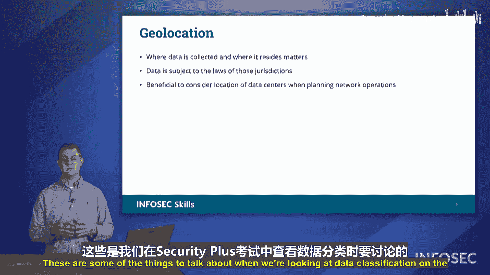

# 【Infosec】CompTIA安全 701认证 ｜ CompTIA Security+ 701 p66 13_01_02_data-classification -BV1LRr5BTEow_p66-

When protecting an organization's data， we have different classifications to consider。

On the security plus exam， there are different ways that we can classify the information that we receive at an organization or that we are storing at the organization these different data types that we can classify are regulated。

Trade secrets， intellectual property， legal and financial information。

 and then we also have human and non human readable formats let's start with regulated information this is information that is protected by regulations in the industry you must obey those regulations or face stiff penalties and fines。

Trade secrets and intellectual property， these are the things that make your organization special it's your secret recipe for whatever success your organization is after it's your secret Coke recipe or your Le herbs and spices。

 it's whatever makes your organization unique and you want to protect that intellectual property and that information so that your competition does not have the tools of the trade to be as successful as you are。

Legal and financial information can also be sensitive information that you don't want adversaries having access to。

 they might be able to steal certain corporate filings， they might have access to your finances。

 you certainly would not want them having access to that information。

And then the final one on this list here is human and non human readable format that's not to say that a human cannot read this information or that a computer cannot read this information。

As we've seen with the rise of AI， you can have computers that can ingest a lot of。

Information that humans have written for other humans， news articles， emails， etc。

But there are more efficient ways to transfer data from computer to computer。And so for example。

 we have here on this slide， I've got a picture of some XML。

XML is a data format that we can transfer data from one computer to another。

 it is a structured format that is easy to parse for a computer that that's not to say that a human cannot read this information right you can read it and say well that looks like that's referring to a particular CVE it has a particular CVSS score。

That's going to have a certain measure with that score。

 and then we can find information about it in that URL。But if I was going to tell you about this。

 I probably wouldn't just send you an XML data file。

 I might write it up more in a narrative if I'm writing this information to you another human。

 this is what is meant by human and nonhuman readable formats。

 Some formats are intended for a computer， some formats are intended for a human and then who your audiences will determine which。

Solution you choose for that。Getting into the different classifications that we've got。

 we have three data classifications to choose from， we have public。

 confidential and critical information。Public information。

 this is information that anyone knows about you can go out anywhere and find this is public information it's not protected in any way。

 shape or form we're having a party for Carolroll at3 o'clock this afternoon in the break room that's going be public information we're not clamping that now that down we're not putting you sort of secrecy level on that。

You might have confidential information that you don't want shared。

 it's not going to be public information， it's only for certain individuals within your organization。

 you're going to mark that information as confidential。

You might see this information that is internal for your organization that you would not want your competition being aware of or have knowledge of。

And then the third option we have here is critical information this is the information that would be limited to a very strict number of individuals。

 maybe only members of your C suiteite， your chief executive officer。

 chief information officer chief information and security officer etc only a limited number of individuals have access to this we also see this reflected in how different government entities will classify their information they will have unclassified information as we talked about with public information you'll have secret information that's can be information that is protected from public knowledge that's going be confidential and then there's top secret that might be that critical level and of course we have in government levels we have other forms of classifications as well but this is what we talk about when we mean data classification。

Other classifications that you might see mentioned on the exam。Proprietary。Private information。

 sensitive information and restricted information。Proprietary again。

 this is going to be your 11 herbs and spices， your secret recipe for whatever it is。

 or the source code for your software solution， this is going to be proprietary information that you absolutely do not want the competition or adversaries getting copies of。

Private information might also include personally identifiable information。

 this is going to be your name address， social Security number， your bank account number。

 all of this information that you don't want anyone that should not have access to it to have access to it。

 this is private information。Sensitive information， this comes out of GDPR GDPR。

Identifies what sort of information can is an example of sensitive information this sort of sensitive information is information that would be extremely troublesome and harmful to an individual if it was to somehow get out this is going to be religious and political beliefs or gender and sexual orientation things that an individual may not have problem sharing with others。

 but they want to be able to have control of who has access to that in certain areas this can be extremely problematic for others when you're considering a business sense for this you really want to ask yourself what business sense does it does it make for us to store and retain this kind of information is it worth the risk to the individual if we store this kind of information if we don't need to collect it let's not collect it。

The final type of information that we can classify on here is going to be restricted information this is the sort of thing that's going to cause international scandal if it was to come out this is the extreme harm to individuals will can befall them if this is information is leaked out you're thinking national secrets or the identity of foreign agents in other countries these are the types of information that were going to have under restriction and absolutely no line levelve employees going to have access to this and only the highest levels of clearance will be able to know this information and it's certainly going to be on a need to know basis。

The final topic to talk about in this section is geolocation and with geolocation。

 we're going to see。It matters where your data is located。

 your data must abide by the laws of the land wherever you set up and so if you're considering where should I put my data center。

 where should our corporate headquarters be， you want to consider the rules and regulations that are going to apply to that organization if you situated in one location or another you need to look at and be aware of the data laws and then be able to choose your location according to your organization's desires。

These are some of the things to talk about when we're looking at data classification on the security+ exam。

