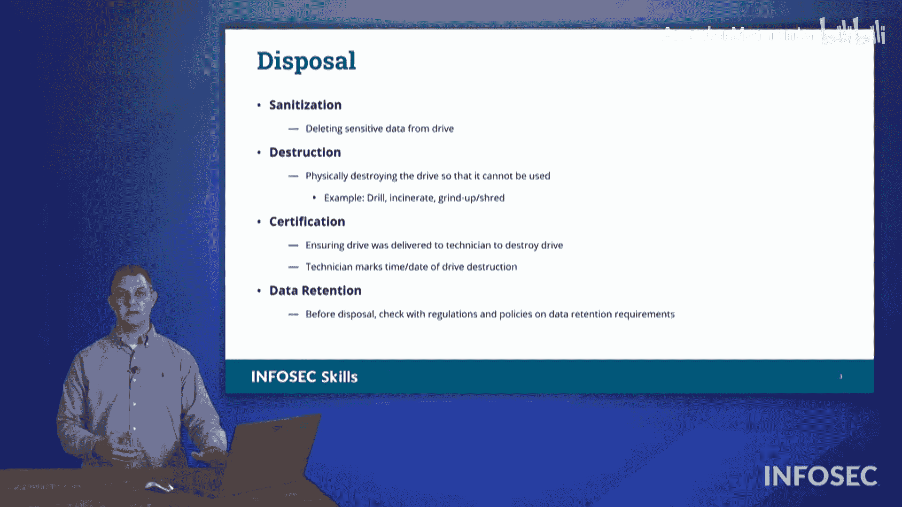

# 【Infosec】CompTIA安全 701认证 ｜ CompTIA Security+ 701 p67 13_01_03_data-destruction -BV1LRr5BTEow_p67-

When protecting information at our organization， we need to consider the data that we have with our devices。

The data that is stored on hardware at some point that hardware is going to reach an end of life。

 we need to think about how we're going to remove the data that is stored on that hardware before we get rid of it in this section we're talking about data destruction。

In data destruction， there's a few terms to be aware of for the security+ exam。First of all。

 whenever we get rid of that hardware， this is referred to as decommissioning。

 this is removing hardware from an active role at our organization。

Stored on that device might be sensitive information。

 we need to go through and remove that information from that device there's a few different ways to do that depending on the situation of that device。

In this case， we have listed as the first of our bullet points here， spinning disc hard drives。

 spinning disk hard drives， store information magnetically on a platter that information must be removed。

It's not enough to just simply go through and say， deletete this file。With modern operating systems。

 when you delete a file， all it does is it just puts a little X in the corner it says this space is available if you need to overwrite it。

For efficiency and for speedy operation， it doesn't go through and actually delete all of that data。

There are ways you can do that， but that's just simply deleting it is not going to be enough and so you can actually go through and do a secure erase where it goes through and overwrites the ones and zeros stored on the hard drive it overwrites them with 11111。

0，0，0，0，0，1，0，1，0，1，0，1，0， and it writes and overwrites that and overwrites it because each point on that hard drive has a small magnetic。

Halo effect， if you will， around each point by changing the value to 1 and0 and1 and0。

 you're erasing that halo effect so that a determined adversary cannot go back later and read not just the bit that's on there。

 but the data that's just adjacent to it by reading that halo effect。

 it can start to get an inference of what that data used to be before it was overwritten so by doing a secure race。

 you're writing it over and over and over and removing any of that inferences that's on there。

If you have a more modern， faster， solid state drive。

There's another way to handle this you cannot go through and simply delete the information and it's not going to store the information magnetically you're not going to have that halo effect you have to physically destroy that drive and you can do this through grinding with magnetic drives you can physically destroy them by grinding them up as well by shredding them or there's also a term called degaussing we're going to talk about in a moment。

If you have different network appliances， network devices， routers， switches。Wireless access points。

 they will store sensitive wireless credentials on that device before you decommission those devices。

 make sure you wipe all of those credentials， lest an intruder grab。

 hold of that device at auction or some other means。

 and then they have authorized access to your network through those credentials they've harvested from your device。

And then you have other special devices like those scanners and printers。

 those multifunction printers。They can actually connect wirelessly to a device。

 you need to make sure that you're removing any information that is stored on those as well。

Diving into each of these topics a little bit deeper。

 we have different types of data that we need to different ways we can dispose of it。

 So first of all， sanitization is just you going through and saying this is the information that I want to remove from this device you're picking and choosing the information。

 making sure you're covering all of your bases by。Selectively removing information。

 this is sanitizing it。Data destruction is physically destroying the media that it is stored on。

 you're physically going through and destroying it through some mechanical means。

 you're either drilling into it， can it is possible to incinerate it if it can get hot enough。

 you can also grind it or shredd it with industrial shredders。There's also this term certification。

Oftentimes it is beyond the capacity of an organization to physically destroy the data they may not have the tools at your organization you may not have an industrial grade shredder or grinder to destroy this media and so you'll provide it to a third party who will collect this information and then when they physically destroy it they will sign off on it and certified it they'll say you know the technician Tommy took this hard drive with this ID number or this barcode and they put it into this industrial grinder。

 this industrial shreddder and destroy that drive it was done at this time on this machine and here's what happened to all Ewate that came out of that this is the process of certification。

Also throughout the whole process before you even begin destroying information。

 you need to consider what are we required to retain data retention laws apply you want to make sure that you。

Don't need this information for any sort of compliance reasons because once it's destroyed。

 if you're doing it properly， there's no coming back。

When you're going through and dealing with magnetic storage media， there's a process called degasing。

Dgaussing takes the very uniform， organized setup that you see here on the left and it subjects that magnetic media to a changing。

 evolving。嗯。Fluux of magnetic field of flux。 And so what it does is it goes through and it completely obliterates all of that order。

 This is the process of degaussing， subjecting magnetic media to a changing magnetic field。

There's also the shredding。System that we have with shredding you have these industrial shredders that these industrial grinders。

 they have giant wheels that will take in metal and crush it up。

 There are some great entertaining videos on YouTube showing this whole process What it does is it grinds up and it shreds the hard drive into。

😊，E waste essentially that can be mined and harvested for its precious metals。

 it can be recycled in other uses， but a determined adversary will not be able to go through and pull out the information on all of the little tiny bits because it's just going to shred it into oblivion。

I got to say I think this would be a fun job for about a week。

 I think it take me about a week to get it out of my system going through and shredding hard drives。

 you know， throwing things into a shredder sounds like a lot of fun。

 there are services that do this and they will sign off with that whole certification process。

As I mentioned earlier there are certain multifunction printer devices that might have wireless credentials stored on them。

 they connect to your wireless network at your organization。

 one of the printer manufacturers recently came out with an announcement saying if you have our device and it is storing wireless credentials even if you do a factory reset。

 you need to go in and change your wfi credentials because。

Essentially the Wifi board is not part of the factory reset process。

 so if you're decommissioning a multifunction printer or any device for that matter。

 make sure you're following manufacturers directions on how to safely destroy all of the data that's on that device these are some of the concepts we talk about when we're looking at data destruction。

