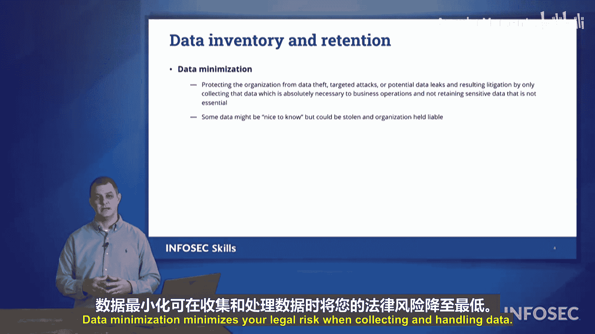

# 【Infosec】CompTIA安全 701认证 ｜ CompTIA Security+ 701 p68 13_01_04_data-privacy -BV1LRr5BTEow_p68-

In this section， we're going to look at how organizations structure their teams in order to protect data privacy。

We're going to get a rundown of different positions within organizations。

That are there to help protect the operation of security。So in this listing here。

 these are different roles that get defined by GDPR。We have the data owner。The data steward。

The data custodian。A privacy officer。Controller， and then finally the data processor。

The owner is the individual at the organization whose name is on the line。

Their job is to take ownership of the entire data privacy aspect for the operation this could be your chief information officer。

 chief privacy officer or some other C suiteite executive it is their name on the line they are the individual that's going to be held accountable for how that organization protects data。

They can't do it alone， so they oftentimes will rely on the data steward。

The data steward looks at the requirements that are needed and their job is to be and they're delegated by the data owner。

And so with the steward， what they're going to do is they're going to make sure that the data they're collecting is accurate and they're also going to stand in the place of the data owner who might be doing other jobs as well。

 but the steward is going to focus on the privacy of the data。

 making sure that what they're doing at the organization is in conformance with data security policy。

Assisting the steward is the data custodian。The custodian is going to implement controls put forward by the steward。

 the steward's going to say we should be doing this， here's how I want to carry it out。

 the custodian will then implement that。Next， the data privacy officer will make sure that what is happening at the organization is in compliance with laws and regulations this is oftentimes going to be a member of the legal team they're going to work with the steward and custodian to make sure they're meeting all of their requirements and regulatory。

Positions needed。Next we have the data controller， the data controller is the individual who controls access to the data。

Using those security controls put forward by the others。

The data controller makes sure that only authorized users have access to the data。

 only authorized users are making changes to that it is the controller who is actually kind of the boots on the ground。

 making sure that the policies are being followed， that the controls are working。

And then finally we have the data processor， this is the individual who is generating value for the organization based on the data that has been collected or is in use these are some of the data roles they' are put forward by GDPR we're going to be able to see them show up on the exam so you need to be familiar with the roles of each of these individuals。

There's another small division use to make note of here on the content we have this idea of a data owner and data subject the owner is the individual who is responsible for the collection and safekeeping of data oftentimes you'll hear individual say you can't do that with this information that's mine。

 that information is mine， it belongs to me。Legally。

 there's a distinction between the owner and the subject。

The data owner again is the one responsible for that you kind of don't want to be the data owner if you're talking about data referring to yourself。

 you're actually in the stronger position if you are the data subject that is the individual individual about whom that data references。

With the data subject， you are in the position of authority and you can say how your data gets handled under GDPR or other state regulations。

There is a difference between the data owner who collects it and is responsible for the safekeeping of it versus the data subject。

And then lastly we have data minimization organizations might want to minimize the types of data that they collect there are certain types of information that is quite sensitive and if it was to get out it would cause harm and so the decision has to be made do we really want to collect that information do I really want to be sitting on that information because it could be a legal liability and so only collecting the data that you absolutely need to make business decisions is actually a safe way to proceed when collecting data you only want to collect what is necessary data minimization minimizes your legal risk when collecting and handling data。

These are some of the terms to be on the lookout for with your security+ exam。

