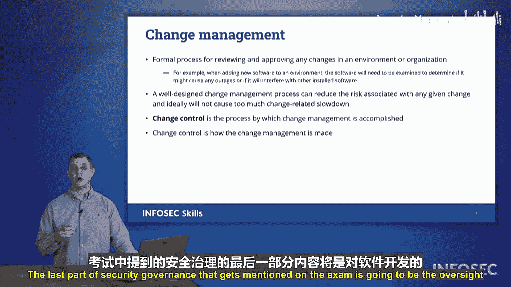

# 【Infosec】CompTIA安全 701认证 ｜ CompTIA Security+ 701 p69 14_01_01_security-governance -BV1LRr5BTEow_p69-

In this section we're going to look at how organizations oversee their security programs this section of security governance is looking at all the various ways that organizations plan for and oversee their security programs we will first look at guidelines guidelines are non restrictive boundaries about how organizations will approach various situations。

It's not going to dictate how a particular incident should be handled。

 it's more morelike giving guardrails to a situation I don't want you to do anything beyond these boundaries but everything else in between is fair game I'm going to leave it up to you to determine how best to handle this these are general guidelines that we've got。

We might also follow various benchmarks， and so these are going to be using。Other organizations。

Measuring sticks we're going to look at。What metrics are other organizations following in order to measure up if we're doing what is needed or what is correct。

 what are the best practices of the industry for example， the Center for Internet Security publishes。

 the CIS benchmarks， these are a collection of best practices for organizations to follow if they are operating connected to the internet。

We also have standards that can be put forth， different organization will put forth standards for how we should handle certain technologies。

 we might have a password standard for how a password will be created， what makes a good password。

Next， we might have access controls that must be followed。

 and this standard might be required to be adhered to by all departments or all companies under a working group or different members of the federal networks。

Further， we can have physical security standards， requirements for how we handle physical security at our organization。

 and we might also utilize encryption standards such as the federal information processing standard this outlines what forms of encryption are allowed for federal information processing or keeping data safe on federal networks these get updated from time to time and organizations。

Will'll have to update to be in compliance with those federal standards if they are a federal network。

Moving on， we have various procedures that we want to outline。

 we will document these procedures and come up with processes for onboarding or offboarding。

Onboarding is whenever we have。New employees or users joining our organization and laying out the process for how we're going to bring them into the organization。

 creating their account， making sure they have the right files and system access to accomplish their jobs。

 making sure they have the right technology in place if they have a computer issued to them or a desk phone do they have a working space all of these are going to be laid out in the onboarding procedure。

Offboarding is almost the opposite of onboarding， it is whenever a user or an employee is going to separate from the organization。

 either willfully or not， whenever people are leaving our organization。

 we need to go through the same offboarding process to both revoke their permissions。

 revoke access to different file shares they might have and also retain our assets。

 if we issued phones， mobile devices， laptops， we need to make sure that we're getting all of our assets back and that we're not allowing access to any sort of data that might be a data exfiltration problem。

We can also have playbooks， a playbook is going to lay out a particular procedure or series of steps that our organization。

 our team should seek and follow。Whenever an incident comes up。

 we want to make sure we're running the play in the same way that athletes on a sports team might follow a particular play in football or basketball if every member of the team is doing their job the team will advance and be able to score with playbooks in place。

 every member knows their job is part of a larger part of a machine and they're able to accomplish whatever they're setting out to do in response to an incident or creating some sort of new system and making sure that it is working as securely as possible。

Other types of oversight that different security organizations might use is to have an incident response plan。

In incident response， you want to make sure that you've got a plan for those days when bad things happen。

There's going to be days where you have some sort of cyber event。

 an incident response plan will help you understand how you're going to respond。

 it's going to define what your team members are doing。

 and you're going to be able to approach that problem with a cool， calm and focused approach。

Business continuity plans help us understand how we're going to proceed and continue to make our bottom line。

Continue to make revenue in spite of this event going on。And then lastly we've got disaster recovery。

 how do we bounce back from this calamity， something has occurred and we want to restore services back the way that they were originally。

 this is all part of the disaster recovery process。

 all blanketed or overseen by the incident response process。Next。

 we want to make sure and we talked about this at the beginning of the course with change management。

We want to make sure that we are following a process for how we're changing different systems。

 we're either updating or patching our systems， we're tracking those changes。

 we're documenting what we are doing， and then we're able to then watch and monitor those systems。

 make sure that we have applied patches as needed， but the key to change management is documentation testing and then being able to apply those to limit the amount of work stoppage that occurs。

The last part of security governance that gets mentioned on the exam is going to be the oversight of software development。

The software development lifecycle， SDDLC is laid out in this example with five different steps。

 we have planning where we go to lay out the requirements for a particular project。

 analysis where we go through and look at which of those can we meet with a software solution。

 then we design the solution to meet those analyzed needs。We then implement that software。

making sure that we roll it out properly and we're operating it securely and then addressing any shortcomings that it might have in terms of maintenance。

 updating， issuing patches， etc ceter， the whole process then starts anew and this is what we talk about whenever we referenced the software development lifecycle this and all of the terms we've just discussed are things that we will see listed under security governance on the security plus exam。

