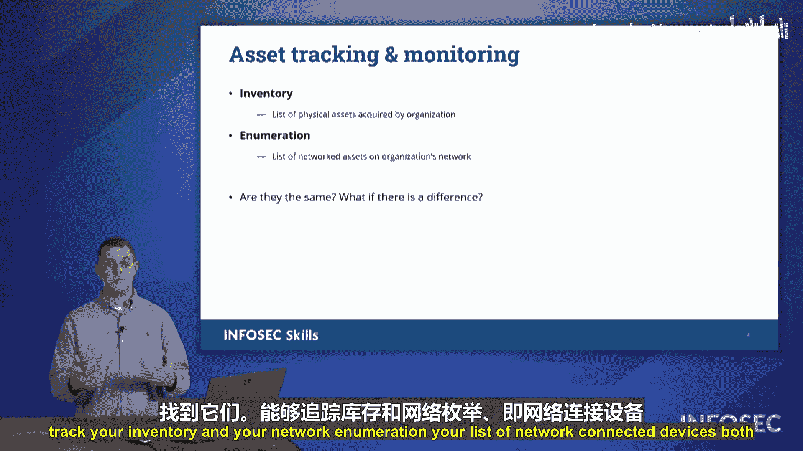

# 【Infosec】CompTIA安全 701认证 ｜ CompTIA Security+ 701 p70 14_01_02_asset-management -BV1LRr5BTEow_p70-

When protecting our organizations， it's vital that we be able to track our assets to determine what assets belong on our network and those that do not。

In this section， we're talking about asset management。With asset management。

 we're able to have an accounting of those devices that we have and if they belong or not。Firstly。

 we want to be able to track our acquisitions。Acquisition and procurement involves。

Creating a paper trail， tracking who requested the item， where do we get it from。

 who provided that to us， and we can start to track that supply chain to avoid any sort of supply chain attacks。

Further， we want to be able to track an individual asset。

 and so we will oftentimes use asset tags an asset tag is a semi permanent。

Extremely hard to remove label that affixes to a device。 And so if you remove it。

 it's at least least gonna to leave some evidence that that information or that tag has been removed。

 I've seen some of them they must have some sort of acid that's in them And when it is on plastic and you remove it it's actually etched into the plastic's it's not coming off and it's going to generally destroy the device that it's attached to This provides a permanent logging of this device。

 and so you can track the ID number found on that asset tag and track it back to the original purchase order and you can track where it came from。

Further， whenever we receive some sort of a new asset。

 we want to be able to track the system's owner， and we're going to say this device belongs to you。

Computer number 1023 that belongs to Tommy Comp number 1024 that belongs to Chuck we're going to be able to say this device belongs to you。

So that if one day you lose your laptop， you can't just quickly go and grab your coworker-s and I'm not just going to grab Bodie's laptop and I'm going to say this one's mine now you need to go find yours and then he's going grab his from Charlene and then we're going to play musical chairs with laptops。

 no， no， no。The asset tag is tracked back to the user and so they can say in this laptop looks like it's the one that we issued to Bodie。

 where's yours， it also prevents me from going down to Best Bu。

 grabbing another laptop and then being like， oh yeah here's my laptop this is one I got。No。

 I don't see an asset tag on here， this is not the laptop we gave you， what happened to our laptop。

Ownership can be affixed in tracks with the asset tag。

When it comes to devices that we don't have specific owners to。The copy machine。

Or even the coffee maker or the refrigerator in the break room。Those are going to be classified。

 they're going to be identified by where they're at in the organization。

 that's the third floor copy machine that one belongs on the third floor。

That refrigerator is on the break room on the fourth floor。

What is it doing on first floor in the first floor break room or that copy machine。

 why is it over here， the classification is able to track it and so because we don't have an individual owner。

 we can have it kind of assigned to an owner space if you will。

Classification allows us to identify the role of that job of the device itself。

We can also with our asset tags create an inventory of the systems the physical inventory is a list of physical assets that we have these are all the things that we've purchased。

Versus an enumeration which is a network based listing。

 it's a logical listing and so we end up with these are the devices that we've bought。

 we bought 500 computers and yet I'm seeing 520 devices on our network Why are these numbers different？

Or we bought 500 computers， yet only 400 have ever been used on our network。

What happened to the other 100 laptops did we ever receive those。

 what happened to them have they just walked away and so you want to be able to determine if our inventory is the same as the devices on our network and then be able to track where those devices are physically within your system within your organization so you can track where it's located and we are able to quickly recover that if we need to if there's a problem we know where in the building to go to locate that being able to track your inventory and your network enumeration。

 your list of network connected devices both important to be able to track assets on our network within our organization terms you might see on the security plus。

