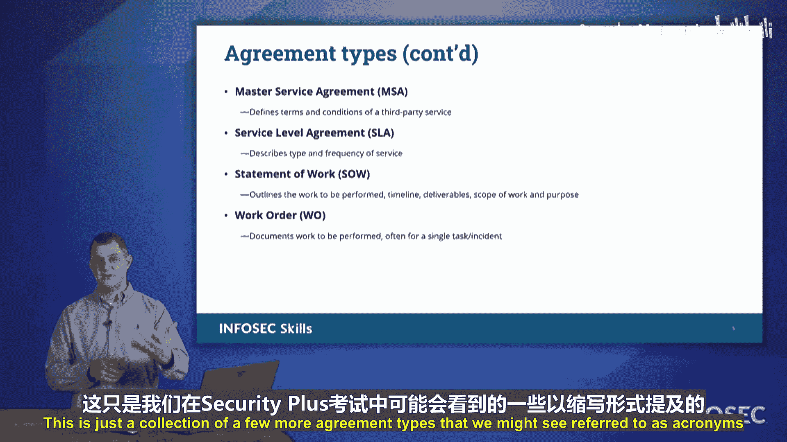

# 【Infosec】CompTIA安全 701认证 ｜ CompTIA Security+ 701 p71 14_01_03_policies -BV1LRr5BTEow_p71-

When talking about cybersecurity governance， we have a number of different policies to discuss different agreement types。

On the exam， there's a number of different acronyms that we need to be aware of。

People have said in the past that。The security plus is an alphabet soup of acronyms。

 It's true there is a number of acronyms that we've seen so far and you may have already noticed。

On this section， we're going to talk about a few more agreement types to throw onto the heap。

The first one to talk about is SOPs， our standard operating procedure。

 our standard operating procedures define how individuals at our organizations should approach and carried out different activities that way we are assured of each step that they have done we know what procedures have been carried out and we know they've been carried out to the T because those are our SOPs our standard operating procedures。

Another common agreement type and one that you may have already signed multiple times yourself are acceptable use policies or AUPs。

An AUP lays out for employees what is acceptable to them。

 what is acceptable for them to do at the organization。

The acceptable use policy defines what is and is not allowed on company technology。So with an AUP。

 we're looking at。I am allowed to do this sort of work on here。

 but I'm not allowed to visit you know gaming sites or I'm not allowed to visit social media sites。

 I'm not allowed to use personal email， etc。AUP has defined what is and is not allowed on company machines。

We also have a collection of other agreement types coming in and these lists kind of grow off of different agreement types。

 you might have them with business partners or you might have them with service providers that you have hired。

The first term to talk about here is our MOU or Memorandum of understanding。

And MOU is a non binding agreement。We go out for drinks after work one day。

 and we find out that your organization is following along the same path as my organization we're both working towards the same goal。

 It's exciting。 We're going to work together。 Let's， let's do this。 Oh yeah， this is exciting。

 Let's do it。 I'll have my people contact your people， and we're going to sign an M OU Hooray。

 hurrah， and we have like the Chaber of Commer Come down。 We have ribbon cutting。

 We serve punch and cookies。 We're all celebrating the M OU。😊。

We never hear about whenever it falls apart， we celebrate when they come together。

 but it can easily be dissolved and it doesn't take legal teams to dissolve an MOU， it's non binding。

 it's a handshake on paper。More binding what does make your legal team stand up and perk up is the MOA。

 a memorymorand of an agreement， and this is where you start to kind of formalize this and you start to make it legally binding。

And this identifies the responsibilities of each party on there and you can celebrate the coming together。

 but then if there's a falling apart it's going to require some legal documentation at the very least。

 and so I've actually had folks in some of our other classes here with infofoOSAC say that an MOU is kind of like your dating。

And an MOA is kind of like you're getting married。And it's a fair way to put it。

 and MOU is nothing official。MOA is binding and in order to undo that。

 it is going to evolve the courts。So we have an MOU， an MOA is whenever we do formally work together。

 and if we're going to form a new entity we'll have a business partners agreement， a BPA。

The business partnersner agreement is on here is a long term structure for partners that's going to define what each partner brings to the table and what they stand to gain from that partnership。

I have a connection that works for Chevron Phillips。

 it's a joint partnership between Chevron and Philips 66。

 especially one of my neighbors works there and the coming together of these two entities。

There it is owned part in part by each one of 5050 they split the proceeds。

 the profits from that 5050 he's told me if there's a $30 million investment that's going on and one partner says hey I can't really float 15 million。

 I can do 14 million。Then suddenly the project goes from 30 million to 28 million because they split it to the T down to the penny that whatever one group puts in。

 the other group puts in the same amount， they have a business partnerss agreement that is binding about what they bring together so that they are not。

 you know， nobody is getting any kind of hurt feelings when they're splitting the proceeds 5050 on that。

Next we have the non disclosure agreement， an NBAA。And I have to say。

 I appreciate whenever I get to sign an NDA， it's usually like，ooh， what are we getting into now？

What's interesting about an MBA is that it protects the information being shared in that meeting。

 that call， that conference， whatever's going on。It protects the organization from having that information shared and the NA will lay out for the person signing the NDA。

How they can be held accountable if they share that information again。

 I appreciate whenever I sign in India because I'm usually like okay this is going to give me some information it's going to shape my thinking it's going to shape my outlook on things and then I can come back to my supervisor and say well。

 you know how we were doing a we're going to do A or B。I can't really go into details。

But I think we should pursue B。A probably not going to work out in our favor Why is that well。

 I can't really say I had to sign an NA， but B is our better way to go。

And so the NA can help shape your thinking， but your can't share that information。

 it also protects your organization from having any kind of contractors come in and do something。

 learn about what you're doing and then run off to your competition and share your dealings with someone else。

Next is we have the interconnection security agreementement， an ISA。

If your organization and my organization are going to pair。

 if we're going to join our networks together because you're going to provide some kind of service to us or we're going to pipe all of our traffic through you。

 we might form an interconnection， security agreement。

 an interconnection security agreement is going to lay out how I am going to protect your network。

and how you are going to protect my network from any kind of malware that happens on our respective networks if I have a malware outbreak。

 I'm telling you that I'm going to pull the plug on our link so that I'm not going to infect you as soon as I detect something I'm going to pull the plug and I expect you to do the same thing it's also going to lay out。

Any kind of security apparatustices that we're going to expect to be installed and maintained？

This is the interconnection security agreement。Our master service agreement outlines an agreement that we have between a service provider and us the client and so the master service agreement is where we become the customer for that service provider it says they're going to provide these services to us maybe it's a new internet service provider or maybe it's a janitorial services or some sort of repair service the master service agreement is what。

Provides that overarching agreement that look we're going to work together you're going to provide these services to us and you know we're going to enter into this contractual agreement。

What is going to define？The activities that we do is going to be the service level agreement。

 the SLA and so whereas the master service agreement might say you're going to provide genial services to us it's the service level agreement。

 the SLA that outlines what activities will be done we're going to clean the commons area twice a week we're going take out the trash nightly we're going to clean the bathrooms daily we're going to wash the windows once a month。

 whatever the case may be this is the service level agreement is going to lay out the expectations that we have under our master service agreement。

The SLA is on the exam be on the lookout for。Some sort of a disgruntled or upset customer that is。

claimlaiming that they need to know you know why you're not delivering this or that。

 you'll refer back to the service level agreement because the service level agreement establishes the type and frequency of service and the minimum deliverables that are required within that agreement。

 you can of course go above and beyond that with something beyond the SLA but this is what we're looking at on service level agreements。

Next is our statement of work， SOW， a statement of work defines what sort of work will be performed with a particular project as we see with different service providers we're going say。

 okay here's a major project we're going to do， here's the statement of work to be performed。

And then the work order are going to be the individual deliverable actions that we've got underneath that overarching statement of work。

Again， there's a number of different acronyms we see on the security Plus。

 this is just a collection of a few more agreement types that we might see referred to as acronyms on the security Plus。

