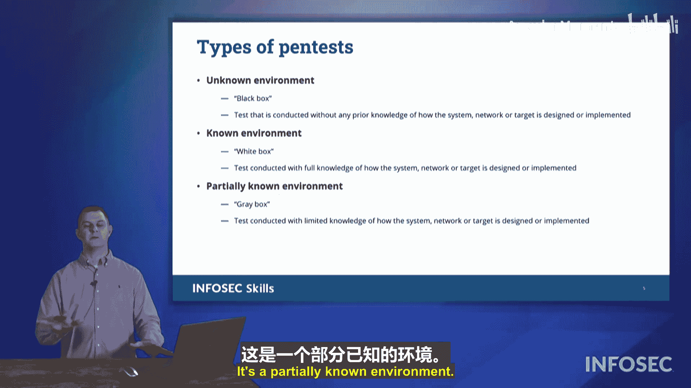

# 【Infosec】CompTIA安全 701认证 ｜ CompTIA Security+ 701 p72 14_01_04_pentesting -BV1LRr5BTEow_p72-

So we've talked about vulnerability scanning and checking for different vulnerabilities on our network。

Now let's talk about ways that we can actively have those vulnerabilities exploited。

 this is going to come in the form of penetration testing or pin testing for short。

And so with pin testing， what we're looking at is hiring a group of experience。

Good guy hackers and they are going to carry out a penetration test against us。

 they are going to try to carry out exploits against the vulnerabilities they have found and discovered present on our network。

 they're going to exploit those vulnerabilities， carrying them through and then exploiting any of other vulabilities they find in order to let us know all of the information that is up for grabs should someone try to exploit these different vulnerabilities。

Clearly they're going to be exposing a lot of information to us so we're going to have a lot of agreements in place with them that they're going to sign NDAs。

 those non-disclosure agreements， they're going to have some limits on what they can do there's gonna to be a limit a scope of what's going on with this and they're going to also document all of their findings so they can provide reports to us about what they've done。

 they're going to put things back the way they found it after breaking in。

 but this is a way to explore all of the vulnerabilities and what those vulnerabilities are capable of exposing to a would be attacker。

This is different， though。Then vulnerability scanning。Vulnerability scanning is software based。

Penetration testing is people based， you cannot automate the process of penetration testing。

 you can have penetration test teams that use certain scripts and programs。

But vulnerability scanning is just an ongoing scan that you can run on your own penetration testing is someone actually breaking in and playing the part of the bad guy getting into that。

With penetration testing， we are simulating the attack。

 we are getting someone to break into our network， play the part of the bad guy this can come in a couple different forms you can have a physical pin test or you have a network based pin test。

In Dallas County， Iowa， I believe there was a judge at the county courthouse that said。

 I'm going to hire some penetration testing folks to come in and test the physical security of the courthouse。

And whenever they broke into the courthouse。Surprise， surprise。 They did set off an alarm。

 They were intercepted by sheriff's deputies。 They were cuffed and hauled off to the county jail。

 And which is the point they were like， no， no， no， we had this get， get out of jail free card。

 The judge signed it。 We're good to go。 We， This is all in the up and up。

 We were not breaking and entering。The sheriff said， no， I'm in charge of the physical security this。

 you didn't have my permission， you can't just walk in here and claimed us the judge is not in charge of physical security。

Oh。These guys did spend some time in jail while this is all being hashed out。

 but in the end it finally worked out that the judge had the final say so。

 and so the penetration test team was released， but they were carrying out a physical penetration test。

 they were trying to figure out，Okay can is there a way that we can break into steal information without anyone noticing and they were going to report back to county officials so they could harden the security of that courthouse？

More often， though not always， but more often there are networkbased penetration testing teams and these network-based penetration testing teams break into the network to steal information from the network carrying out different computer exploits and trying to trick users into he over information and sometimes there's integrated where they work together。

 they'll do both a physical and a network at the same time。

 breaking into all sorts of different secured facilities。

 and so they'll be launching a physical side of things to get into the network and then the network penetration team will then exploit those holes found and placed and the network。

When carrying out a penetration test。You're going to need to collect information about the organization and so you've got two different types of reconnaissance that you might carry out there's active and passive。

Passive passive reconnaissance is weird you're sitting in the parking lot across the street from the facility。

 you're there with binoculars and you're looking and you're watching people coming in and they're like。

 okay， people are coming in at this time and they're wearing， you know。

 everybody's wearing kind of business formal and they've all got a red lanyard on they've got an ID card。

I need to get a red lanyard and an ID card as well so that I can go in at this time。

 everybody's looks like they're carrying this kind of thing with them。

 this is what is expected of me。Passive is just collecting information from afar。On a network。

 passive reconnaissance would be I'm just receiving information from the computer。

 I'm not sending any commands out， I'm just receiving data。

 I'm making copies of data as it goes to this company's Internet service provider I'm just watching the data on the network I'm just listening to wireless signals from a safe distance I'm not actively engaging with the network。

 I'm not sending anything out Act reconnaissance would be sending data out if I send this packet to the server。

 what is the response that comes back if I talk to someone on the phone。

 what is the response that I get if I dress up as a delivery driver and I go into the facility。

As I walk in， I might start looking at where are the security cameras at and where the security guards and how alert are people and what's what's the kind of general vibe that's going on here that's going to be the a form of active reconnaissance because you're going and you're engaging with in this case the target those security cameras are going to see you。

 they are going to be aware of you and it's going to be logged。

If you send data to a system and you get a response back， it's going to be logged。

 it's going to be discoverable， and so active reconnaissance is usually done after you perform passive reconnaissance so that you're less likely to be observed。

When carrying out penetration tests， we have three different environment considerations to be made whenever a client is hiring a penetration firm。

 they will either provide an unknown environment， a known environment。

 or a partially known environment。The unknown environment is a complete black box。

And this is where they don't share any information about the organization at all。

 they don't say this server is running Windows， this server is running Linux， this is our web server。

 this is our database server， this is our authentication server， none of that。

Get shared with the penetration crew。The penetration testing team might be working in a known environment。

 they might say， hey， here's all the information， here's a network diagram of what we've got going on。

This is the version of Windows we're running here， this is the version we're running Windows here。

 here's the users that we've got， all of these are part of the known environment。

And then as you will see with Comptia， you've kind of got these two extremes and then there's kind of something in the middle。

The something in the middle and this one is a partially known environment in the past these were referred to as a black box。

 a white box， and then you have this gray box in the middle。

 the gray box or the partially known environment is where they say， okay。

 we'll let you know that this is our DNS server。This is running Windows and here's the IPs。

Or here's just few IepP addresses we're just going to share a little bit of information with you。

 but we're not sharing everything it's a partially known environment here's the information that is publicly facing。

😊。

Thatll kind of get you started， but that's going to be the third of the three states。

 so you have the black box， the white box， and then the gray box， or as you'll see on the exam。

The unknown environment， known environment， and partially known environment be on the lookout for these types of questions on the security plus exam when talking about penetration testing。

