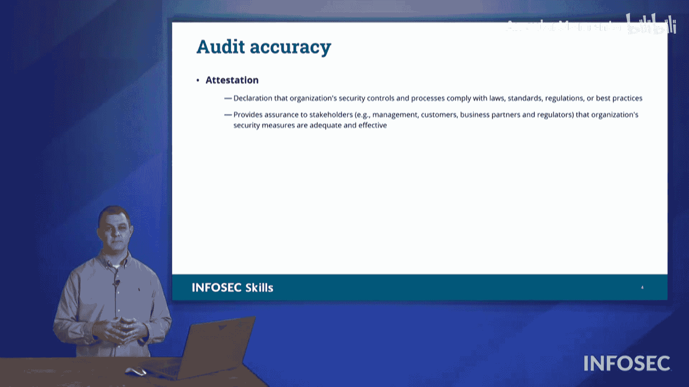

# 【Infosec】CompTIA安全 701认证 ｜ CompTIA Security+ 701 p73 14_01_05_audits-and-assessments -BV1LRr5BTEow_p73-

Part of protecting our organization and security involves creating audits and assessments to check on what our organization is doing。

In this section on audits and assessments， we're going to look at what some of these audits and assessments look like。

To begin， we're going to look at compliance audits。

This might be your organization carrying out an assessment or an audit to make sure that what we do is in compliance with initial regulations。

 laws， statutes， etc。We might also form an audit committee this is going to be made up of a body of individuals who are going to check on the board's operations。

 make sure that what is being done at our organization is in compliance with those laws and regulations this is going to be independent of management at our organization。

Finally， we might carry out a self assessment， a self assessment is going to be an informal checkup on our structure。

 our operations， and it's just a way for us to check the pulse of our operations。More formally。

 though， we might rely on external audits。With an external audit we might carry out a regulatory audit or assessment。

 this is going to be done in order to stay in compliance with regulations regulations might require that we create or conduct one of these audits to prove that we are doing what we say we're doing and to prove that we are within regulations we might carry out a formal assessment this is just going to be an overall checkup on the health of our organization making sure that we are in compliance and that we are formally doing what we need to be doing。

In order to make sure that we have an unbiased opinion of what we're doing at the organization。

 we might have a third party audit， this is where we invite someone from the outside to come in。

 audit what we're doing free of any bias， free of any。Opinions on what we should be doing。Instead。

 we're going to rely on this third party to come in and tell us what's actually going on。Oftentimes。

 we as humans， we judge ourselves on our intentions， but we judge others on their actions。

And so by doing this， we can actually get a good honest assessment of what we're doing。Finally。

 we can carry out a formal examination。The examination is where we have this third party come in and it's a very formal type of assessment。

 this is going to be one that's going to be very exhaustive and it's going to be complete of our entire organization。

Finally we want to go through it and make sure that our audits are accurate。

 we want to have attestation， someone's finally going to sign off on that report saying I attest that this is true。

 that these findings are correct and I'm going to put my name on it。

 this is often done by the CEO or some other individual in the C suite at the organization。

 they're going to attest to the accuracy of our audit。

Just a few terms to be on the lookout for on your security plus exam。

