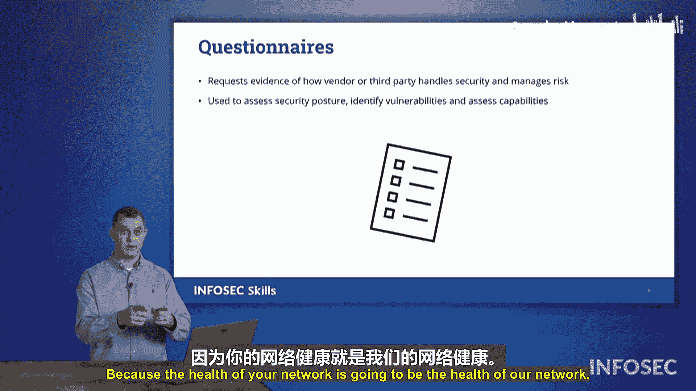

# 【Infosec】CompTIA安全 701认证 ｜ CompTIA Security+ 701 p74 14_01_06_third-party-oversight -BV1LRr5BTEow_p74-

In this section， we're going to look at how we partner with other organizations。

Whenever entering into a contract agreement， there are certain things we want to check off before formalizing that agreement。

In this section on third party oversight， we're going to look at some of the terminologies and concepts that are related to this idea。

When selecting a vendor。You might want to come up with certain requirements for those vendors you might want to require that they have a pin test done remember penetration testing is going through and actively seeking out different vulnerabilities and possibly exploiting those to see what is available to and would be a attacker should they be able to penetrate that network。

We might also put forth a right to audit clause saying， look。

 if we're going to enter into this agreement， we reserve the right to get access to your internal audits or to externally audit you at our expense。

You might also want to see evidence of internal audits。

 I don't need to see the internal audits that might contain information and details you don't want to share with us。

 but we at least need to see that you have done this and that it's been submitted to their proper authorities。

Or if you do an independent assessment， we get a copy of that as well。

 maybe this has to be done for compliance reasons or regulatory reasons。

 we reserve the right to request a copy of that or you should send us a copy of that if we're going to be in this relationship together。

And you might also want to dive in and look at。Do a supply chain analysis。

 I don't want my organization falling victim to a supply chain attack and so we're going to investigate you as a vendor and to see who are your suppliers。

 how secure are they because if that。Vendor or supplier gets attacked that could be a problem for us as well and so we might be the target。

 but they're going to go through the vendor or that vendor's suppliers in order to get back to us so running through all these different checks when entering into a partnership or agreement with a vendor can be very vital in choosing those vendors。

You might also want to look at due diligence， carryinging out due diligence is a requirement for a lot of organizations。

It would not be a professional decision to be made if you're not going through and thinking about what are all the ways that we might have。

A conflict of interest coming up or what are all the ways that？

This vendor or supplier may not be able to help us。

 they can tell us they're going to be able to do it， but can they actually back that up。

 are they really able to provide the services that we're requesting of them？

The conflict of interest that I talked about， you want to make sure that you're free and you're making these decisions free of any sort of conflict of interest。

So you need to disclose if there's any sort of financial interplay going on if we do this is there some sort of kickback that's going to occur or is that going to change what we're looking at。

 do we have any sort of personal conflicts of interest。

 perhaps our CEO is heavily invested in this particular company。

 is that going to sway our thinking or not。We want to make sure that we don't have any sort of competitive conflict of interest if we hire a vendor。

 we want to make sure they're not a subsidiary of one of our competitors。

Because then we're buying services from our competitor， we're putting money in their pocket。

We don't want that to happen。We also want to make sure that we're making this decision free of any sort of insider information that could make this particular vendor selection illegal or unethical。

 this whole conflict of interest is all about making sure that we're making the best decision for our organization free of any potential liabilities。

We also want to go through and make sure that we're monitoring those vendors。

 making sure that they are operating safely， free of any risks or any kind of issues that come with their suppliers because if they are providing a service or products to us。

Their problems become our problems， making sure that they're doing what they need to do and making sure that they are operating at the capacity that they have said that they can operate at is part of making sure that we are being secure。

Lastly， we want to send out questionnaires to these vendors。

 it's going to ask them are you doing this， do you have these security plans in place。

 are your people cyber aware， are you operating in a cyber security defensive position。

How active are you in protecting your network because the health of your network is going to be the health of our network？

These are some of the terms to look at when entering into some third party agreements and some terms that we might see showing up on our security+ exam。

