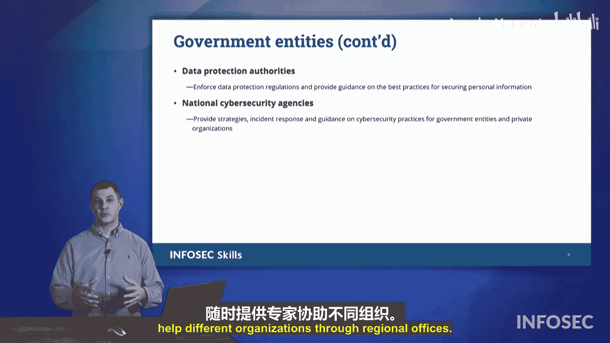

# 【Infosec】CompTIA安全 701认证 ｜ CompTIA Security+ 701 p75 14_01_07_legal-considerations -BV1LRr5BTEow_p75-

In this section， we're going to look at some of the various laws and regulations that organizations will consider。

This section on legal considerations dives into some of these various topics and outlines some of the laws we need to be aware of on the security+ exam。

To begin with， we need to reflect on that there are laws that must be followed at both the state and local level。

At the national level and at the international level。State and local level。

 this is going to vary from venue to venue from jurisdiction to jurisdiction。At the national level。

 there are a number of different national laws that you must follow depending on which industry you are in。

At the international level， I mentioned on here GDPR。With GDPR。

 this is the overarching data privacy law passed by the European Union。

It is considered international because each of the member states of the European Union are their own sovereign country。

They are， by definition， under the European Union， anything they do is going to be international。

Each country has their own laws and they all subscribe to the same GDPR。

There are also various industry compliance and regulations we need to be on the lookout for with industry compliance and regulations。

 it depends which industry you are situated in。Different industries have different requirements。

 according to laws and according to bodies found that are overseeing that particular industry。

 when it comes to industry compliance and regulations。

 we must abide by these and otherwise face stiff penalties， loss of licensure， etc。

We will mention some of these coming up， looking at various laws and regulations that we must abide by。

 we have a number of different types of compliance and regulations that we must follow。

On this slide here we see some that are listed out under privacy GDPR gets mentioned here。

 the general data protection regulation of the European Union。

 we also have the California Consumer Privacy Act CCPA。And this safeguards California citizens。

 California constituents， from having their data and privacy stolen。With CCPA。

 even if you're not a California citizen， you are still benefiting from CCPA。In fact。

 if you go to a big box store and you buy a consumer grade。Home internet router。On that device。

 the wireless network will not come with a standard default username。

 password and wireless network name instead it's going to have an issued。Wireless network name。

 it might seem like a jumble of random of random letters and numbers on here。

But CCPA says we had too many problems with people using。The default。

 just leaving their routers as default， that led to a lot of cyber criminal activity。

So now with these devices shipping out， they are shipping out with assigned usernames and passwords。

You don't have to leave it at Li that， but if you do leave the default on here。

 the username and password is still going to be unique to your device。

If you're working with children or working in an education space。

 there are a number of different compliance policies that you must follow， for example， FERPA。

 meaning you can't share a student's information with someone other than their parents or guardians。

You also have the Children's Internet Protection Act。

 this is what requires schools and libraries to filter internet activity for kids so that they're not exposed to any sort of explicit information on the internet。

 they're filtering all that before the kids get on that internet connection。

And then we also have copa， the Children's Online privates You Protection Act have you noticed any sort of web application that you go to sign up for it asks。

 are you 13 years or older， the reason it's 13 is because of copa copa says。

At the age of 13 or younger， you can't store any information about that individual。From 13 to 18。

 it's been a great area with the passage of COa 2。0。

 this is going to reduce the number of accounts that kids can have that minors can have and will generally bar social media organizations from farming and providing harmful content to mines。

In healthcare we have the Health Insurance Portability and Accountability Act HIPAA。

 this is what safeguards your personal private information that you've shared with a healthcare provider。

 doctor or pharmacy from that information being stolen and used for identity theft。

Under financial services， if you're a publicly trade company。

 you're subject to the Graham Leach By Act， you must provide certain disclosures to investors and shareholders。

With a PCI DSS or payment card industry data security standard I can almost guarantee this is going to be on your CompTia security plus exam。

 it's been on every single CompT exam I've ever taken what PCI DSSS focuses on is if you take payment cards that's industry speak for credit cards。

 debit cards or gift cards issued by some of the large players in the payment card space visas。

 Mastercard， American Express discover。Any of those companies。

 they are coming together and forming the payment card industry。

And the PCI DSS specifies how organizations that take payment cards must safeguard themselves from financial fraud。

 waste and abuse。Financial services， companies or any company taking payment cards must abide by PCI DSS。

Beyond on the lookout， because Comptia will ask you about PCIDSS usually framed as an example of a voluntary regulation。

You don't have to take credit cards。This day and age。

 how many companies don't take payment cards and so you don't have to abide by PCIDSS。

 you just can't use credit cards if you don't。If you take credit cards， you must abide by PCCIDSS。

 it's voluntary。But it's kind of not from due to market forces。

 and so PCIDSS is Compe's example of a voluntary regulation that organizations choose to follow if they so wish。

Other types of compliance and regulations that exist out there。

 we have the Federal Information Security Modernization Act， FISMA。

 and we also have the Criminal Justice Information Services Security Act。

 these oversee organizations operating in those various industries。

When it comes to how organizations govern themselves。

 they will generally have a board that provides oversight these boards are made up of。

Industry individuals who best understand the role and trajectory of a particular organization and their type of business they may not always be that cyber aware they may not understand all the technology they might be intimidated by that and so sometimes the boards will delegate to a committee of individuals who are more closely aligned to being subject matter experts to then provide insight and oversight and report back to the board the committee operates under the aegis of the board but the board delegates their responsibility to the committee oftentimes generally rubber stamping whatever the committee suggests so committee's work at the pleasure of the board the board is providing the overall oversight the committee is providing targeted oversight to whatever specific topic that committee is formed for。

We also have two different structures of that governance。

 we have centralized oversight and decentralized oversight。

Centralized oversight is a one size fits all we might have a large corporation where we have a headquartersquarter and then we have a bunch of satellite offices elsewhere with these satellite offices。

 we might have security responsibilities to add all of them with centralized oversight we might say yeah we're going to do this at our headquarterss we're going to have all these security measures and we're going to do the same thing at all of our other sites。

That means that at our main headquarters office where we might have 100 or more employees。

And then a small。small commuter office in the suburbs somewhere that only houses four or five people we're going to have the same exact security controls at both of those complete overkill on the small closet sized office that we're talking about versus the headquarters and so we might prefer to have a decentralized oversight decentralized oversight is where。

Depending on the size and the location of each of these offices。

 we will have different security controls in place or those security controls might be represented differently。

 so what works for our main headquarters building might be completely different for one of our smaller satellite offices。

And then we also have a number of different government entities that can help with the operation of security at our organizations。

Oftentimes there are regulatory agencies that provide that regulatory oversight that we've spoken about with those laws and regulations there's also intelligence agencies such as the CIA who will gather intelligence over foreign adversaries providing that intelligence back to us here locally we might have law enforcement agencies such as the FBI they're going to provide intelligence about internal actors within the US to our constituents。

 they're going to be looking at what sort of activities are going on and how can we best protect others。

 what sort of heads up should we give certain cybersecurity organizations。Next。

 we have defense and military organizations， so we can think about like the NSA or each of the federal military branches has their own cyber operations。

Army， Navy， Air Force， Marines， Space Force， and indeed even Coast Guard have cyber operations。

 they can all provide intelligence and actionable information for organizations to better safeguard themselves。

We also have data protection authorities， so making sure that customers and consumer information is being protected and not being sold in mass on the black market。

 we want to make sure that those that sort of data is captured and safeguarded and the data protection authorities will be the ones on the forefront looking out on the part of consumers。

And then lastly， we have national cybersecurity agencies what comes to mind here is organizations like the Cybersecurity and Infrastructure Security Agency CISA CISA provides a national government level federal government level oversight over defensive programs and they have experts at the ready ready to help different organizations through regional offices。

 so be on the lookout for some of these terms and concepts coming up on your security plus exam。

