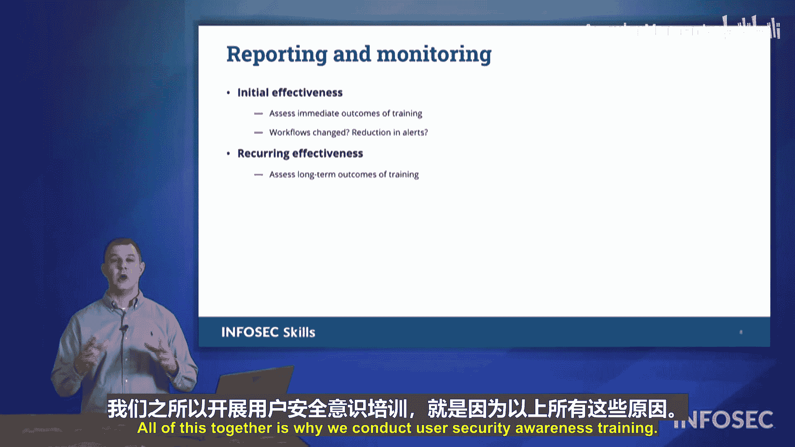

# 【Infosec】CompTIA安全 701认证 ｜ CompTIA Security+ 701 p76 14_01_08_security-awareness -BV1LRr5BTEow_p76-

In this section we're going to talk about how organizations ensure that their employees and users are staying cyber safe and aware in this section on security awareness。

 we're going to go through and talk about some of the concepts that revolve around security awareness trainings。

So first of all， we're going to look at ways and reasons why we might carry out cybersecurity training for our users。

 we want to be able to recognize any sort of abnormal activity that comes up in our workplace or on our network。

 we want to be able to identify risky and unexpected behaviors as well as those unintentional errors caused by users that can still cause harm to our organization。

Many organizations rely on fishing awareness simulators here at InfoSec we have IQ IQ is one of our phishing simulators that will send out fake phishing emails and if you click on too many of those URLs you end a free trip to training land when it comes to fishing awareness。

We also have user guidance and training videos such as workbyites Workbytes is a video series that we have from InfoSec and in fact I actually have a friend here that's going to be coming in。

 I think he's coming in soon， I think I hear him landing。Are we coming in， hey， there York？

And there we go there's cl hey clack good to see you Cck is actually the star of one of infofosex training videos workbys and it's good to have you here me So in this training video you actually go through a lot of these topics together we have different ways of spotting insider threats we've got some on password management I think you've also got some on social engineering right' okay I thought so and Reable media。

 all sorts of password and security topics but it's all a lot of fun lighthearted ways to approach cybersecurity training and the reason why we would want to do that So hey man thanks for stopping by it's good to see you and we'll catch you later all right thanks。

😊，Hey Claack， on the way out， will you turn the green screen back on for me， all right， thanks。

So we carry out cybersecurity training for a number of different reasons like I just mentioned talking about with CL there we've actually got a few of these different topics that we will throw out these can come up in a lot of different contexts。

 and then when it comes to training others we actually go through the development model called AddI this is where you analyze the needs of your audience you design some sort of training。

 you develop those instructional materials and then you conduct the training。

 you actually implement that training， you carry it out and then most importantly you want to make sure that you're meeting the requirements there at the end you're going to evaluate those trainings and making sure that your users are collecting and picking up those sorts of lessons that you're trying to accomplish。

In the execution phase of this， you're wanting to make sure that you're meeting their needs and making sure that the users are able to affect their behavior and make sure that they create a lasting impression with this。

When you go through this sort of training you want to make sure that you are reporting and monitoring what is going on i'm collecting a training log from my users and I'm wanting to make sure that the behaviors I'm setting out to change are being changed we're going to measure both the initial effectiveness what sort of behaviors are they conducting a few days out or a week out versus what are those recurring effectiveness changes those longterm changes that have taken place because of their cybersecurity training all of this together is why we conduct user security awareness training this is a way to keep our users safe and also prepared for the day when we might have a cybersecurity incident happen with our organization beyond the lookout for some of these topics on the security plus exam。

