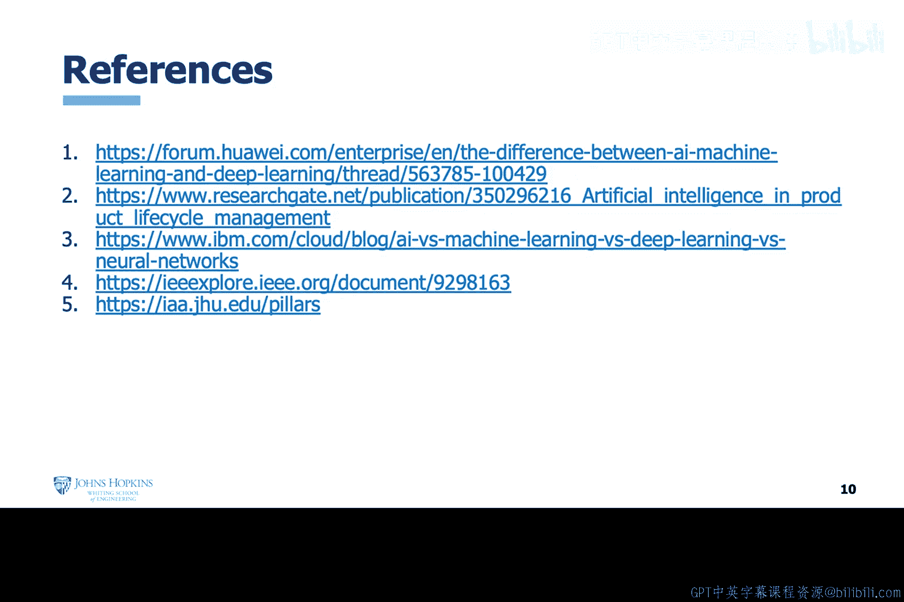

# 约翰霍普金斯大学《网络安全的AI｜ai for cybersecurity》中英字幕 p01 0_人工智能技术背景与综述.zh_en -BV1WQNzzUEU6_p1-

Welcome class to AI for Sse in this lecture we will focus on discussing background on artificial intelligence and a brief overview。

AI or artificial intelligence is a buzzword that you will likely hear just about everywhere。

 Many people use this acronym but may not exactly know what it means or where it came from。

Some folks may even think it is a new term。 However， the truth is that it is a rather old term。

 like a mythical Phoenix that has gone through several cycles of death and re and resurrection。

It has a genesis in 1956 at Dartmouth College。As I mentioned earlier。

 it has gone through cycles of death and resurrection。These cyclees are tied to government funding。

AndGovernment funding is plentiful。For AI research。The progress is made in the field。

 And when government funding dries up， like it did around 1974， the term AI winter was coined。

 This term has been used ever since to describe times。

 and the government is no longer funding AI research。

 The most current cycle of AI government funding started around。2012 and is still going strong。

This dis resurgence。Was sparked by a recent vi of a machine learning algorithm referred to as deep learning。

 This algorithm requires an enormous amount of data and computing power。 And around 2012。

 there were significant increases in both of these。AI is actually a very broad field。

Most had not realized this。And does significant confusion arise as a result？

You might hear AI used in some instances， the machine learning used in other instances。

 And then you think you have it all figured out and you hear deep learning being thrown around。

So to pull all of this into perspective， AI is a broad field that encompasses many different types of techniques。

Gerally speaking， AI can be defined as algorithms that simulate human intelligence。

Using computers and can be characterized into subgroups。Of behavior。Cognition。

And learning and perception applications Today， you may be most familiar with behavior applications such as robotics。

Perception applications such as natural， language processing and cognitive。And learning applications。

 such as machine learning。Machine learning is likely the most popular term of them all。

 so popular we will dedicate a slide to it later for now。

 just know that deep learning is a subfield under machine learning。

Before we talk specifically about machine learning。

 we will talk about the concept of strong AI versus weak AI。You may not have heard。AI being used。

Orre being nuanced in this way before。 But I'm sure you have seen representations of this。

For example， most of you have probably seen or may even own a driver assist or selfd car。

While there are many very functional driver assist algorithms out there。But， honestlyley。

Are there any out there that you would trust to drive you completely from one end of the country to the other。

 I don't think so。These are examples of weak AI。 You may have seen a move entitled Delishia man。

Where the cars in this movie were capable of driving humans anywhere they wanted to go。

 This is an example of strong AI。 Now I am sure most of you have seen the movie I robot。

 in that movie， humans were illegally not allowed to drive on the interstates。

 only self driving cars because they were more capable drivers。Than any human。

 This is an example of super AI。 regardless if you've seen the movies。

Or not the point I'm trying to make is that weak AI。It's what we have developed today。

 and it is mostly expressed in terms of machine language applications。I'm sorry。

 machine learning applications further， we currently have not developed strong or super AI。

 and we mostly only know about these from the movies。Now let us focus on machine learning for a bit。

As I mentioned earlier。Or in earlier slide， AI is a broad field of study。

 which encompasses several subfield under the sub field of cognition and learning within AI。

 machine learning finds its home。 However， there are several other algorithms as well such as fuzzy logic in others。

 So while we focusingcus on machine learning。 Currently。

 machine learning is the most popular expression of AI right now。

 This is mostly driven by the fact that Ml or machine learning is mostly data driven。

 and currently there is data available to accommodate many of the areas that require machine learning。

 equallyqu important is the fact that there is a fair amount of computing capability available to use the algorithms to crunch the data。

 I will leave things ambiguous for now， until we further definey machine learning。

Machine learning can be broken down into three types of algorithms， supervised， unsupervised。

 and reinforcement learning。Gerally speaking， supervised learning algorithms use labeled data to learn how to classify data。

 whereas unsupervised algorithms learn to group data based on intrinsic aspects of the data。

Without the requirement of having labeled examples。

The reinforcement learning algorithms learn through trial and error interactions with the data or environment guided by a reward。

 function or matrix， as you progress in this class you will encounter handson lessons that will help you understand more about each of these types of algorithms in the context of solving cybersecurity problems。

No networks are a type of machine learning algorithm that can be supervised or unsupervised。

It is inspired by biological neural networks in the human brains and consists of an input layer of connected nodes。

 output layer of connected nodes， and one to many middle or hidden layers of connected nodes。

 a specialized version of neural networks mostly characterized by multiple hidden nodes is referred to as deep learning。

Deep learning requires an extreme amount of data， and thus compute processing。

Recent increases in both make deep learning feasible。

If we pull at thread a little more regarding deep learning， we see that， as mentioned previously。

 it is characterized by the depth of his hidden layers。Which is where it gets its name。 Also。

 deep learning is characterized by its ability to choose its own features。

 The downside is at the deep learning that deep learning is mostly a black box。

 There little inherent insight into how these features are chosen or even how it arrives at its decisions。

What we do know is that it is highly effective in making decisions that solve complex problems。

 you probably are familiar with this ability to defeat human players in several types of complex games and challenges。

We cannot talk about AI without talking about autonomy。

 AI can be used to develop systems that can perform certain tasks without various levels of help from humans。

This implies that there are various levels of autonomy。

There exist many frameworks that seek to relate AI system autonomy。

Lovel to human and to human dependence。But I will focus on the very simple framework illustrated in this slide。

 As I mentioned before， Currently， we have achieved a certain level of system level autonomy。

 For example， in self driving cars， I would refer to this as level 2 semi autonomous high。Also。

 weak AI。Level three， fully autonomous systems and cars only exist in the movies。

Another important topic to discuss is assurance of autonomy。 Once it as used to provide a system。

 a certain level of autonomy， there should be some way to ensure that the system is safe， secure。

Reliable and continues to operate as expected。 This can be done through autonomy assurance。

 The J2 Institute forsure autonomy was stood up to investigate best practices in this area。

 Their framework takes a holistic view。Of assuring autonomy。

 so they did not just look at the technology， but also the entire ecosystem that interacts with the technology and finally the laws and policy that govern the behavior of the technology。

In this slide is what a rubber starts to meet the road in case you do not know allow me to be the first to share with you we have a cybersecurity problem。

 this problem is that compute based technology is used throughout our 16 critical infrastructure sectors。

Critical infrastructure。 So in case you didn't know critical infrastructure gives the US is huge economy in its military might。

This technology is moving much faster than our ability to secure it。

 and thus all technology is honourable。To being exploited。

 these vulnerabilities exist because imperfect humans designed and built this technology。

 which in most cases， are interconnected via the Internet。Thus。

 this technology is not just exploitable， but in most cases， it is remotely exploitable。

 So hopefully this helps to cast a proper light on the cybersecurity problem。

 This gets even worse when we realize that there are not enough human cyber warriors to defend the systems in our critical infrastructure。

 This is where AI may be of help。In this class， we're going to focus on the use of AI to assist tier1 cybersecurity analysts in triages and cyber incidents。

 and other words， the belief is that if design and implemented properly， human analyst。

Should be able to use AIdri tools as force multipliers to assist them and better protect the networks。

 systems， applications and identifying insider threats。Thank you。

