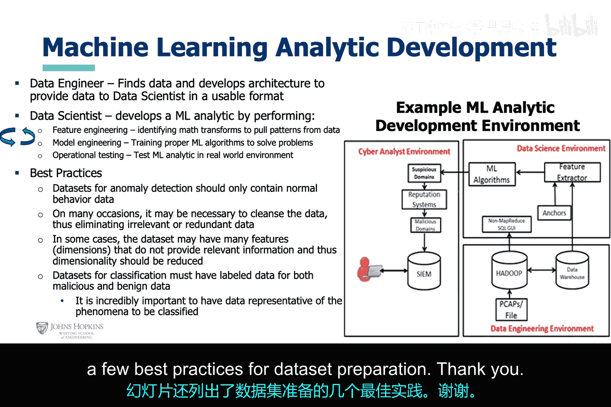
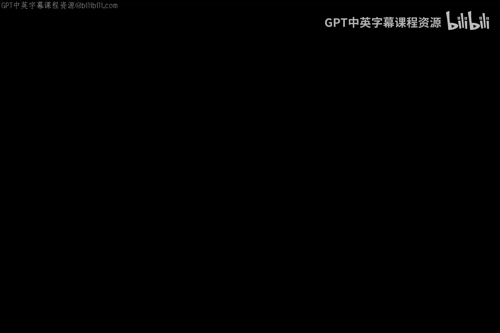

# 约翰霍普金斯大学《网络安全的AI｜ai for cybersecurity》中英字幕 p02 1_多种机器学习算法实战演练.zh_en -BV1WQNzzUEU6_p2-

Welcome to class to Apha cybersecurity In this lecture we will take a hands on approach and look at several important machine learning algorithms。

As I mentioned in a previous slide， we will be taking a handson approach to using an AI to solve cybersecurity problems you have been supplied with a CAI virtual machine that contains Jupyter notebooks with the running code for the AI methods that we will be discussing。

You only have to open a virtual machine with the username and password both being in Laura Case Kelly。

 then navigate to the directory illustratellustd in the slide and launch Jupyter notebook also illustrated in the slide。

For this lecture， all of the code will be in chapterer 1 folder， then the sources folder。

Then the Chapter 1 examples notebook Note some of the code from your textbook uses deprecated commands。

 So I have made modifications to fix errors。 However。

 you may still see some warnings and occasional errors。

 but it should not hinder the functionality of the code in a notebook。

You are encouraged to export a code， however， for best results。

 copy the code into a new cell and run the code from the new cell。 Also， in some notebooks。

 you may see two versions。Of the code， always use the second version of the the second version as the first version is likely the original code from the textbook。

That uses deprecated commands。 You might notice that the original code was run and results appear。

 So try not to rerun those cells， so you do not lose the original results from the original code。

 If you happen to copy the code into a new notebook。

 make sure that you use the same kernel version for the example notebook。Now in this slide。

 we introduce a handful of supervised machine learning algorithms。

These algorithms learn from using trainer， using training， from being trained on labeled data。

These machine learning algorithms and others can be used for cybersecurity problems like detecting spam To do this。

 you would need to train to supervise a machine learning algorithm on examples of spam and also examples of legitimate emails。

 then test a machine learning algorithm on emails that it has never seen to be able to determine its learning performance。

Illustrated in this slide is a linear regression supervisism scene learning algorithm the call S。

Sniip it on the left hand side。Of the slide illustrates the main components of the Python code used to implement this algorithm。

 also illustrated as a plot of the data used to train the machine learning algorithm and aligned the machine learning algorithm predicted that the best。

The line is a prediction that best describes the data。First。

 there are several important libraries that are imported then a linear regression model is etaciiateated and trained with random linear data。

Finally， the output of the machine learning algorithm is visualized on top of the data it was train on。

This example illustrates the high level steps required to instantiate the model trained at MV results。

In this example， the author supplied a custom function to plot the machine learning。

Algorithm decision space， the important Python libraries are imported here。

 the author creates a dataset set from the Python dataset package。

Then plot the points from the data set next instantiateiateates the machine learning algorithm and train。

 Finally， it plots the decision space on top of the data points that it was trained on。

This slide introduces several examples of unsupvised machine learning algorithms。

These machine learning algorithms do not need label data。

The clustering algorithms can learn characteristics from the data and group the data based on on that and the dimensionality reduction algorithms can reduce the features in the data set。

 These machine learning algorithms and others could be used for malware and fraud detection。

In this slide， the author uses the PCA algorithm to reduce the features in the dataset set first。

 Dany uses the clustering algorithm to group the data。

 So let's take a step back First thing he does is to import。

Important libraries then he loads a data set from the CSV file that he supplied。 Next。

 he instantiates the PCA machine learning algorithm and applies it to the data。

 The PC algorithm reduces the features from 2 to 4。

 The negosian mixture clustering algorithm is instantiated and applied to the reduced data。 Finally。

 the resulting cluster groups are visualized。I added this law for completeness。In this chapter。

 the author provides hands-on examples for supervised and unsupervised learning。

 but does not provide an example of reinforcement learning。 As a compromise。

 I added a slide with more detail regarding this method。 However。

 you will have to wait until a later module to receive a handson example of reinforcement learning。

In this slide I list a couple of reinforcement learning approaches。

 generally reinforcement learning algorithms learn via trial and error interactions with the data set。

 attempting to earn a maximum points from a rewards matrix。

 the reward matrix is designed to award the algorithm positive points for making right decisions and negative points for making incorrect decisions。

Reforcement learning can be used to detect polymorphic malware。

This slide is a good summary of the machine learning analytic process that would be required for a cyberanalyst to develop machine learning tools the process would begin with the cyber analystlysts performing the role of a data engineer。

 which is identifying the appropriate data and housing the data in some structure that would store the data in a usable form for the next role。

 which is that of a data scientist， this could be as easy as working with a small data set and saving it to a CSV file。

 as difficult as setting up a cluster to house petabytes of data and having to extract out smaller portions into a data warehouse a data mark for the data scientist to access next to cyberanalys working as a data scientist would need to perform the machine learning analytic process which would be extracting patterns out of the data using mathematical transforms to feed into supervising machine learning algorithms。

 of course unsupervised machine learning algorithms for a deep learning algorithm。

Would not need this step next is the machine learning model development and optimization step。

The work here is to identify the appropriate machine learning algorithm for the data。

 then train and test the model until optimum results are achieved。

The feature and model engineering steps can be an iterative process when it comes to optimization once an optimized model is achieved。

 then the cyberanalyst should test the machine learning analytic and a realistic environment。

The slide also lists a few best practices for data set preparation， Thank you。

