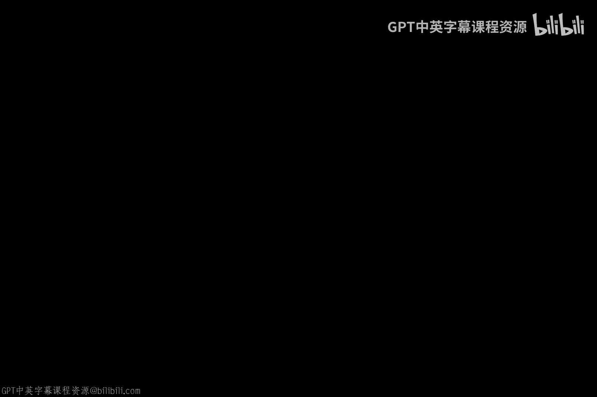
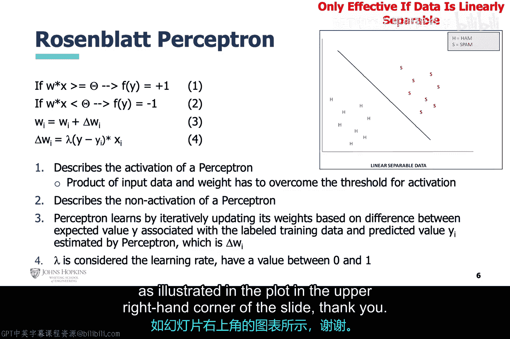

# 约翰霍普金斯大学《网络安全的AI｜ai for cybersecurity》中英字幕 p03 2_使用人工智能检测电子邮件网络威胁.zh_en -BV1WQNzzUEU6_p3-

Welcome class to AO for S Security in this lecture we will be discussing the detection of EM threats。

Use an AI。A call for this module can be found in Chapter 3 folder on the CalliVM。

 We will now have a look at our first cyber securitycur problem that of detecting email spam。

 believeve it or not， email is a huge attack surface。

 Each of us receive huge volumes of email every day。

 This is the perfect application to build an AI analytic to provide automated protection。We are now。

 We are not alone in our pursuits。 One of the first AI automatic email spam filters will spam Asin。

 Please investigate for yourself to enhance your understanding。Initially。

 spam filters may have been very simple and composed of static rules and statistical analysis。

 Some of them may have just tracked certain keyword。

 The singular presence of these keywords along would not meet the threshold。

 but certain keyword found in the email together can meet the threshold for spam or malicious intent。

 as illustrated in the top table。DNS Ba became smarter。 They may have been。N from war。

Nuancedbound rules。Which track the frequency of key words and may have applied a mathematical transform and then applied a threshold as spamers progress further。

There may have been a need to change the key words or recalibrate threshold。

 like in the second table in the slot。As experimentss get smarter and smarter。

 more simplistic spa filters would never work。And where we are today is a need for more dynamic spa filters like those that AI can provide。

Now let us switch gears and talk about AI for a moment。

 We mentioned neural networks in the last module。Here， we will dive a little deeper and attempt it。

Be even more deliberate。And drawing parallels between human brain neurons and artificial neural network neurons。

 sea side by side comparison。 the biological neuron takes in stimuli。Through his ddrites。

 which causes electrical changes in cell body。If the stimulus。From the d rice is strong enough。

 a resulting signal is sent to the axon and travels on axon to the Exxon terminals where it is set to fire。

For this discussion we will focus on the perceptron， which is the most basic neural network。

 instead of having a hidden layer， has a transfer function that takes in inputs similar to dendite。

 applies weights， processes to weights。Input and sends out to a activation function。

 which has a threshold applied to it， the preubron Italy assesses weights to properly classify training data with the hopes that these optimized weights will allow it to yield high performance and classify future unseen data。

I'm not sure if you realize this or not， but data science is mostly math。 However。

 the good thing is that in this class， you retain the role of a cyber analyst only playing data data scientists for the purpose of being。

AI。For the purpose of developing AI tools to solve cybersecurity problems。

 which means that you get to gloss over to math and just focus on a high level understanding of the AI algorithms so we can focus on the preceptton as being a linear classifier。

 which means that it can classify data by drawing a straight line similar to the example spam filters we discussed earlier。

 so we can essentially have to perceptron and perform the same double of spellm filtering as the example we。

Talk through。In this slide， we focus on the mechanics of setting weights， as I mentioned。

In the previous slide， the preceptron iteratively updates its weights during its training process。

 Now to be clear， this describes a preceptron's learning process。

 it irs iteratively updates its weights based on the difference between training and predictive values slide also ties in a learning rate。

 which describes how quickly the weights can be updated。Finally。

 the preceptron is only effective in subly separable data。

 as illustrated in the plot in the upper right hand corner of the slide。 Thank you。

