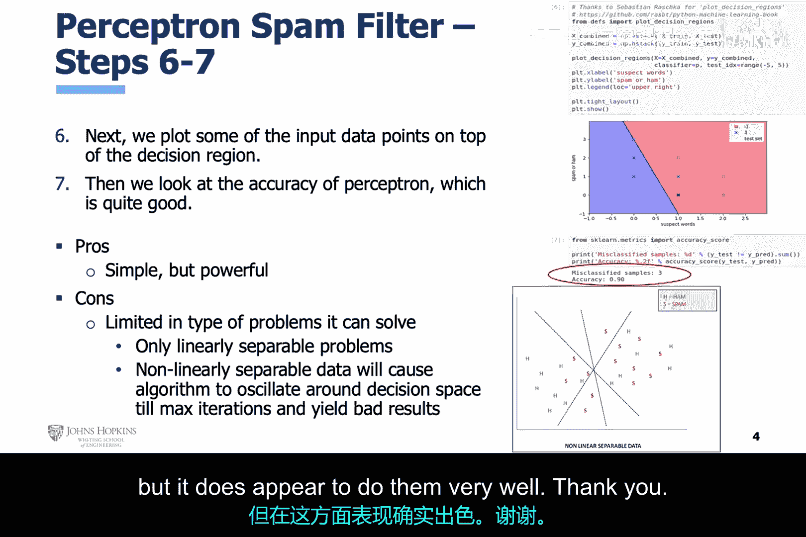

# 约翰霍普金斯大学《网络安全的AI｜ai for cybersecurity》中英字幕 p04 3_感知机神经网络垃圾邮件过滤器实例.zh_en -BV1WQNzzUEU6_p4-

Welcome class to AI for cybersecurity in this lecture we will be focusing on hands on。

Example of the use of a machine learning perceptron for spam filtering。 This is the first attempt。

At using AI for spam filtering or spam filtering using a real public data set。

 this slide illustrates a snippet of the public dataset set in the upper right hand corner of the slide。

Each role of the data set is a SMS text message that is labeled ham or spam。

 We refer back to our simplistic example and use the keywords。

 then filter the data set for the keywords and track their frequency and record this into a new dataset set and we also retain the labels in this slide data engineering steps with the machine learning analytic development process are performed The data is read in from a CSE file and preprocessed and a new data set is created。

In this slide the data scientist steps for the machine learning analytics development process are performed。

 the new data is broken up into training and testing data set。

 data set is composed of two features which are the frequency of their appearance of the two keyword per SMS text。

These raw features are used without any mathematical transformation been applied to them。

 then the perceptron is instantiated。Initial optimizations are applied to his configuration settings then the perceptron is trained and eventually tested at this point for all practical purposes。

 the machine learning analytic has been developed。In this slide。

 data scientist steps continue the decision space is visualized along with the test data points and the accuracy of the machine learning analytic is evaluated The accuracy of the machine learning alytic is pretty good。

There are many more critical metrics that could be used。

 but we will discuss those later in the course。 For now， we focus on the simple metric of accuracy。

 We can itly modify its configuration settings and attempt to produce more accurate results。

 But again， we。Well keep everything as simple as possible for now。

 We acknowledge that the perceron is limited to solving inherently sparable problems。

 but it does appear to do them very well。 Thank you。

