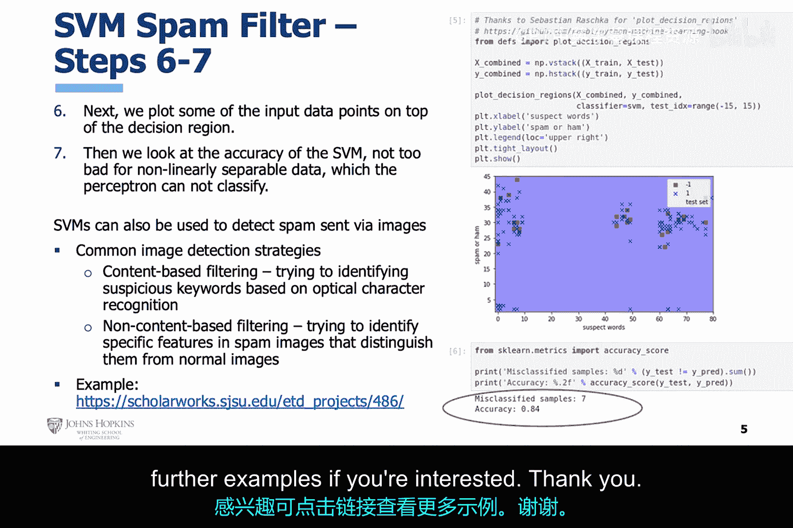

# 约翰霍普金斯大学《网络安全的AI｜ai for cybersecurity》中英字幕 p05 4_支持向量机(SVM)垃圾邮件过滤器实例.zh_en -BV1WQNzzUEU6_p5-

Welcome class to AO for S security In this lecture。

 we will be focusing on a handson example of the use of a machine learning。

Support vector machine for spm filtering。 The support vector machine is similared to the perceptron in that it is a supervised machine learning algorithm。

 However， it is different from the perceptron in its goals。

 Perceptron seeks to classify data by minimizing classification errors while the support vector machine seeks to maxim the distance between the hyperplane it uses to separate the data and the training data closest to the hyperplane。

A support vector machine can also。Classified non linearally separable data。

This is another attempt at using AI for spam filtering。

 using the same public data set as the perceptron。This slide illustrates a snippet of the public data set in the upper right hand corner of the slide。

Each row of the dataset is a SMS text message as labeled ham spam。

 This time we use this set of keywords referred to as suspect words or spam and neural words neutral words for ham and out of scoring function can no longer be a model as a linear function this is a very important distinction because the resulting data set is no longer linearly separable and thus a harder problem which the preceptron can no longer solved Next。

 the data set is filtered for the set of keyword and their frequency tract。

 This is recorded into a new data set and we also retained the labels in this slide。

 the data engineering steps for the machine learning analytic development process are performed The data is read and from a CSv file and preprocessed and a new data set is created in this slide。

 the data scientist steps from the machine learning analytic development process are performed The new data is broken up into training and testing dataset set。

This data set is composed of two features。Which are the frequency of the appearance of the set of keywords per SMS text。

 these raw features are used without any mathematical transformations being applied to them。

Then the support vector machine is instantiated， initial optimizations are applied to its configuration settings。

 then the support vector machine is trained and eventually tested at this point for all practical purposes that the machine learning analytic has been developed。

In this slide， data science steps continue。 The decision space is visualized。

 along with the test data points and the accuracy of the machine learning analytic is evaluated。

 The accuracy of the machine learning analytic is pretty good。 considering there is。

This is no longer a linearly sparable problem。It is a harder problem now。 again。

 there are many more critical metrics that could be used， but for now。

 we will focus on the simple metric of accuracy。 Also。

 we could iteratively modify the machine learning analytic configuration settings and attempt to produce more accurate results。

 But again， we will keep everything as simple as possible for now。

 the support vector machine is capable of。The support vector machine is also capable of detecting spam via images。

 Click the link and have a look at further examples if you're interested。

Thank you。