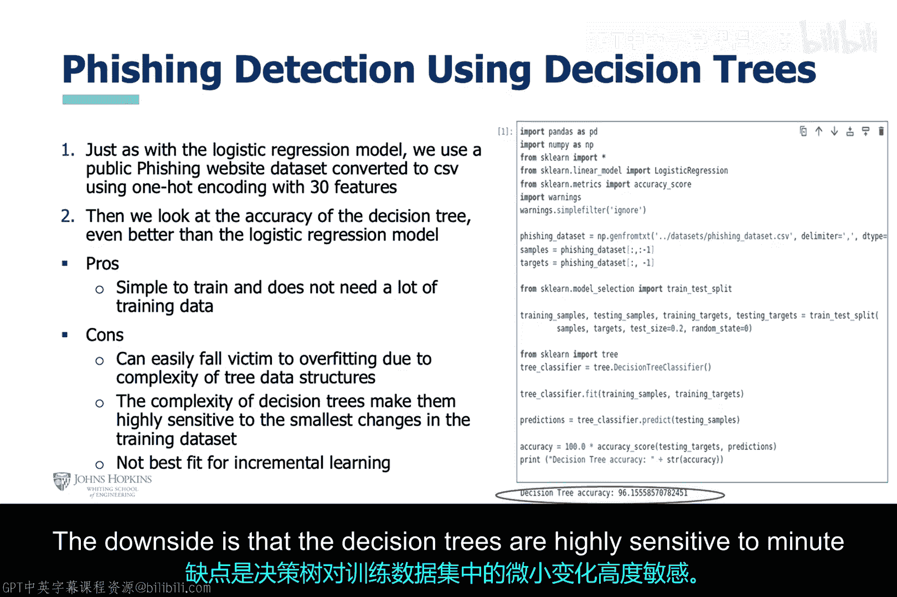

# 约翰霍普金斯大学《网络安全的AI｜ai for cybersecurity》中英字幕 p06 5_基于回归和树算法的钓鱼攻击检测.zh_en -BV1WQNzzUEU6_p6-

Welcome class to AI for cybersecurity In this lecture we will be focusing on a hands on example of the use of machine learning regression and decision tree algorithms for spam filtering We now pivot to the linear regression machine learning algorithm similar to the preceptron。

 it is characterized by data being represented assalms or features。Leading to a straight line。

This is yet another attempt at using AI for spa filtering using the same public data set as the preceptron。

 road data each row of data set is a SMS text message that is labeled hammer span。

 We revert back to the same keywords as the preceptron Next the data set is filtered for the keyword and their frequency is tracked。

 This is recorded in a new data set and we also retain labels in this slide all of the steps of the machine learning analyte development process are performed data engineering feature engineering model engineering and accuracy results are achieved。

 The result is nowhere as good as the preceptron， but expected since the linear regression machine learning algorithm works better with continuous data than discrete。

Theline regression machine learning algorithm is simple， but has many drawbacks。

 such as it assumes features are unrelated and does not do well with classification results。

As we have seen。In contrast to the linear regression machine learning algorithm。

 the logistic regression machine learning algorithm estimates the probability of the samples being。

Belonging to individual classes， which is a better strategy for classification problems。

Now develop a logistic regression machine learning analytic。In this slide。

 all the steps of the machine learning aly development process are performed， data engineering。

 feature engineering， model engineering。And accuracy results are achieved。

 A new phing website dataset set is used。 A snippet。

 a snippet is shown in the top right hand corner of the slide。

 The one hot encoding technique is applied to this dataset set to convert the categorical data into numerical data。

 The new dataset set is broken up into training and testing dataset set。

 This dataset set is composed of 30 features。 These features result from applying the one hot encoding technique。

Then alog regression is instantiated。It is trained and eventually tested at this point。

 for all practical purposes， The machine learning analytic has been developed。

 The method works quite well。 There limitations such as the features are assumed to be linearly independent。

We now develop a decisionion treating machine learning analytic In this lie。

 all the steps of machine learning analytic development process are performed。 engineering。

 F engineering， model engineering and accuracy results are achieved。 the same data set。And one hot。

 one hot encoding technique used with the logistic regression。Machine learning alytic is used。

 The new data is broken up into training and testing datasets。 This data is composed of 30 features。

 These features result from applyinglying the one hot encoding technique than the decision tree is instantiated and it is trained and eventually tested at this point for all practical purposes the machine learning alytic has been developed This method works even better than the logistic regression machine learning analytic Also it is much simpler and does not require a lot of training data。

 The downside is that the decision trees are highly sensitive to minute changes in the training dataset。

Thank you。