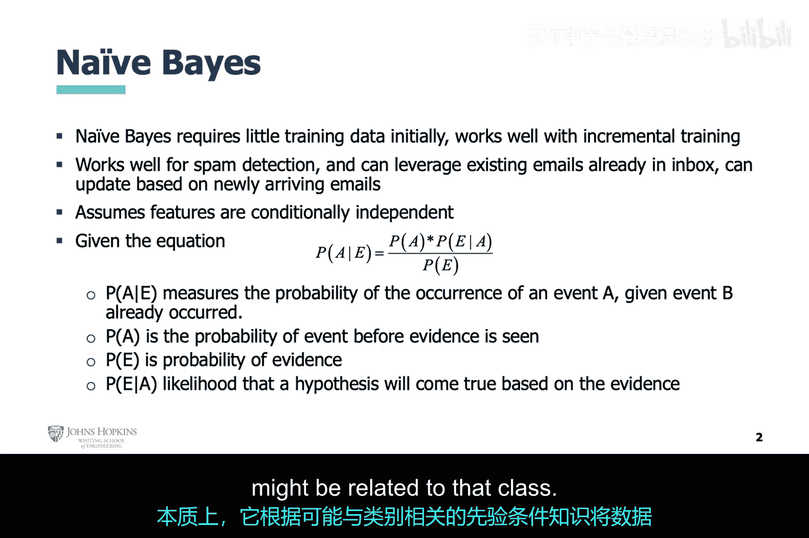
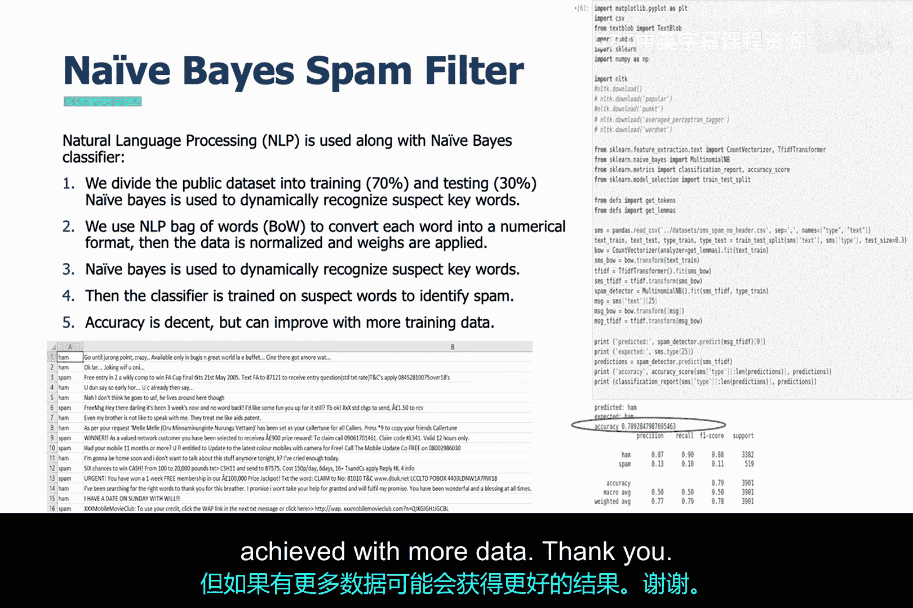

# 约翰霍普金斯大学《网络安全的AI｜ai for cybersecurity》中英字幕 p07 6_朴素贝叶斯垃圾邮件过滤器实例.zh_en -BV1WQNzzUEU6_p7-

Welcome class to AI for cyber Security in this lecture we will be focusing on the hands on example of the use of nave base。

 machine learning algorithm and natural language processing for spam filtering。

We now pivot to the Nau Bay's machine learning algorithm。 It is a very powerful technique， requiring。

Little training data， it is a probabilistic classifier it uses。Bay theorem， toclass data。

 essentially the signs dated to a class based on prior knowledge of conditions that might be related to that class。

This is yet another attempt at using AI for spam filtering using SMS text public data set。

Each row of the data set is a SMS text message as label hammer or spam Natural language processing is used to convert each word into a numerical format。

In the data is normalized。In weights or applied， the Navy bay is used to dynamically recognize。

 suspect keywords。 in this lie， all of the steps of the machine learning anate development process are performed。

 data engineering， feature engineering。Modern engineering and accuracy results are achieved。

 The result is decent。But better results could probably be achieved with more data。

Thank you。