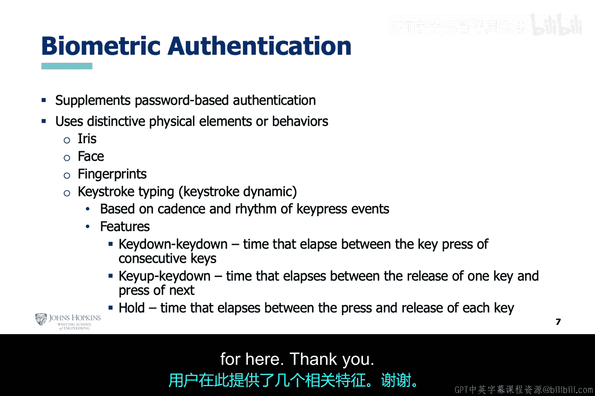

# 约翰霍普金斯大学《网络安全的AI｜ai for cybersecurity》中英字幕 p08 7_用户身份认证安全技术.zh_en -BV1WQNzzUEU6_p8-

Welcome class to AO for Cysecurity。In this lecture。

 we will discuss background on securing authentication。Here we switch gears a little away from spam。

 malware and network threats to authentication and the drivers for the need for securing authentication。

One of the main drivers of user account intrusions is explosion of the Internet of Things devices。

Are also known as IoT。LT device。Devices mostly contain small memory and CPU power with wireless access to the Internet。

 however。Some like the author of your textbook argue that this also includes smartphones。

But there are other devices such as Fitbits， Alpo and Samsung watches。

 and other devices that organically fall within this category。So when you think of these devices。

 you can see。How they increase opportunities for humans to interact with machines。

 and which also increases the probability of unauthorized user access。

User account access dis implies weak user account protection， specifically user passwords。

So let us focus on passwords for a moment， having a single authentication method such as just a password enabled on your account is a recipe for disaster there are other options as well。

 one popular option is one time password text to your smartphone or email to email address on file for that account and other options listed in the slide。

Cyber analystlys overseeing a system that host a users's account may have many options to help them identify unauthorized access。

 Most of them center around trying to identify behavior that is uncommon for humans such as rapid attempts to log in。

Or many different passwords being entered in rapid successession。

 Other behavior uncommon for the specific user， like logins for uncommonly visit visited regions of the world or the use of operating systems uncommon for that user。

Cyber analystlys can use a reactive or predictive approach to securing a systems user account。

I'm sure many of you have witnessed reactive strategies before。

 such as the blocking of a users's account after multiple wrong password attempts。

 I'm not saying that that such a strategy should not be used。

 I'm only saying that this approach could leave legitimate users locked out of their account due to their failed attempts。

 Also， what is a threshold for the number of attempts。 should it be different for different users。

A reor strategy will likely。Sat a static threshold for all users。

 which may or may not be effective in stopping the attacker and could also leave legitimate users unable to access their accounts。

 On the other hand， a predictor strategy could be。Dynamic and inclusive of an individual user's behavior and more effective in denying future attack behavior。

Well， this is the promise of this approach， at least。As you probably have already guessed。

 a predictive approach or strategy can be implemented using machine learning。

We have already discussed a machine learning analyte development process。

 so you are aware of the necessary steps involved in developing predictive analytics in this slide the author provides insight into the best machine learning。

 algorithms to use given certain situations based on his experiences and examples given in the book。

Our researchers， other researchers may have different opinions on this matter as well。 For now。

 we will use this information as initial guidance while developing machine learning analytics。

 doing the modeling。Doing the model engineering phase of the machine learning atic development process Also in this slide。

 the author points out potential features for identifying fake account behavior such as multiple accounts。

Correrelatedated with the same IPp address and account activity occurring in very short durations。

This slide continues the idea of potential features and titbits for model engineering using supervised and unsupervised algorithms。

 The author focuses on features that help to score the reputation of a user's account This help to ascertain the normal behavior of a user's account The best practices for supervised learning should help with false positives and the best practices for unsupervised learning should help with accuracy results。

Finally， the author mentions the use of biometrics for authentication biometrics are being used more now。

 probably due to the increased capability of smartphones。

 many biometric features for smartphones are based on the face or fingerprints。

There exists other biometrics like Git， basically how you walk or keystrokes。

 which the users provide a couple of features for here。

Thank you。