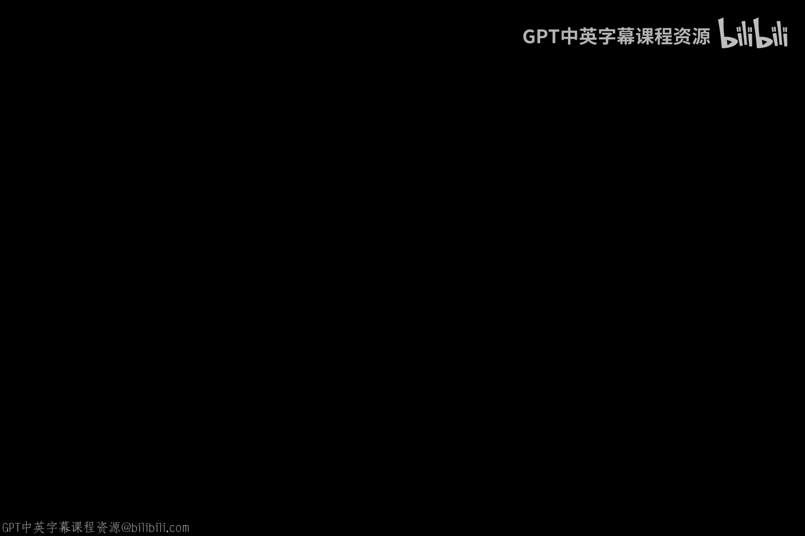
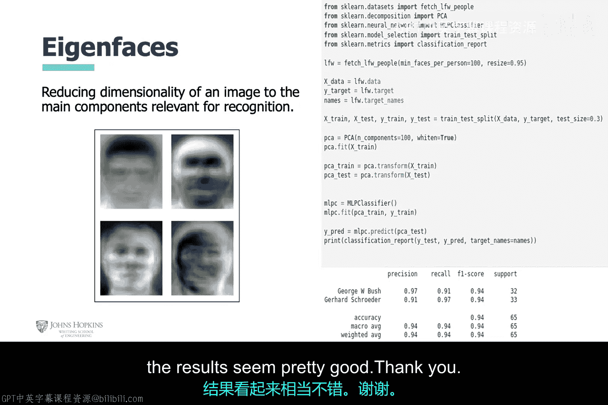

# 约翰霍普金斯大学《网络安全的AI｜ai for cybersecurity》中英字幕 p09 8_击键动力学与人脸识别生物认证.zh_en -BV1WQNzzUEU6_p9-

Welcome class to AOA cybersecurity in this lecture we will discuss the use of AOA biometric authentication。

 specifically keystroke and facial recognition。We mentioned in the previous lecture that one biometric that could be used for authentication is user keystroke。

 we also discussed several features that could be used。Here。

 we using a public dataset composed of over 30 features。

Including the ones we discussed in previous lectures。

These are from 51 people each typing the same password at 400 times。

 the goal is to develop a machine learning analytic that is capable of correctly identifying the keystroke delay pattern of multiple users。

Naturally， the machine learning analytic development process is used first the public data is loaded and the training and testing data sets are made from the larger data。

Then the 30 plus features are extracted and fade into the machine learning models。Each model。

 multilaer perceptron， support vector machine and Caer' neighbor are all trained and tested on the same dataset set。

It appears that the author did not do any model optimizations。

 He likely just used the default parameters for each classifier。 Finally， the accuracy metric。

Was calculated for each model。It appears at the multilayer preron， outperformed of the models。

In this slide， we focus on the notion of using facial recognition as a biometric user authentication method。

The use of biometrics are not new。 facialcial recognition is at least as old as the Wild West。

 where one at posters were used to help boonnie hunters identify criminals。Also， police。

Have fingerprints use fingerprints as a means of identifying criminals。They've done this for many。

 many years。Naturally， smartphones make the use of facial recognition easy。

 since most of them have high definition。Cameras on the front。And back of the phone。

 if we if we just focus on facial recognition for a while。

 we immediately began to realize that even though this might be a good idea。

Theyre issues that can make the actual use of facial recognition as an authentication method challenging。

 For example， it is possible for people to look very similar。 For instance， identical twins。

 family members or just people in general。 Also， people。

 facial features tend to change as they become older or even if they become sick。

To surmount some of these challenges， researchers tend to use only distinctive features of what is called shinglings。

This slide introduces terminology that we will use in later slides。First。

 we distinguish between facial recognition and facial detection。

 facialci detection is identifying a face within an image。 This is not what we are planning to do。

 We're focusing on facial recognition， which we have an archive of faces。

 and we're trying to match or classified them with the name。

 The techniques use mostly involved a use of linear algebra。 eigenfaces。

Facial recognition is what we're looking at。 These features tend to have a。High number of dimensions。

These images tend to have a high number of dimensions or features。

 but we are really only interested in any subset of these features。

 just to important distinctive features， as we mentioned earlier。

 to help extract these important features， we use the principal component analysis unsupervised technique to reduce the dimensionality of these images。

In this slide， we focus。On。The PCA algorithm， principal component algorithm。

How it works and what it does， we'll start by saying that the PCA algorithm identifies the principal components of a data。

Which are likely the most distinctive features of a face in an， in an image。Technically。

 these are the components along which。The data is most spread out or simply to access where the variance assumes the maximum values。

So at a high level， the steps are as follows， first you would calculate the covariance matrix of the data set next you would identify and keep the largest eigenvectors in the matrix。

And finally， you get， you would get rid of everything else。

This slide just focuses on the definition of variance， covariance。In covariance matrix。

 here we use Python to calculate an example covariance matrix for your convenience。

In this slide we revisit the earlier mentioned notion of using linear algebra to calculate eigenphas for facial recognition。

 we begin with defining eigenvectors and eigenvalues。

 and then relating that to the notion of principal components。

 I include a link to a detailed YouTube lecture that illustrates how the most important eigenvectors can be used to calculate principal components。

Which is beyond the scope of this slide。 Also， there is a quick example where Python is used on a dataset to calculate eigenvalues and eigenvectors。

 The lecture can be used to illustrate exactly how the principal components can be calculated using just these values。

Finally， we get to the point where we can start talking about eigenfaces。

Which are the main components of the faces。 So let us start with the machine learning analytic development process。

The Python labeled faces in the wow function is used to load a subset of publicly available。

Images or a publicly available data set。In the data is broken up into training and testing datasets。

 Next is feature engineering。 The author uses the PCA algorithm to extract the eigenfaces from the dataset before they are sent to the multilayer preceptron classifier。

 It does。 It does not appear that the author did any optimizations。To the model。

Based on the metrics used， the results seem pretty gift。

Thank you。