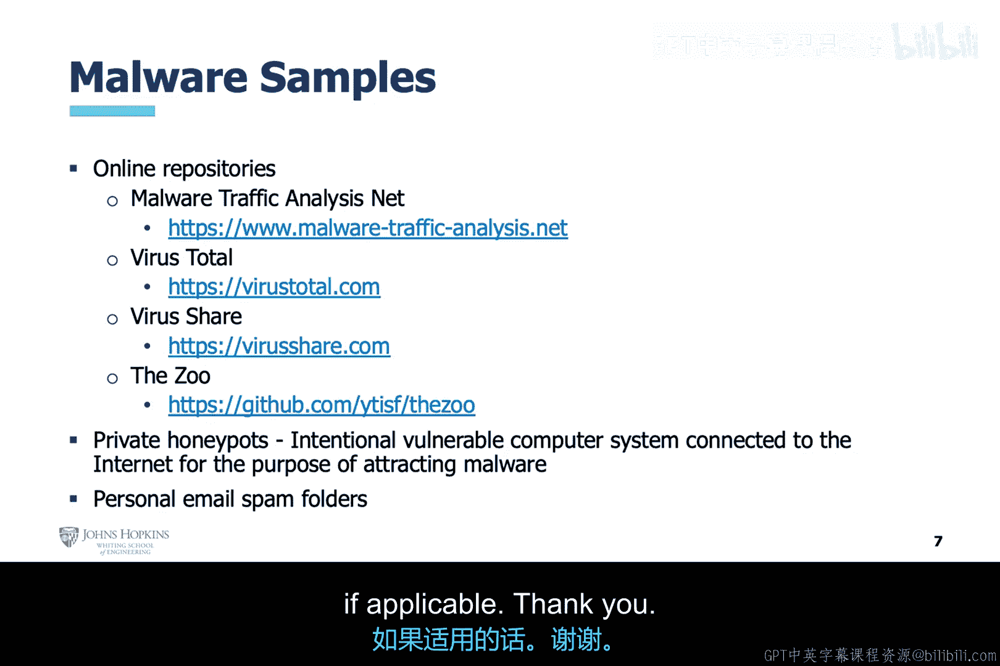

# 约翰霍普金斯大学《网络安全的AI｜ai for cybersecurity》中英字幕 p10 0_利用人工智能检测恶意软件威胁.zh_en -BV1WQNzzUEU6_p10-

Welcome class to AF for S Security In this lecture we will be discussing background on malware and basic malware analysis tools。

We will begin by saying that our best defense against cyber threats is defense and death。

 which implies layers of different types of security， and not just one security technique。

 Having said that signature based malware detection has been rendered。

 less effective by advances in malware by criminal attackers。 But again， this is just one method。

 and even though it is not as effective as it has been in the past。

 signature based detection is still useful and protecting against known threats。

 So all would not just throw away。 more capable techniques such as AI based techniques that such as the AI techniques that you will encounter in this class。

More capable techniques such as the AI based techniques that you will encounter in this class。

Such as anomaly based detection and autonomic cyber security should also be included as layers in your defense and depth solution all three of these techniques together yield a stronger defensive posture。

So now let us talk more about the role that machine learning should play in assisting the cyber analystly again。

 as mentioned in earlier modules， machine learning should assist a Tier 1 analyst。

 which is the first line of human defense。In detecting and triageaging threats due to the rise in the number and types of malware threats。

 this could become an overwhelming job for human analysts。

 So if machine learning techniques can assist a human。

Alysts by making threats more apparent Then this first line of defense would be strengthened。

 The first stage of malware attack is likely the host file system。

 Deecting malware on the initial hosts before it can spread throughout the network is ideal。

 basicic tools used by cyber analysts for malware detection are static analysis tools。

 which examine malware at rest and dynamic analysis tools， which examine malware， as it is executing。

 There are several common types of malware。 Trojans appear to be legitimate applications。

 but behave maliciously when you lease expected to botnets are a group of compromised computers called zombies。

 completely controlled by command and control computer， or computers， which。

 in turn are control by humans called bot herders。 Trojans and botnets may spread via downloaders。

 which is malware that downloads other malware。 Trojans and botnets may use root kits。

 which is malware that penetrates into a computer below the operating system。

 as aware persisting owned to。しと？Then there is ransomware， which is altogether different。

 His primary goal is to find important information encrypt it with the hopes that the system owners will pay a ransom to regain access to the files。

 The ultimate form of malware is a persistent threat。It has its own life cycle。

 which I encourage you to investigate， also， it most likely compromises a computer。

Using zero day vulnerabilities， which are vulnerabilities that no one knows about。

 not even the hardware software vendor。 these types of malware will eventually accomplish their goal because they have the backing of nation state hackers。

Which are funded by an entire government as opposed to regular cybercriminals or black hats。

Other types of malware analysis tools are listed in this slide。

 some of these tools are static analysis tools and some are dynamic analysis tools。

 others are tools that help reverse engineer or undo obfuscation techniques malware writers have applied to malware to hide from detection tools。

In this slide I would take a deeper dive into the notion of static malware analysis。

 look at basic and advanced strategies in examining malWware code。In this slide。

 we would take a deeper dive into the notion of dynamic malware analysis。

 but first we introduced the concept of system and networking。Networking monitoring。

Wouldch support dynamic。Mware analysis。 We look at high level steps for performing dynamic malware analysis and also protective methods that malware writers。

Will take to help their malware high from detection。

This slide reveals locations in which to look for malware samples。

 I've used virus total on several occasions， the company will allow professors and students limited access to their archives for research purposes。

 I've also helped students to stand up honey pots to attack Malware。To attract malware to study。

 the other repositories look interesting， also。In of these will be great sources of hourware samples for you。

For homework and or class projects if applicable。Thank you。

