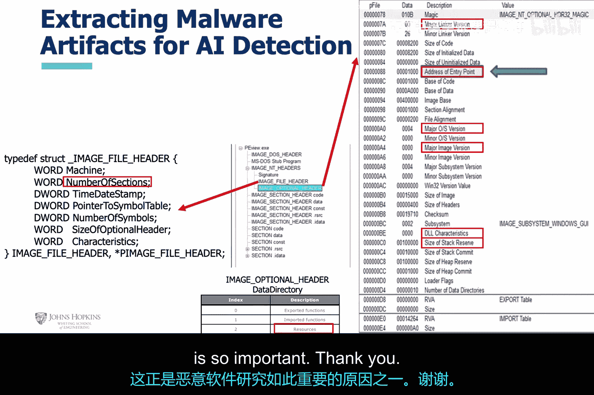

# 约翰霍普金斯大学《网络安全的AI｜ai for cybersecurity》中英字幕 p11 1_针对Windows操作系统的恶意软件分析.zh_en -BV1WQNzzUEU6_p11-

Welcome class to AI for S Security In this lecture we will be discussing a basic approach to analyzing Windows based malware。

 Let us first start with introducing the portable executable file format or PE file format。

Which is the format for everyone knows executable file。We also introduce PE view。

 a basic tool used to visualize PE structures。 The PE file can be broken down into various sections。

 mainly the PE file header， section table and section data encapsulated in the W N header structure is the M Dos。

Header， P signature， image file header and optional header。

 This slide illustrates a P view visualization of a Windows file。

 noticeice the PE sections information enumerated on left hand side of the PE view screen。

 this information and its contents are a good potential features for machine learning algorithms。

 So as we discuss this information。 Just keep in mind that we are focusing on this information for this reason。

 It is all good information for features。For machine learning algorithms to learn the differences between legitimate files and malware。

Let us focus on the PE sections enumerated by PEVi specifically this slide highlights the DoOS header。

 DoOSS Stub and PE headers and provides basic information about both categories。

 again very good potential features for machine learning algorithms。

This slide focuses on the image optional header and the location of the address of entry point。

 This information would also potentially be a really good feature for machine learning algorithms。

 This lie illustrateuss information about the import and export tables。

 These tables are historically used and very different ways by legitimate files and malware。

Like I stated previously by treating this type of information as features。

 machine learning algorithms can learn to discern the differences between legitimate files and malware。

This slide brings home a point that I've been trying to make throughout this lecture。

There are specific PE files sections that get used by legitimate files and malware in very different ways。

 these are the specific PE files sections that make really good features。

 His this has held true for specific PE files sections and others are used and roughly the same way by both legitimate files in malware It really does not help much to use these types of PE files sections as features because they would not be useful and attempts to discern between malware and legitimate files。

 this information was likely determine experimentally through a malware through malware researchers doing malware analysis and observing these differences。

 It is very possible the new malware could exhibit different behavior using different PE sections and malWware researchers would have to characterize that also This is one of the reasons malware research is so important。

Thank you。