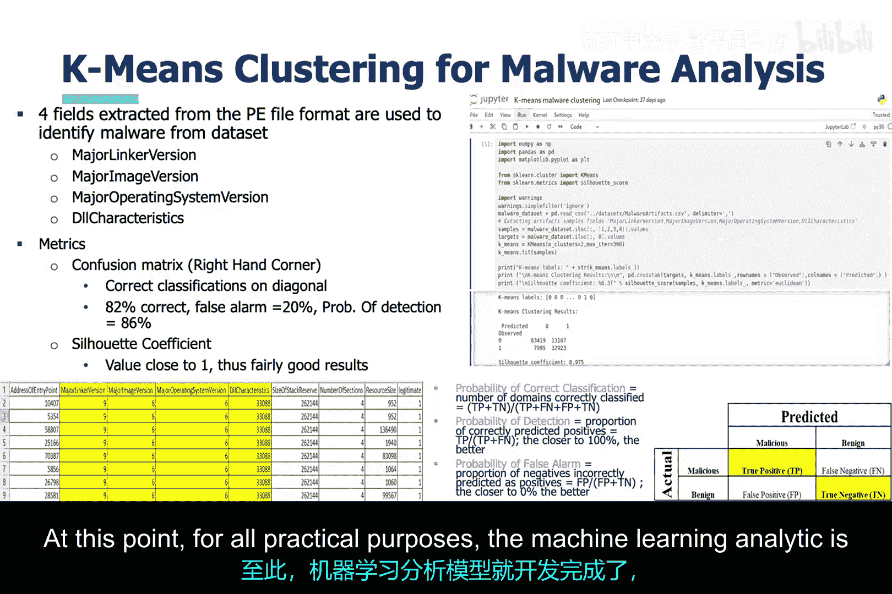

# 约翰霍普金斯大学《网络安全的AI｜ai for cybersecurity》中英字幕 p12 2_基于聚类和决策树的恶意软件威胁检测.zh_en -BV1WQNzzUEU6_p12-

Welcome class to AApha cybersecurity In this lecture。

 we will be utilizing the content knowledge we discussed in a previous malware analysis lecture to develop machine learning analytics to develop malware。

Sorry to the nowhere。First， let us start by attempting to understand how unsupervised。

Receine learning can be used to detect malware。One of our rationales for using unsupervised machine learning is that malware。

 such as polymorphic malware， can change itself and thus。For this type of malware。

 you have to figure out what aspects of a malware it cannot change about itself or normally just does not change about itself and focus on that aspect。

 Having said that with unsupervised machine learning， there's no learning on sample data。

 So you So you're not providing。The algorithm and example。

 any examples and stay at unsupervised machine learning。Learns based on some intrinsic aspect。

Of the malware and can group files according to these intrinsic aspects， Thus。

 the hope is that the right unsupervised machine learning algorithm will group malware with malware and legitimate files with legitimate files。

 In this case， we focus on clustering。Which will primarily use a distance between the features of the files to classify them in this slide。

We look at three different types of distances， Euclidean， Manhattan and Cheby Cheev。

There are several types of clustering algorithms， some of them are even supervised。

 one supervised clustering algorithm is the nearest neighbors。

The user specifies a number of clusters K and the algorithm group' data based on how close they are to the test data。

 The other algorithms are unsupervised， as you might expect， and have their own nuances。

 as you can see in the slides。This lie highlights a metric that can be used to determine how well the clustering algorithm did his job。

 The metric essentially tests how close are the points in each cluster。

Our close they are to each other， are far away。Points in other clusters R and are the right number of clusters being used。

For implementation， well focus on the K means clustering algorithm。

So this slide provides more detail around the algorithm at a high level the K means clustering algorithm is an unsupervised machine learning algorithm。

 where a user chooses the number of clusters and the algorithm places the data points in the clusters based on the similarity。

Basically， a Euclidean distance or the point to each other。 Mechanically。

 the algorithm randomly chooses a location of each cluster in feature space。

 Fe space is an in space where all of the variables or features live。Now using a notion of using it。

 so the location of each cluster in feature space， using a notion of a centralroid。

 which is the cluster center。Then it places the data into the clusters then the location of the clusters are updated to ensure the centroids are asend as best as possible between group。

Points of each cluster。The benefit of this machine learning algorithm is that it is extremely simple and works well with a lot of data。

But it does not work well with data with a large number of features。 Also。

 you may have to explore the data set quite a bit。To be able to choose K Wsley。In this slide。

 we speak to the author's unsupervised machine learning， clustering malware analysis implementation。

The four features listed in the slide come from the image optional header of the PE file。

 also covered in the slide is the Con matrix and the definition of his contents。

Three key machine learning analytic metrics。Probability of correct classification。

 probability of detection and probability of false alarm。 These metrics are not。

Specific to any machine learning algorithm， they measure how well the analyticsnalytic classifies the test data。

Theyquest the test data set overall。How well the analytic identifies malware and how often it claims to have seen malware。

But didn't， respectively。Then there a silhouette there is a silhouette coefficient。

 which is a metric specific to machine learning clustering algorithms and measures how well the clustering algorithm worked in terms of choosing cluster locations。

And properlyly assigns data to the clusters。Finally， there is the analytic itself。

 as illustrated in the top right corner of the slide。

 the data scientist steps from the machine learning analy development process are performed。

And supervising machine learning， there's no need。In in unsupervised machine learning。

 there is no need for training。And stay at the four features mentioned earlier are extracted from a larger data set。

An excerpt is illustrated in the bottom left corner of the slide。

 These raw features are used without any mathematical transformation being applied to them。

 Then the K means algorithm is instantiated。Initial optimizations are applied to its configuration settings。

 Re are produced in the silhouette coefficients calculator at this point， for our practical purposes。

 the machine learning analytic。

Is developed in contrast to the unsupervised machine learning clustering algorithm In the previous slide。

 we discuss an implementation of the supervised decision tree machine learning algorithm。

 Dec trees make decisions based on if then ill statements Also illustrated in this slide are performance parameters and metrics used to tune and evaluate decisions made by the decision trees。

 The author uses only two features for the image from the image optional header of the P file to determine the。

To determine the decision tree analytic。These raw features are used without any mathematicalthe transformations being applied to them Next a data is broken up into training and testing datasets。

 Then the decision tree algorithm is instantiated。 initialitial optimizations are applied to its configuration settings。

 Here is where the performance tuning is done and results are produced。Thank you。

