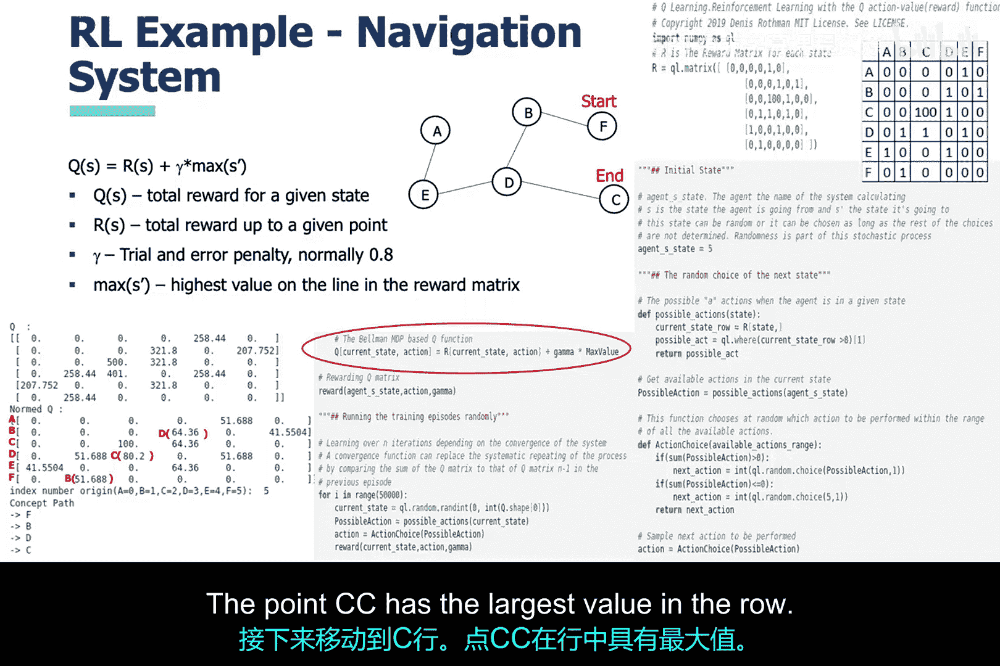

# 约翰霍普金斯大学《网络安全的AI｜ai for cybersecurity》中英字幕 p13 3_变形恶意软件检测技术.zh_en -BV1WQNzzUEU6_p13-

Welcome class to AI for cybersecurity In this lecture we will continue talking about cybersecurity and malware。

 we will talk about metamorphic and polymorphic malware and AI tools that can be used to detect and create these malwares。

In this slide， we focus on the evolution of malware from basic to metamorphic。In cybersecurity。

 we know that the relationship between cyber defenders and cyber attackers is that of an arms race。

 Cyber analystlys began by putting measures in place to protect the system。

 Then cyber attackers counter by figuring out how to evade those security measures。 This leads。

Cber defenders back into what we have seen。So far as it never end in battle between cyber defenders and cyber attackers。

 Having said that metamorphic malware is just one of the many to come advancements of cyber attackers。

 This malware proceeded by polymorphic malware was developed by cyber attackers to hide the malicious intent of malware posing as benign applications When cyber attackers began producing malware to hide its malicious appearance using encryption。

 It was novel and difficult for cyber defenders to somemount。However， when they did。

 cyber attackers just came out with the next best thing， which was metamorphic malware。

 which rewrites itself。At every。And every use instead of using encryption。 unfortunately。

 this cycle seems to continue with no end in sight。

Now that we've been given more background regarding polymorphic and metamorphic malware and discusses basic characteristics。

 let us discuss cyber。Analyst detection strategies。

 one simple approach to detecting polymorphic malware is to simply wait until it decryptps itself and then look for the signature of non malware。

 it likely will not just decrypt itself in a way that it can be detected before it performs its malicious intent。

Instead， we must need。We would need to place a suspected file in a controlled environment or sandbox and allow it to decrypt itself。

 Then we could look for malicious signatures。Protection of metamorphic malware is a bit more challenging。

 We would need to somehow analyze its behavior by capturing its instruction flow logic to understand if the application is actually rewriting itself。

There are several problems with this with this， such as high false positive rates。

And this approach can be computationally intense。Here's where machine learning could help。

We will talk more about this approach and the use of Hi and Markov models。

AI could play a role in both the detection and proliferation of metamorphic malware。

 One promising approach to detecting metamorphic malware is to use Hi curve models to learn the Op code sequence。

 which is basic the logic flow of instructions of malware and compare the Hi hole model。

Of suspicious fo。If the file is malware， it will likely have a high probabilistic similarity to hidden mark to the hidden Markov model for malware。

 One approach that malware rid may take in the future to evade malware detection is to incorporate AI like reinforcement learning into malware and use it。

As the engine to modify itself， for practical purposes。

Reinforcement learning is the theory of learning the optimal behavior in an environment to obtain maximum reward。

 similar to Hi MarkovV model， the Markov decision process is a mathematical framework that can be used to implement reinforcement learning we will discuss this further in a later slide。

Now let us take a more detailed look at Hi Markov models First。

 a Markov process is a random process which changes its state based on predefined probabilities。

In this process， all of the states are observable。In contrast。

 Hi Markov models have some states that are not directly observable。

 We talked a lot about Hi Markov models。 So let us discuss a simple example。

It is called a earn problem。There are three hidden urns that contain a known mix of balls。

 balls are chosen at random from the urns and the ball sequence is shared， but not the urn sequence。

 The balls are chosen based on monca processes， because the current urn chosen does not depend on the urn chosen before it。

But it has。States that cannot be。Directly observed， it is referred to as a hit and markov process。

 This leads to the conclusion that the earned choice can only be thought of in terms of probabilities。

So now let's look at a Hi Markov model implementation example。

 this example sort of mimics an elementary computer application instruction call sequence。

 which is somewhat similar to how you would use Hi Markov model to identify metamorphic malware I will start by introducing the hidden states M&L which refer to malicious and legitimate instructions respectively。

Then observable states， W and N， which refer to the computer working or not working respectively。

 Hopefully the diagram on the right hand side of the slide gives you a good visual of a problem at hand。

 which is a computer that processes instructions and and can continue working to stop。

Can continue working or start working based on the instructions it executes the important aspect of the diagram or the parts that correspond to the start matrix。

 transition matrix and emission matrix， this gets into our analytic development process since for all practical purposes。

 these matrices are like features， which a user train of the model doing instantiation。

Then the model yields the probability of seeing the observed sequence and the most likely hidden state that generated the observed sequence。

In this slide， we discuss reinforcement learning in more detail。But before we do。

 I want to reiterate that reinforcement learning could be used by malware writers to build malware that evades detection。

 so that is my purpose for introducing reinforcement learning at this point。As I mentioned before。

 reinforcement learning can be implemented using the Markov decision process。

 which can use the Bellllman equation to provide a calculation for rewards given the interaction with the environment or behavior。

In this example， a user starts at F。And wants to get to see a navigational system is developed using reinforcement learning。

 This system chooses the next node， randomly。Attemptant to maximize its reward if the system is implemented properly。

 it will lead the user to C， which is the choice that provides the maximum reward。In this slide。

 we implement the navigational reinforcement learning system using a Markov decision process and calculate the rewards using the Bellllman equation。

 which appear is circled。In red。In the coast nipplet。We'll start by looking at the graph of de roads。

The navigation system must maneuver note that the user starts at F and needs to navigate to C。

Now let us look at the reward matrix， note the illustration of the reward matrix in the top right hand corner of the slide。

Note that there is a one everywhere。 There is a connection or road from one node to the next and0 everywhere。

 There is no connection or roads except for the location， C。Ccomacy。

This location has the value 100 dear。 This is the ultimate ultimate reward and thus is the point where the user wants to get。

Two， and also the reinforcement learning navigation system。

 because this is where the most points will be collected。Now。

 let us navigate to the lower left hand corner。 There you will see the reward matrix after 50000 iterations as illustrated in the co snippet in the middle bottom of the slide。

 You will notice that the values have now changed by this time。

 the algorithm should have learned through trial and error， the most lucrative path。

 which should also be where the user wants to end up further in the left hand corner at the bottom。

 you see the path chosen by the reinforcement learning navigational system。

 This correlates with the contents of the reward matrix。 Not the red labels and and。

Notice the red labels， the same labels are applicable across the top of the columns as well。

Beginning with row F。If you move our route to E comma B。It has a largest value in the row。Next。

 move to Robby。The point B comedy has the largest value in the row Next move to row D。

The point Dcom C has a large value in the row。 Next， move to row C。

The point C has a largest value in the row。

So， now we're done。I know this is not。A malware example。

 but hopefully this example does help you understand reinforcement learning better。

 You have to wait until a later lecture。To see reinforcement learning being used to evade malware detection。

Thank you。