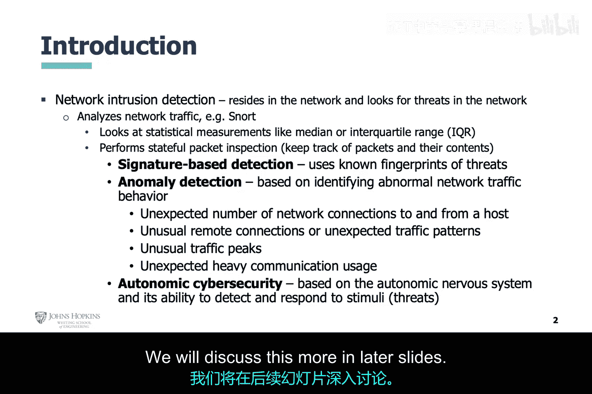
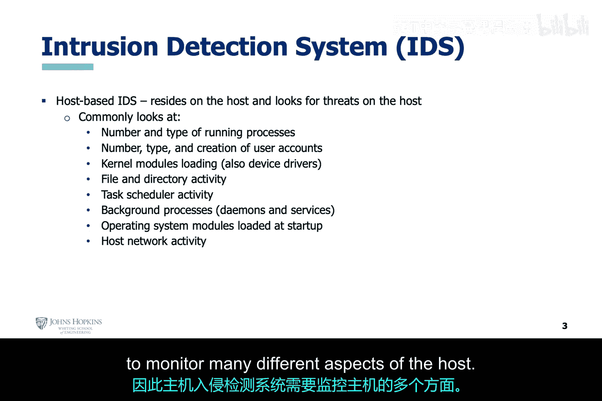
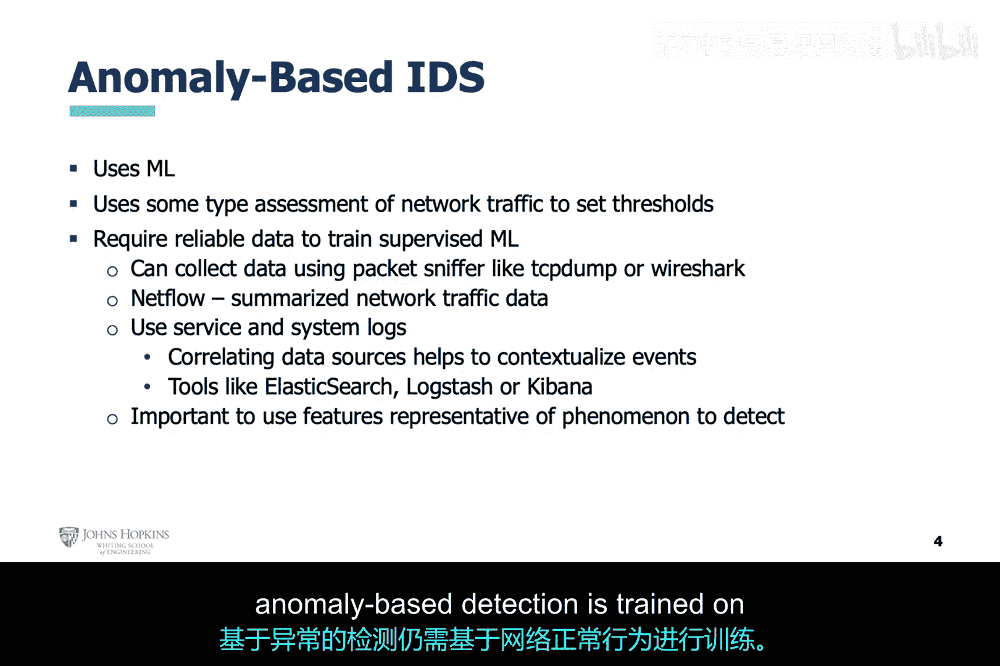
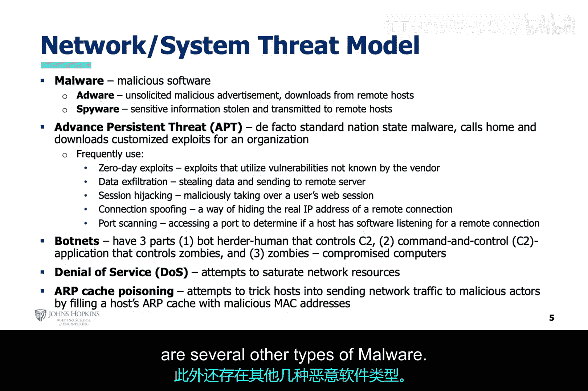
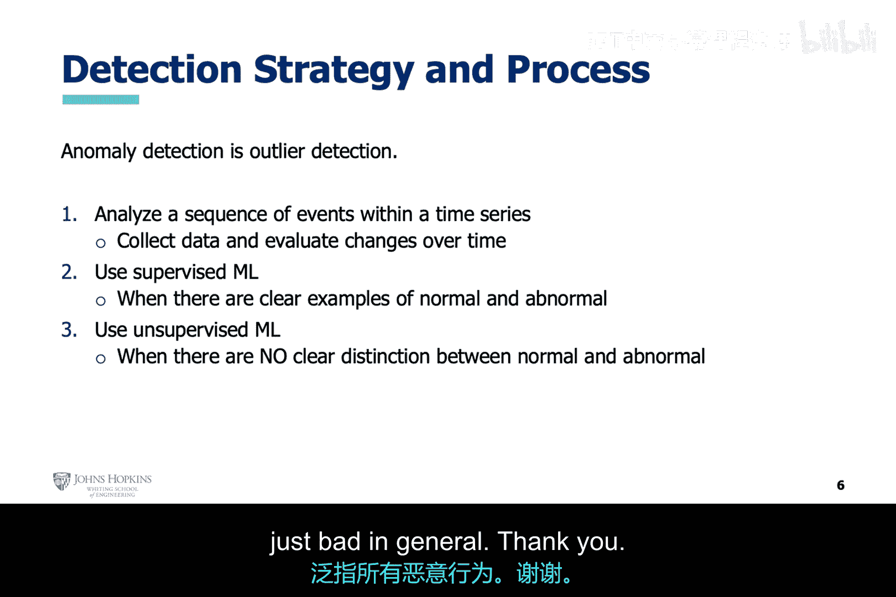

# 约翰霍普金斯大学《网络安全的AI｜ai for cybersecurity》中英字幕 p14 4_网络异常行为检测.zh_en -BV1WQNzzUEU6_p14-

Welcome class to AI for cybersecurity In this lecture we will discuss background on anomaly detection As I mentioned in an earlier lecture。

 we have a cybersecurity problem because all of our critical infrastructure sectors use computers which are composed of hardware and software that are products of human production and thus riddled with flaws further。

 these computers are all networked and men are even connected to the internet。

 which means that now these flaws can be remotely exploited by attackers all over the world。

 This background paints a good picture for the landscape that we are dealing with at this point。

The above background helps to explain why anomaly detection is needed。Begin this slide。

 we're talking about intrusion detection。 specifically network intrusion detection。

 This leads us to a discussion about signature and anomaly detection and autonomic cybersecurity。

 at this point an arms race between cyber defenders and cyberters。

 Sign to detection is barely useful because of advanced malware。

 Anomaly detection is currently promising an autonomic cybersecurity is the future， in my opinion。

 at least， despite this not being a new paradigm。 I believe the necessary advances in artificial intelligence are just beginning to be made that will allow that true promise of this technique to surface。

 We will discuss this more in later slides。

This slide continues the intrusion detection theme from the previous slide here we focus on intrusion detection in the end system or host system。

The in system is generally composed of hardware such as CPU memory and file systems。

 software such as operating system and executing applications。

 as well as other semi hardware or software aspects。 and， of course， network interfaces。

 So there are many different places for malware to hide in the host。 Therefore。

 a host intrusion detection system needs to monitor many different aspects of the host。

 Since we are currently looking at look into anomaly based detection to show promise。

 Let us talk a little bit more about it。 Of course， it is a machine learning detection scheme。

 but it has a simplistic side。

Instead of attempting to learn the complex behavior of malware。

 anomaly detection is assumed to be trained on the boring normal behavior of the network。 However。

 this could be easier said than done since it is more difficult for network owners to actually witness the true normal behavior of the network than would than they would like to emit。

Most of the they really cannot be sure that the network is not already compromised in some way。

 so for our practical purposes， anomaly based detection is trained on the normal behavior of a network。

Now， let's talk a little bit more about those threats that are out there that we are so afraid of。

 The bad guys exist。And can manifest in the form of malware， which can enter into a computer network。

And to our computer networks our or end user systems， malware is essentially malicious software。

 it ranges from bad to worse， some examples of the bad side are Adware and Spware which can annoy you to death by trying to sell you stuff or even steal your personal information respectively。

On the worst end or even horrible even or even。Or even horrible。Is advanced persistent threat or A。

 which is the ultimate manifestation of the bad guys。

They're so bad because this form of malware likely represents a foreign government and likely has all of the financial backing of such。

 This type of malware is so bad that it has its own life cycle riddled with a host of bad activity。

 This malware will likely eventually defeat all of our defence and de approaches， giving enough time。

Primary reason for this is that it will likely contain zero- day exploits for your network or end user system。

 which will eventually literally open up your network or end user system。Like a can opener。

 because you nor the vendor even knew your network or end user system had the vulnerability。

 it will exploit。 Thus， the name。 Then somewhere in between are several other types of malware。 Now。

 let us talk。

About a potential strategy and the associated process we will use to detect network intrusions。

 First let us revisit the primary theme of our strategy， which is anomaly to。So again。

 our goal here is not to detect a specific type of threat of malware instead we're looking to identify when the behavior of our network or end user system is outside the bounds of what we would normally expect it to be。

 the key is for us to be able to collect network or system data when we have brown truth that our network is behaving normally。

This will form a baseline behavior。 Everything I just said is true when you're using unsupervised machine learning and also a one class supervised machine learning algorithm。

 We will not look at this type of machine learning algorithm。 But for your situation。

 awareness this type of。Machine learning algorithm can be trained on one class of data。

 and that can be the normal data or it should be the normal data then it can be tested on existing network or system data to determine if the network or system is devviating from the norm but I digress with this conversation back to the topic at hand with unsupervised machine learning。

 there is no training and thus no need for examples of normal or abnormal this algorithm can simply be used directly on network or system data and the engroup this data based on intrinsic characteristics of the data Next to supervised machine learning with this type of algorithm we need examples of good and bad behavior and depending on the data set we use the train is machine learning algorithm we could look for a specific types of malware or if training on the bad behavior of multiple types of malware just bad in general。

Thank you。