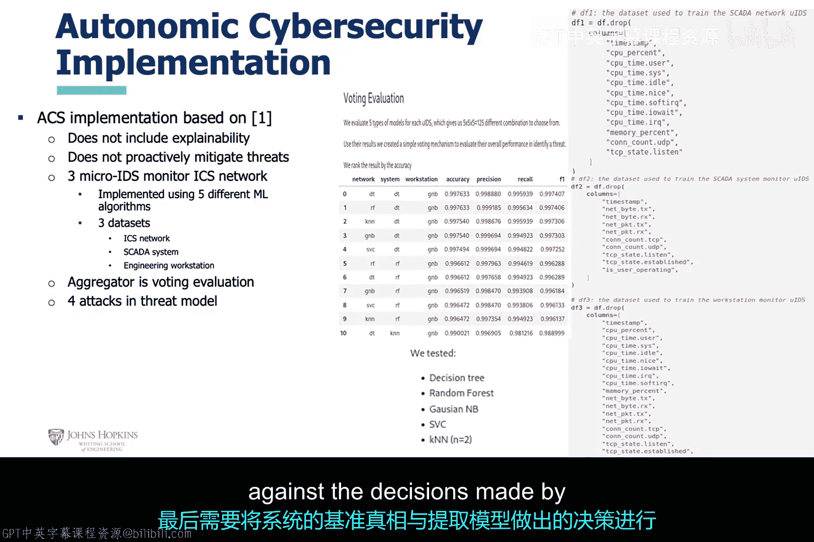

# 约翰霍普金斯大学《网络安全的AI｜ai for cybersecurity》中英字幕 p15 5_僵尸网络异常检测案例分析.zh_en -BV1WQNzzUEU6_p15-

Welcome class to AI for cybersecurity In this lecture we will focus on the hands on implementation of anomaly detection analytics using botnet data as mentioned in the previous lecture。

 our strategy in this module is anomaly detection， which is really just looking for evidence that the network is not behaving normally。

However， we have network data and specifics features。

Craft it to pull patterns out of network data to look for anomalies and network traffic caused by the presence of a botnet。

In case I did not explicitly say so， a bonet has three main parts infected computers or zombies。

 which are under the control of。A command control。Sometimes referred to as a C2 which can be one of many computers depending on the type of bonet in turn these C2s are under the control of a bot herder or herders the go to the bonet can be different such as Bitcoin mining spam。

Distributed knowledge service or something else。 Another term is。The botnet kill chain。

 which is a collection of network behaviors that characterize the botnet malware。

 Having said all of that in this slide on right hand side， we。

 we have a co snippet for bonet analytic development。First， label data set is ready and separate it。

Into training and testing data sets， and the features are extracted from the data。

 The details of the mathematical transforms used to produce these features are not given here。

 We just have the features in a data。 We train and test three supervising sea learning algorithms in this co snippet Ka nears neighbor decision tree and Gaussian Nive Basin。

 The only metric we use here is accuracy and all three perform quite well。

Let us change gears a little bit for a second in this slide we will focus on statistical analysis for a bit。

 specifically the Gaussian distribution also referred to as a normal distribution。

 we can discuss properties of normal distribution in terms of his average or mu and variance or sigma squared。

Why is the Internet of this important， essentially because we can assume that the features of the data set throughout。

Throughput and latency have a normal distribution。If this is true， then the system。

From which these features are extracted， should always produce network traffic which conforms to this distribution。

 if not， then it's likely the system is exhibiting anomalous behavior and thus an indication of malware。

This slot is an embodiment of the theory expressed in the previous slot。

Here we lay out a statistical process that has been implemented in Python to detect anonymous behavior and network traffic。

 I think this is a good example that highlights the benefits of using a non machine learning approach。

 which is less less complexity， but also the drawbacks， which would be less powerful。

 So allow me to explain statistical methods can produce results quickly with very few lines of code。

 which which is good for an initial static analysis。

 But if you require something more ongoing and dynamic than developing and analytic is probably more desirable which user machine learning。

 This slide highlights the drawbacks of the statistical method mentioned in the previous slide。

Notice that the static threshold has to be determined at the heart of this implementation is a custom class that uses data to produce this threshold。

 However， I did not consider this a machine learning approach is based on the statistical relationship containing in a data set used and the threshold used to make predictions would only be accurate and very limited situations mostly using this data set。

 a model depending a model developed using a machine learning algorithm width。

Be more dynamic and applicable in less limited situations。

This lot mostly focuses on the introduction of new metrics that can be used to describe the quality of the statistical or machine learning alytic developed we introduce。

Recall or sensitivity of what some call true positive rate， also precision。

 false positive rate and F1 metric。Now we pivot to a new evolution of intrusion text system based on autonomic computing。

 this type of system is thought to be selfaware based on a minimum of four self realizing attributes。

 this system theory and map K architecture is thought to be the basis of autonomic cybersecurity。

Here we introduce a notion of autonomic cybersecurity It is rooted in autonomy and likely maps to level2 autonomy or semi-autonnomous high as we discussed in earlier slides at this level of autonomy。

 the system is proactive and comes up with its own rules for a user to approve before executes them essentially this manner of intrusion detection system is made up of many microidDs that monitor small aspects of the cyber asset to be protected such as。

having a micro IDS for each protocol used on the network for each application used on the host to use keystrs to use mousestrs and likely other aspects of a cyber asset to be protected then these micro IDs constantly send their results to an aggregator this aggregator could be a machine learning algorithm that takes in the output of all the microIDS and the size if a compromise has occurred and it develops a plan to mitigate the compromise。

Anonomic cybersecurity system could directly take action on this plan。

 or it could send its plan to a human for approval depending on which level of autonomy has been implemented。

If the autonous cybersecurity system is explainable。

 it would also explain the actions that it is suggesting or decided to take。

The example mentioned in this slide only determines if the compromise occurred and explains its decisions。

 however， it does not offer any suggestions for mitigation。In this slide。

 we focus on the data set and the threat model。 the industrial control system environment consists of a rapid scaled application running on a virtual machine networked。

To a virtual machine that represents an engineering workstation。

 the industrial control system emulation is responsible for some industrial tasks where a rascated devices taking inputs from some physical process performing a calculation and producing an output engineering workstation emulation represents a PC that is executing a human machine interface application that would normally provide the user the health and status of the skated device。

For data gathering purposes， the autonomic cybersecurity system contains scripts that can extract CPU running process information。

 also data， memory data from the rapidcd device and user mouth movements from the engineering workstation。

 Also the threat model system for basic attacks against industrial control system。

 the microcro IDs of the autonomic cybersecurity system constantly monitor the rapidpicd virtual machine。

 the industrial control system network and engineering workstation for anomalous activity and fees the responses to a naggreggator。

 which decide if the saver asset has been compromised。

This slide focuses on the explainability of our example autoomic cybersecurity system。

 if decision tree machine learning algorithms are used for the micro IDDS then the logic。

Used to decide classification can be extracted and used to explain the anomic cybersecurity overall alert decision logic。

ThisThis is a very important concept in Adeline development since very powerful machine learning methods like deep learning。

 light the capability and this capability and developers have to go to great length to attempt to glean decision logic information from this type of an algorithm。

This slide focuses on autonomic cybersecurity implementation。

 all the aspects of the autonomic cybersecurity system we discussed in previous slides are implemented exc explainability and proactive mitigation aspects。

 the micro IDs are all implemented。Using five different machine learning algorithms。

And excerpts of the results are shown here。 If this M， if this。Implementation were based on。

If this implementation would test it or some prototype。

 it needs to to be developed to attempt to measure its true performance on a running system。

 the best performing machine learning algorithms would need to be exploited as models using something like Python pickle feature and various aspects of a real system would be monitored。

 features would be extracted and sent to the extracted models。

 then the models would produce results and in the group。

 the ground truth of the system would need to be compared against the decisions made by the extracted models。

Thank you。