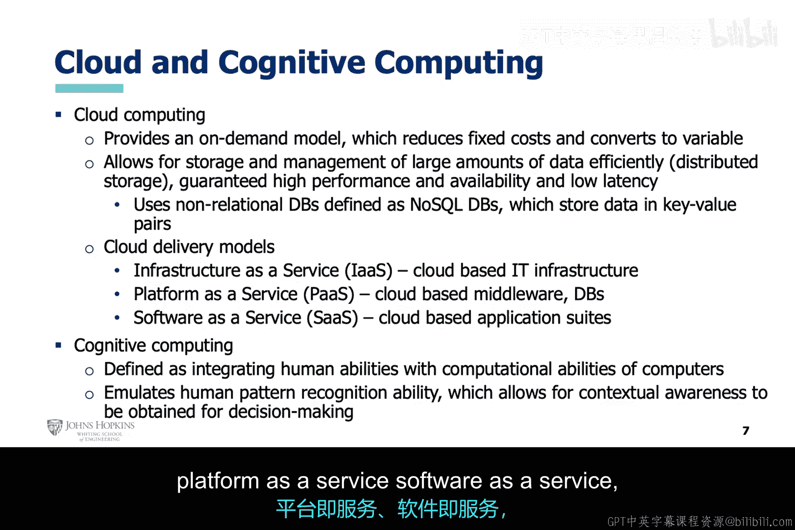

# 约翰霍普金斯大学《网络安全的AI｜ai for cybersecurity》中英字幕 p16 0_基于人工智能的信用卡反欺诈系统.zh_en -BV1WQNzzUEU6_p16-

Welcome class to AI Alpha S Security in this lecture we will discuss the credit card fraud and its prevention using AI。

Blue to not， but credit card fraud can be loging of fruit for criminals。

Crit card fraud has its basis in identity theft， which can be accomplished as easy as forging documents。

So they can counterfeit a few documents， then they're off to the racists。

And there is little to deterish behavior。 In fact， the risk of getting caught is less than many other traditional crimes。

Since as long as they keep the stolen amounts below a threshold。

 financial institutions have little motivation to pursue。

 also financial institutions in most cases fear that reporting such crimes weaken them in eyes of the public。

The perpetrators are likely organized crime using credit card fraud to support law。

Money laundering or other illegal activity。The tools necessary to prevent all of this can be complex。

 and thus require cloud resources。Critit card fraud loss is measured。

On the order of billions of dollars and likely falls under three scenarios。

Criminals would steal a legitimate card and run up the balance。They would steal the number。

 the credit card number， and or pin for a legitimate card， and charge small amounts continuously。

 or they will steal a person's identity and get a legitimate card issued based on false information and charge an unlimited amount continuously。

Financial institutions attempt to mitigate this by using two factor authentication on the low end and machine learning。

 predictive analytics on the high end。Let us discuss the difference between fraud detection and fraud prevention the former results。

After fraud has occurred in the latter attempts to deter fraud from occurring in the first place。

 let us focus on fraud prevention for a moment， specifically event expert driven predictive models。

 as expected， is developed using rules established by experts based on the scoring and then the nine of certain transactions and the block in of transactions due to certain aspects of the transaction。

This approach is easy to implement， but may be。May not be effective against new types of fraud patterns。

In contrast to rule driven predictive models， data driven predictive models are dynamic and of course based on data。

Here's where machine learning becomes applicable。Since it can learn。

From data and thus is able to correlate multiple features from a data set。

 a downside of this approach can be a lack of explainability。But at the end of the day。

 it is likely more practical to employ a well balanced combination of both rule and data driven predictive models。

And a good fraud prevention solution。This well balanced solution I mentioned in the previous slide again would be a combination of both rule and data driven predictive models。

This would also allow the solution to benefit from the strengths of both methods and thus mitigating the shortcomings of the individual methods。

 For instance， rule based models usually reduce false negatives， but increase false positives。

 So a common combined solution。Could reduce false positives。 Also， the combined solution。

Would also possess the capability of being dynamically updated。As I mentioned in an earlier slide。

The proper credit card prevention tools may require cloud resources。

 These types of solutions provide an on demandd。Provide under resources such as infrastructure。As。

 as a service， platform as a service， software as a service and cognitive computing。

Thank you。