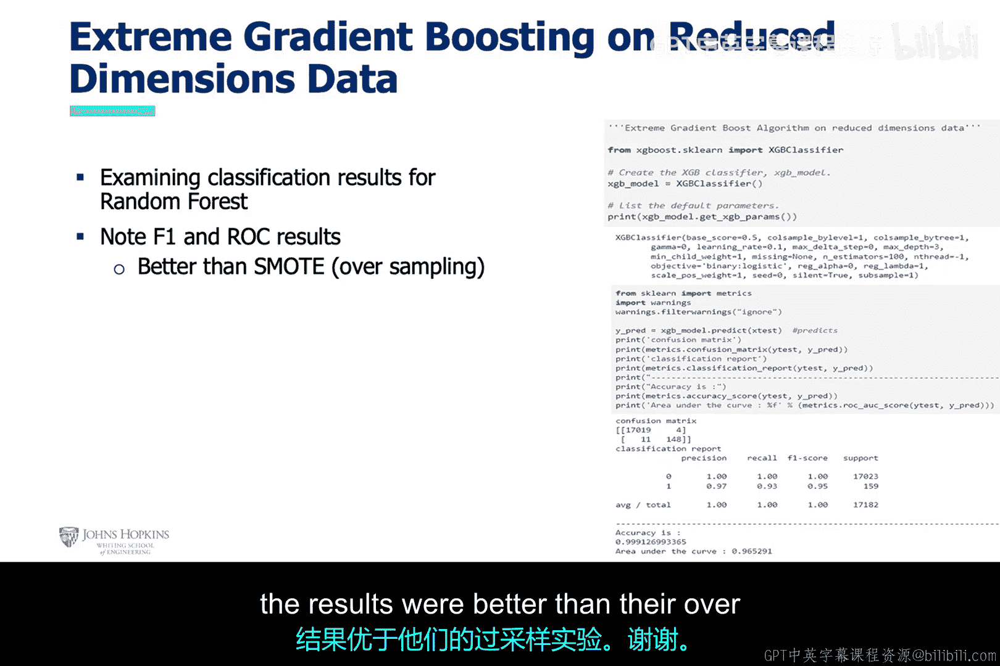

# 约翰霍普金斯大学《网络安全的AI｜ai for cybersecurity》中英字幕 p17 1_IBM Watson信用卡反欺诈案例研究.zh_en -BV1WQNzzUEU6_p17-

Welcome to class to AF for cybersecurity in this lecture we will discuss the IBM Watson platform and is used to implement credit card fraud and its prevention。

And it's machine learning， prevention solutions。In this lecture we will use IBM Watson to implement AI fraud prevention solutions。

 this platform enables predictive ensemble learning solutions through offering a diverse set of resources such as sampling techniques。

 bagging， boosting and stacking algorithms。Before we start。

 I have to bring to your attention to fact that for the hands on aspect of this lecture。

You' will need to set up an IBM Watson account。 This requires a credit card in your name， however。

 your credit card would not be charged。This is not mandatory since I capture all of the output in the slides and also there is output in your Jupyter notebook in chapter 7 in the virtual machine I provided you。

For those of you who are O with setting up an account， I will proceed。

You would need to go to the link， provided in the slide and follow the steps。In this slide。

 you will be setting up your account and creating the placeholder for your credit card。

 fraud detection， Jupyter notebook and data。Which will we， which we will discuss more later。Before。

Before you begin this slide， please download the Jupyternet notebook and credit card fraud dataset the location of these items is given in the slide。

 once these items are downloaded proceed with uploading these items to the asset location of the credit card fraud project that you created in the previous slide。

 please ensure that your screen looks exactly like the screenshots in the slide。At this point。

 you can run a Jupyter notebook just like you would in your local virtual machine。At this point。

 you should start to see the sales in the Jupyter notebook fill up。With output from the Python code。

 note that an excerpt from the dataset appears here you see excerpts of the 31 features in the dataset。

 an explanation of the features is listed in the slide。

 note that a large portion of the features are composed of confidential customer information that has been transformed using the PCA algorithm。

This is likely used to decrease the dimensionality of their original set of features。

 this also helps to master the values so they would not be easily recognizable。

Next we look at a subset of the features here the legitimate transactions appear in green and the fraudulent transactions appear in red。

They are significantly more legitimate transactions than fraudulent。

 but this sort of reflects reality。This is an unbalanced data set。

 but the point here is that there are many fraudulent data points present。

Before we look at results for the random forest algorithm。

 let us go back and talk through the machine learning development process。

 and development process for this fraud prevention solution。First。

 the fraud detection data set was loaded。 Then statistics and visualization of the data was done。

 These steps can be done to help。A data scientist determine what types of mathematical transforms will be needed。

Will need to be applied to the data to pull out patterns from the data also to determine if the data set is imbalanced in terms of having significantly larger set of samples in one。

Label set than other， even though such a situation may reflect reality reality。

There still may be reasons to attempt to rebalance the data set。

 such as trying to increase machine learning performance， as you will see in later slides。

In this example， the author does not apply any mathematical transforms to the data since the PCA algorithm has already been applied to the necessary features。

Already， it that the author took these steps to learn about the spread of fraud to non fraud data points。

 Next the author created training and test data sets for the data。

And train the random forest algorithm， he also applied optimization parameters to the model。Finally。

 several metrics were used to assess the performance of the classifier。

 based on the F1 and rock metrics， the results are decent。

In this slide the same analytic development process was followed， however。

 the extreme gradient boosting machine learning algorithm was used。

 this algorithm uses weighted samples from the data set whose weight is adjusted to offset errors to reduce bias。

First， a fraud detection data set was loaded。In this example， the author does not apply。

Any mathematical transforms to the data sense？The PC algorithm has already been applied to the necessary features already。

Next， author created training and testing and datasets from the data and trained extreme gradient boosting machine learning algorithm。

He also applied optimizations。To the model， finally several metrics。

Were used to assess the performance of the classifier based on the F1 and rock metrics。

 The results were better than the random forest algorithm。In this slide。

 the same analytic development process was followed， however。

 the random forest machine learning algorithm。Was used。First。

 the fraud detection data set was loaded， however。Much fewer of features were used as compared to previous slides。

 and here's the key， here's the difference between this use of the random forest algorithm and the first use。

Again， much fewer of features were used as compared to that particular situation。In this example。

 the author does not apply any mathematical transform to the data since the PCA algorithm has already been applied to the necessary features already。

 makes author created training and testing data sets from the data and trained random the forest machine learning algorithm。

He also applied optimization parameters to the model finally。

 several metrics were used to assess the performance of the classifier， based on F1 and rot metrics。

 the results were worse than the previous results。For the random forest machine learning algorithm。

In this slide， the same out development process。Was followed as in the last light where a random forest algorithm was used。

First， a fraudulent detection data was loaded with all of its features， however。

 the data set was randomly unsseled。Undersampled to reduce the imbalance in the fraud instances by decreasing the size of the legitimate instances。

 again， the difference here is that the data set was randomly undersampled to reduce imbalance in the fraud instances by decreasing the size of the legitimate instances。

In this example， the author does not apply any mathematical transform to the data since the PC algorithm has been used already。

Next， the author created training and testing data sets for the data and training the random forest machine learning the algorithm。

 he also applied optimization parameters to the model。

 finally several metrics were used to assess the performance of the classifier。Based on the F1。

In rock metrics， the results were the best of all the experiments that we've gone over。

Or we will go over in this and， in this particular lecture。In this slide。

 the same analytic development process was followed in the last slide where the random forest machine learning algorithm was used。

First， a fraud detection dataset set was loaded with all of his features。

So here we're not reducing the number of features we're loading in all the features。And also。

 we are randomly overs。To reduce the imbalance in the fraud instances by increasing the number of fraud instances using synthetic data。

 So big difference here。 first we're using all of the features and we're in this particular scenario。

 we are overassesembling。To reduce the imbalance in the fraud instances by increasing the number of fraud instances using synthetic data。

In this example， the author does not apply any mathematical transforms to the data since the PCA algorithm has already。

Been applied to the features anywhere the author created training and testing data sets for the data。

And several metrics were used to assess the performance of the classifier based on the F1 and rock metrics。

 the results were better than those from classifiers with imbalanced data sets。

 but not as good as a classifier that use underasse。

In this slide the same analytic development process was followed， however。

 the extreme gradient boost machine learning algorithm was used First a F detection data set was loaded。

 however， much fewer features were used as compared to previous slides。

 in this example the author does not apply any mathematical transforms to the data since the PCA algorithm has already been applied to the features already。

Next， Arthur created training and tests and dataset sets from the data and trained extreme gradient boost algorithm。

He also applied optimization parameters to the model。 Finally。

 several metrics were used to assess the performance of the classifier based on the F1 and rock metrics。

 The results were better than their oversling experiments。

Thank you。