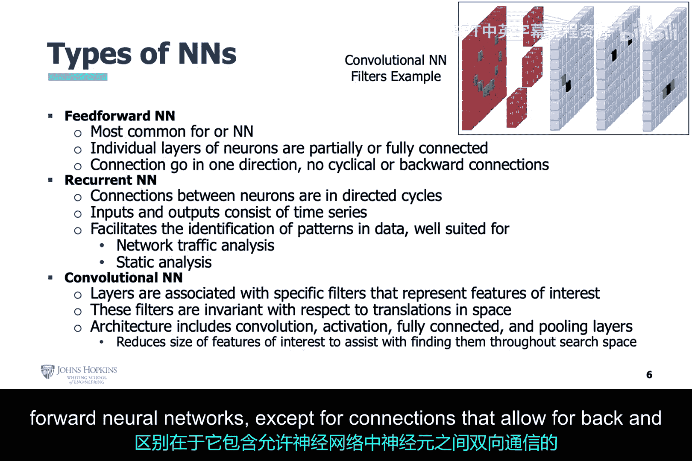

# 约翰霍普金斯大学《网络安全的AI｜ai for cybersecurity》中英字幕 p18 2_生成对抗网络(GAN)基础入门.zh_en -BV1WQNzzUEU6_p18-

Welcome class to A Alpha P Spe security In this lecture we will begin our discussion on generative adversarial networks or GANS。

This complete discussion will span two modules。 Again。

 the goal of this class is to introduce AI methods in such a way that you understand their applicability to cyberse。

So this is in no way meant to be an exhaustive study on Gs。Let us start。

Our discussion generally with the little background on Gs。

 The theory on Gs has been out for roughly a decade。 Now， Ian Goodfellow released his paper。

 generative adversarial Network 10 years ago。Toman knowledgewich。There's been no watch for it。

Use of Gs。Our black hat hackers are still things。 however， the potential does exist。

 so this is why we study it。I wanted to point this out to help you understand why I've taken the approach I have in presenting this information。

In earlier modules， there were clear examples of using AI to address threats that we know and hear about every day。

 In this case， we will get。To examples。That are mostly focused on doing something concrete to show you the capability of the technology。

Being later before。Conclusion of the discussion。I'll talk about how theory can be applied in real world situations。

 so back to the slide。The bottom line up front on Gs。

Is that essentially you have two neural networks that are placed in competition with each other。

And they compete until they reach a balanced condition。Which we will talk about more later。

To continue this bottom line up front。Gams remind us that AI。Can be used to attack AI。

Since I mentioned neural networkss and the previous slide allowed me to be clear and clarify。

We're talking about deep neural networks。 Again， deep learning is a subset of machine learning。

Designed to specifically mimic the brain's architecture。

It builds on a notion of artificial neurons to the point where we can think of deep learning as layers and layers of neurons connected together or simply put deeply connected neurons。

These deep connections of layers。Of artificial nuance， give。

Deep learning the ability to create its own features and even combine these custom features in such a way that ultimately。

 it achieves better accuracy than machine learning methods。Hovered a downside。

Is that deep learning is not inherently explainable。 In other words。

 there's no clear reasoning to how。It may have achieved those better than machine learning results。

 which is mostly due to its complexity。So now let us revisit a topic that we discussed before。

 the percept line。The signal perceptron or roenblt's perceptron was only able to solve linearly separable problems。

 which is very limited。Then it was improved by the multilayer perceptron or MLP。

 which is literally layers of perceptrons。This new percetron can solve problems other than those that are literally so separable。

 In fact， due to the Mlps。Actation function。 it can approximate any continuous mathematical function。

 given enough perceptrons。Recall， once the perceptron is simulated above。

 is stimulated above a threshold。 its activation function provides a response。

Common activation functions are the rectified linear unit or。

Rlo in a variant called a leaky rectified linear unit or leaky reu。These activation functions。

 because of their ability to translate a linear relation to a nonlinear response。

 allows for the approximation behavior previously mentioned。

So bad with me as I continue to revisit background on artificial neurons as a precursor to a more detailed discussion on GNS。

You could creatively think of newer networks as a different approach to recreating mathematical functions。

That is essentially what is happening。 The input layer of the neural network receives input。

Our data and activation function， once it is stimulated。

 provides a response to the next layer of pertrons。

 and this essentially begins a chain reaction throughout the neural network。While this is happening。

 the neural network is recreating key aspects or features from the data set and potentially making new features to help assist with classifying the data。

This tiny reaction now spoke of earlier is all happening in the forward direction。

With neural networks。With within a newer network， or simple put， there is。For propagation。

 as opposed to back propagation。Which is the discussion。Were talking about。Which in this discussion。

 we're talking about training a neuraler network and not data flow。

So let's continue back propagation for so let's continue this thought back propagation is for training。

And it occurs once an initial output response is achieved。

 and output is significantly different from the expected value。

We know what to expect because we have examples in the training data of what we should。

On what we should expect to see now this discussion could get very complex very quickly。

If you're wearing。An artificial intelligence hat， however， as I've said before。

 were wearing a cybersecurity hat。So we really only want to dig into AI。

Far enough to understand how to use it to help cyber analystlys to do their job in triage and cyber threats。

Having said that， we will stick to a high level discussion。

On back propagation and just know that it is used to train a neural network。

To output results as close as mathematically possible。

Given the number of neurons in a newer network and other performance performance parameters。

Use the train a neural network to output results as close as mathematically possible to the training data set。

This is done by readjusting the weights of the neural network based on the partial derivative of the error function。

 which is based on the difference between output of the neuralne and the training data。

 And so youll notice that in your book， it seems the author may have gotten a little bit confused when he was talking about。

Back propagation。 So let's stick to the slides。Think the slides and。

 and the discussion that we just sort of had。We give you a really good high level understanding of back propagation。

 what is' used for and what it refers to in this context。

Now allow us to revisit the discussion on board propagation and back propagation。

In the previous slide， I was careful to make the distinction between data flow and training。

In that discussion I was talking about。The most common form of neural network。

 which is a feed for neural network， which propagates its data flow in the forward direction only。

 technicalnically， the convolutional neural network is also a feed for neural network。

Since data flow。Is only in the forward direction， however， it does。

Have some nuances that make it special， like， for example。

Filter has a filter of specific layers or kernels that allows it to focus on specific features in the data set。

In a previously mentioned layers， in a previously mentioned slot。

 I did it reference back propagation。 But again， only from the perspective of training a neuraler network and that data flow。

 at this point， I'm prepared to discuss another type of neural network。

That allows data in the backwards direction。 This is the recurrent neural network。

 The architecture of the recurrent neural network is similar to feed for neural networks。

 except for connections that allow for back and for communication between neurons in the neural net。

Thank you。