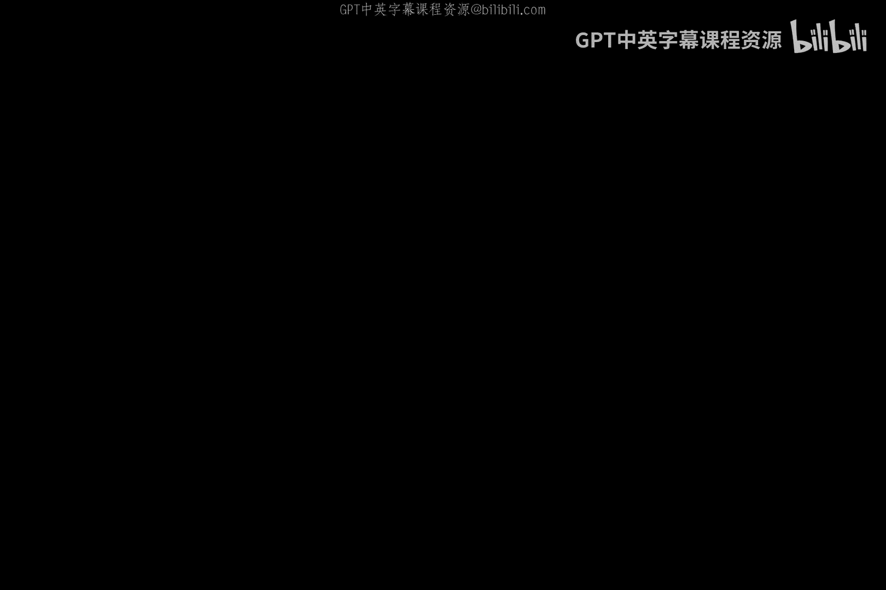
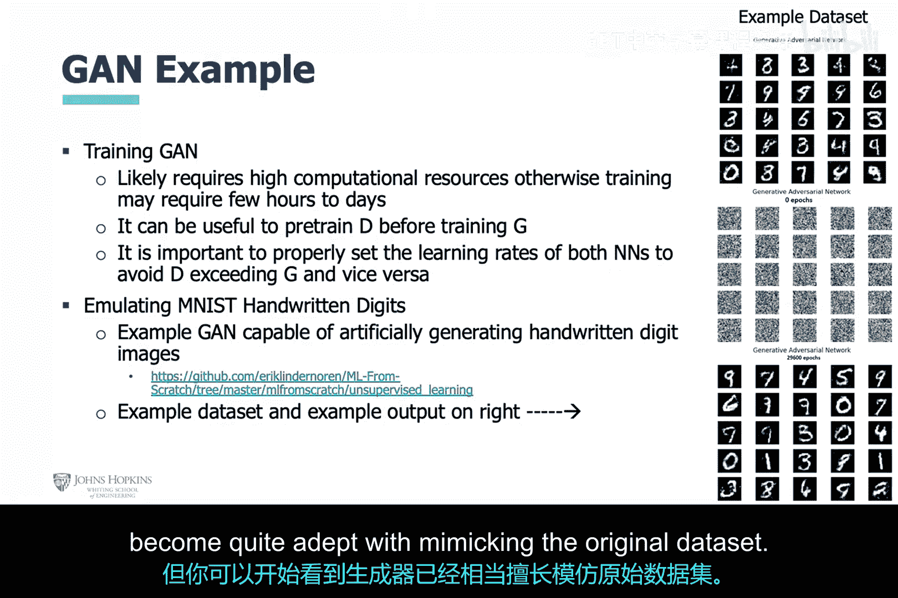

# 约翰霍普金斯大学《网络安全的AI｜ai for cybersecurity》中英字幕 p19 3_生成对抗网络技术剖析.zh_en -BV1WQNzzUEU6_p19-

Welcome class to AL for cybersecurity。Now that we have talked through a background discussion on neuraler networks。

 we can begin this lecture by discussing more about GNs。

We'll start in a similar way that we started the last lecture。

 talking about GNs at a very high level。As we said before。

 the bottom line up front in regards to Gs is that there are two neural networks in competition with each other。

 both working together to achieve a balanced result。

 These two neural networks are referred to as a generator and a discriminator。

 The generator's goal is to create。Or generate artificial data。

 that's so closely resembles the original data that the other neuraler network。

 which is referred to as the discriminator， cannot tell the difference between artificially generated data and the real data。

Unlike the neural networks we have discussed previously。

 the generator is not concerned with trying to reduce training error。

 Instead it is focused on trying to fool the discriminator。The discriminator， on the other hand。

 is focused on trying to discern。Or discriminate the difference between artificially generated data and the real data。

Let us dig deeper into the concepts of a generator and discriminator。

They both learn from each other in different ways。We will leave this point vague for now。

 let us frame the discussion as a cybersecurity problem， consider the spam and ham。

That we talked about in previous lectures and the goal here is not to discern spam from Ham instead the goal is twofold。

Discerance spam from fake spam， which is the goal of discriminator and to create fake spam that is indistinguishable from real spam。

 which is the goal of the generator， while attempting to optimize its objective function。

 the discriminator calculates a probability。That a given email represents spam based on the presence of suspect words。

 while the generator calculates the probability that a given spam message。Contained suspect words。

The generator wants to minimize its objective function by minimizing the resemblance between its generated data and the original data。

 while the discriminator wants to maximize its subjective function by maximizing its discernmament between the generated data and the original data。

This， in turn， is referred to as a zero sum game。When the loss of one party is the gain of another and vice versa。

These two are said to have reached a na equilibrium。When both strategies are optimized。

This is Goodfeellows famous equation for describing the men max relationship between the objective function of the discriminator and generator。

Again， the discriminator wants to maximize this equation。

 which means that it maximizes the output associated with the real data and minimizes the output associated with the fake data。

 On the other hand， the generator wants to minimize error associated it with creating fake data and maximize the errors associated with the discriminator being able to discern real data。

To discern real from fake data。Which would be。Which would be when the discriminator is only 50% sure that its ability to。

It's it only has about 50% confidence in this ability to discern real data from fake data。

As alluded to earlier， training a GAN is different than training a single neural network to classify data。

There are two neural networks that have competing objective functions。

 so you're not just inputting data， producing an output and applying a back propag algorithm to minimize error。

Is more involved and and intertwined than that。And the computational resources required to achieve equilibrium and again。

 is normally pretty high and thus training may take hours to days。

You probably want to pretrain the discriminator。On what real data looks like and set the learning rates of both neural networks to an appropriate value so that they are easily matched。

D feed the generated noise plus a glimpse of what the original data looks like。

Dner generator will combine the noise as and glimpse of the real data to attempt to produce an indistinguishable copy of the real data。

 The discriminator will continue training on the real data and will produce his own loss function to attempt to learn the real data better and better。

 Also， the discriminator will。Comparare the generator。

 generators copy of the data with real data and provide a loss function back to。The generator。

As well。Which will hopefully help it。Make a better copy of the data next time。

This continues until an equilibrium state is reached， so this is the training theory。

 let us use an actual G to attempt to reproduce handwritten numbers given the data set see an excerpt of this data in the top right hand corner。

Then in the middle， seated noise data with some characteristics of the original data。Add it in。

This is fed into the generator。 Now see the output after a couple hours。

In the bottom right hand corner。The Ga has not reached equilibrium yet。

 but you can begin to see that the generator has become quite adept with Ma Mc King' the original data set。

Overall， let us try to look at。Again example through the lens of thelytic analytic development process。

 we start with data engineering。This is a large data set referred to as。The mince handwritten。

Digs data set。This data has already been prepared for the G to use。Next will be feature engineering。

 however， we've learned that deep learning creates its own features。

 so we really do not know or have any idea what features are being used here。

Next is model engineering Here。 we can tweak the perform parameters。To try to improve again。

But we have to be careful here to make sure we did not pull the two narrow networks or put the two narrow networks out of sync in terms of being equally equipped to do their job。

Note the neural networks both use a leaky relu activation function。 So next would be training again。

 We went into depth regarding training in the previous slide。

 So we will just say a few words about the training progression。

We saw a picture of where the generator started。And then an updated picture after a few hours so we can easily see that in early Es。

 it is very easy for the discriminator to discern between real and fake data。

NotA note that discriminators loss function。In the slide in the bottom right hand corner。

Note the discriminator's loss function is minimized and the generator's loss function is maximized。

This is the opposite of where the game wants to be。But as the G trains。

As the G trains more and later epics， it becomes harder for the discriminator to discern real from fake data。

 and by this time the generator's loss function would have minimized and a discriminator's loss function would have maximized。

Thank you。