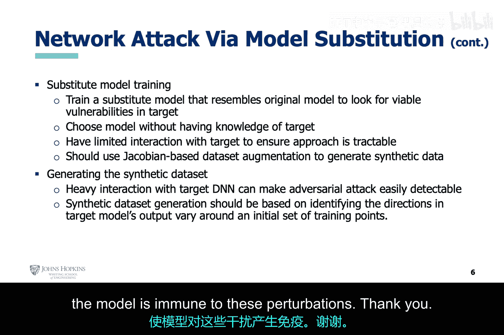

# 约翰霍普金斯大学《网络安全的AI｜ai for cybersecurity》中英字幕 p20 4_对抗性攻击原理详解.zh_en -BV1WQNzzUEU6_p20-

Welcome class to AO for cybersecurity In this lecture we will begin our discussion on adversarial attacks based on the theory behind Gs。

We will talk mostly about the theory of these attacks and in the next lecture we will take。

Hands-on example。In in previous lecture I mentioned that GANs reminded us that AI can be used to attack AI。

Here we will discuss this notion more General， new networks are vulnerable to attacks by GAs。

Or if nothing else， a theory of Gs。What I mean here is that Gs can be used to create synthetic data inextinguishable from real data by neural networks。

This approach could be used to full neuraler networks， used in applications like 3D medical imaging。

And others。But some adversarial attacks do not even need an actual G。

Just thinking just the the logical but the logic。Just the use of the logic behind。Behind Gs。

 for instance， a human can make perturbations to an image to cause a neural network。

To misclassify an image as something else。But the image looks unchanged to the human eye。

In this case， the human acts as a generator and a new a network as a discriminator。

Not being able to distinguish a per。A perturbed image。From real images， it was tri now。

So there I said it。These statements are powerful and that now all of our notions and and and innovations。

And newfo applications。For a hour are now called into question。

We just recently discussed the use of AI for biometric authentication。

And I just recently bought an electric vehicle with self driving capabilities。

 And now all of a sudden， none of this sounds like a good idea。

Using AI for these applications and other future applications are probably。As good a， good。

 as good a decision as it was to use network computers to run our US critical infrastructure。

 feel better。 Probably not， 。The bottom line here is that the cybersecurity problems started with the use of vulnerableable computers in US critical infrastructure。

 and its problem isacerbates。When we attempted to give these computers the ability to simulate human intelligence。

Because this technology is also vulnerable to attack。This is one point of view。

 The other point of view is that the development of the computer and its use and critical infrastructure has allowed our civilization to grow by leaps and bounds and the new advances in the speed of computing。

Power and availability of data has given us a whole new potential future。 So essentially。

 we deal We are dealing with a double edge sword。 Technology gives us a broader future on one hand。

 but curses us the strong potential of having it all being sabottaged through cyber attacks at any given time。

Well pull this AI attack。AI attacking AI through it a little further。 But before we end this lecture。

 we'll talk about how to protect AI from AI。 These AI attacks， again， can be considered。White box。

Attacks with attacks。But attacker has total access to the target A。

 to the target AI's model internal parameters， as well as output and input。

Or they can be black box attacks， where the attacker only has access to the targets to the target modelss input and output。

Unfortunately， there are many different types of these AI attackss against AI in this slide we just named a few of the most common in the next lecture we will take a hands on approach to discussing the fast gradient sign method or FGS S attack。

And the projected gradient descent or PgD attack。These are both white box attacks。

 And as I mentioned before， are based on a theory behind gangs where a human attacker becomes a generator。

 attempted to fool a discriminator。Which is the neural network。 The F GSM attack is sort of。Simple。

What a deep neural network's back propagation algorithm is exploited by the attacker。

The attacker gains knowledge。Of the direction of the gradient that maximize the loss。

And then the attacker slightly modifies each pixel。Of an image， accordingly。

The end result is an adversarial image。 that looks。Like the original image to the human eye， however。

 the deep neural network will misclassify it as an image from a different class。

 the PGD attack is similar to the FGSM attack， except the PGD attack acts iteratively and slowly modifies each pixel。

 Some variations of these attacks can create adver adversarial images where the attacker can choose the deep neural network's misclassification class。

Now we will pivot and talk about AI black box attacks against。Against yeah。

Now our model host it on the web somewhere and an attacker can。

Send input to a model and has access to the output of this model the attacker sends synthetically generated data to the target market and to the target model and observes the resulting classificationification result。

This gives attacker a labeled dataset set that he can now use to train a local model。Essentially。

 this synthetically generated data set with target Deep Miural network labels has transferred the decision logic of the target Deep Miural network to the newly trained local AI model。

Now， adversary examples， these are images that have been modified by attacks like FGSM or PGDM that look like one thing to humans。

 but。Will be misclassified as。To target deep neural a network as something else。So。

These adversarary examples can be created using the local AI model。That should be also misclassified。

By the Deep neural network， by the target Deep neural network， author the paper。

 practical black box attacks against machine learning， demonstrated principle or transferability。

Of adversarial attack by successfully using this attack against a few other wellknow host it models。

For the black box model substitution attack to work properly。

 there are a few best practices that should be followed。 Essential。

 you should have a limited interaction with the target model。

As's possible while building a target label data set。

 this means that there should only be a handful of queries to the target Deep Ne network。

 the key is choosing a minimum number of target model inputs that will properly capture the decision logic of the targetet Deep Ne network。

Now let's talk about how to defend。The had to defend against these attacks。

 The author discusses three different types of defenses。 First， a statistical defense。

Where you would attempt to use statistical knowledge of known images to detect adversarial examples。

 Next is a gradient masking defense where you would try to stop the exploitation of the back propagation algorithm by burying its true gradient information in random noise。

 Then lastly。Is。If you cannot beat them join them approach where data scientists would generate adversarial examples in advance and train their models on these examples subject so if they are subjected to them later。

 the motto is immune to these perturbations。

Thank you。