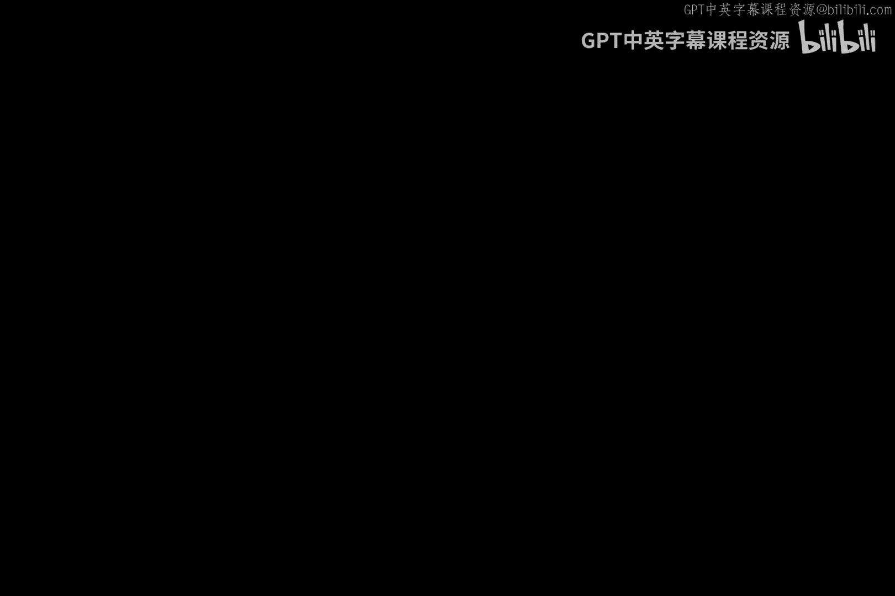
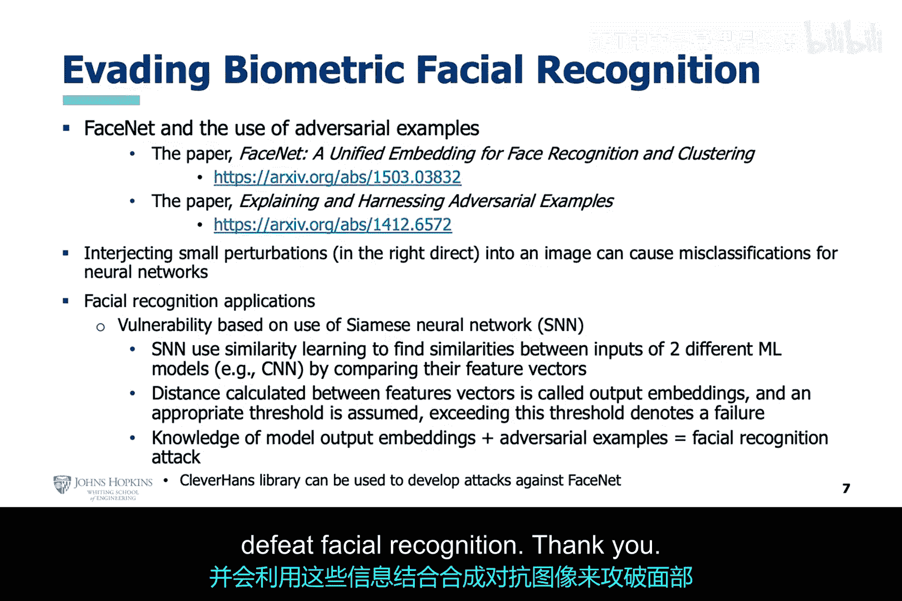

# 约翰霍普金斯大学《网络安全的AI｜ai for cybersecurity》中英字幕 p21 5_对抗性攻击实战演练.zh_en -BV1WQNzzUEU6_p21-

Welcome class to A Alpha cybersecurity In this lecture we will begin our discussion on hands on adversarial attacks。

Now we get into the hands on aspect of adversarial attacks， recall。We mention if。FGS some attacks。

Which essentially exploit the back propagation algorithm's gradient information。

Then the attacker uses this information to modify each pixel in the direction maximizing error to attempt to cause a deep neural network to misclassify the image。

 even though it looks unchanged to the human eye。If you think about it。This is G logic。

But attacker acts as a generator and a deep neural network is a discriminator。

 Those talk through every aspect of this attack。 Ater is supply the data， which。

 for all practical purposes， is synthetic adversarial data。

 Since attacker is employing G logic and serving as a generator。Again， it's not being used here。

 but again。The logic behind again is being used。 The actual code it creates the。Perturbated。

The protred images。Is in the top right hand corner of the slide。

 This synthetically generated adversarial image is applied to the deep neural network that has been already and。

 and has already been trained。So essentially， the deep neural network is an optimized analytic train to identify set of images。

 The deep neural network extracts its own features from a deep neural。From the deep。

It traces his own images。The deep neural network extracts its own features。

From the image and uses this information to decide on the class to place the image in based on its training here under。

Gan logic， the deep neural network is acting like a discriminator， trying to determine if the image。

Is real data or not。 And if the attack is successful。

 the deep neural network will misclassify the image。

 and the attacker or generator would have been successful in fooling the discriminator into misclassifying the image。

 The logic here is not directly the same as with GNs。

 but is similar and that the overall goal is for the generator to trick the discriminator。 Now。

 let us have a look at the images in column A and their associated results。

 The trained analytics shows very high confidence and its ability to recognize the four images prior to the attack。

Then in column B after， after the synthetic， synthetic adversarial images。

Have been created and submitted to the train analytic。

 You see the train analytic can no longer accurately identify the proper image。And。

In at least one case， the trained analytic is more than 80% sure that it has made the right decision。

 however， to the human eye， it clearly has made an error。

Next is a hands on example of the PGD attack recall we define the PGD attack as similar to the FGSN attack itself it modifies pixels iteratively and slowly。

In comparison to the FGS Stype。You can even。See in the bottom left。Hand corner， the Pg， the Pgd code。

There's a loop that iterates a specified number of times， whereas in the FGSM code。

 there is no such loop。We went through。Great detail in the previous slide， discussing the details of。

The FGSM attack。 And instead of repeating。That we will just state that the gang logic is used here as well。

 and the attacker or the generator is able to fool the deep neural network or the discriminator。

 If we look at the hands zone result in in the slide in column A。

The pretrain analytic is able to properly identify 17 out of the 18 images of handwritten numbers submitted to it。

Then in Col B， after the PGD attack is waged， the pretraining analytic is only able to identify eight of the 18 images of handwritten numbers submitted to it。

In this example， while you can clearly see the number。In the attack images。

 you can also see the perturbations。Another tech。Which is again， similar to the FSGM attack。

But localized to a small area of the target image in the adversarial。

Is called the adversarial patch attack Radis are calculated similar to the FSGM attack only but only for the patch area。

 also the generated patch has to be trained over a large number of images to be effective this attack can be a larger threat than then the FSGM and PGD attacks and that it can be applied to a small portion of a target and the patch can force a misclassification to a specified class。

Think about someone placing a patch。Of a red traffic light or a stop sign in the back of the car。

 If the deep neural network used in your car is self driving。

Caappabilities is vulnerable to this attack。An accident is imminent。Look at the images in column A。

These are examples of patches of different resolution。 If you look closely。

 some of the patches may seem to resemble their labels。 Now look at the images in column B。

 note that the patches take up a very small portion of the larger image， but in each case。

 the patches drive misclassification to specific classes with very high confidence。Now， we have。

Discuss the use of GAN logic to wage adversarial attacks against deep neural networks。

 let us pivot back to actual GANs and how it can be used to attack enterprise systems。

The paper entitled， generating。Adversarial malware examples for black box attacks against Gs reveals howgans can be used to defeat malware detectors。

 This is a black box attack against deep neural network。

 malware detectors similar to the black box attack we discussed against deep neural network image detectors。

 A substitute local malware， Deep neural network detector is trained on synthetic malware examples created by GAN and labeled by the target deep neural network malware detector Together the G and the substitute deep neural network detector learn to create adversarial images that are very hard to detect。

Similarly， gunNs can be used to evade network anomaly detectors。

 again a black box adversarial attack strategy is used。

 in this approach theres no substitute model instead the discriminator is trained by label traffic。

From the target anomaly detector。The generator starts out with noise and an indication of what malicious traffic looks like。

 Then the synthetic malicious traffic， as well as normal traffic is fed into the target intrusion detection system。

Deep neural network and a resulting label traffic is used trained a discriminator。

None a discriminator learns the decision logic or the target。Deate neural network， Ids。

And can now instruct the generator to produce network traffic that can evade to target deep neural network Is。

Our final discussion for this lecture would be。On how adversarial attacks can be waged against deep neural networks to defeat facial recognition technology。

Before we start， allow me to introduce notion of Siese's neural networks。

These are employed in facial recognition systems。Essentially。Si's neural networks or SNN are similar。

They use similarity learning。To find similarities in the inputs of the two different neural networks that are used in this network。

Next at a distance between the facial features。Which are called output embeddings is calculated。

 A baseline was created initially。 So if the embedding。If the output embedding exceed a threshold。

 then the facial recognition is said to have failed。

 A white white box adversarial attack would require knowledge of the output embeddings。

And would use this information， along with a synthetic adversarial image to defeat。

Pla your recognition。

Thank you。