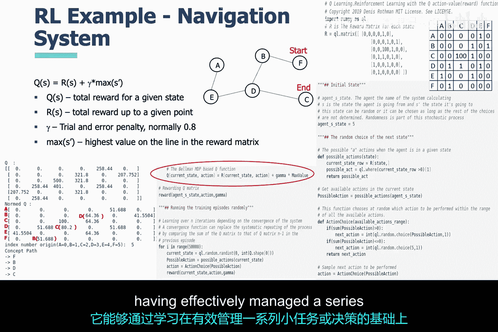

# 约翰霍普金斯大学《网络安全的AI｜ai for cybersecurity》中英字幕 p22 6_强化学习技术原理.zh_en -BV1WQNzzUEU6_p22-

Welcome class to AO of Cysecurity In this lecture we will have a very practical discussion about reinforcement learning。

Let us start by restating that machine learning has three types， supervised learning。

 unsupervised learning， and reinforcement learning。In Subraed learning。

 algorithms learn by using label training data and unsupervised learning algorithms learn from inherent characteristics of the data。

 such as distance between the points， and they use this to learn to separate the data and both of these types of machine learning。

 the common theme as data。 however， in reinforcement learning， there is no such theme。

 and stay at there is a different paradigm altogether。Allow me to begin to lay this out for you。

 First， there is this notion of an agent and an environment。

 The agent interacts or performs in action within this environment。 and in doing so。

 the agent gets feedback from the environment。In interacting with this environment。

 agent receives positive feedback in the form of a reward actionsions that advance the agent toward a goal。

 but receives negative feedback in the form of a penalty for actions that move to agent further from a goal。

Also， it is interesting to note that the agent。Did not even be nuanced about how it executes its actions。

 trial and error or random is the preferred approach。

The reinforceinforcement learning approach works well for solving mazes and playing point based games。

 as a matter of fact， there has recently been a lot of excitement around using reinforcement learning to master old school At Tori 2600 style games。

Initially， the learning is slow as the agent learns based on receiving sum rewards and mostly penalties。

 eventually learns how to achieve mostly rewards and conquers these old school games easily。Also。

 and， okay， enough for that。Back to reinforcement learning in the previous slide。

 we painted a picture of an agent randomly interacting with this environment and receiving rewards for performing the right actions and receiving penalties for performing the wrong actions。

 So let us attempt to formulate this scenario a little better。

 Let us think of the environment as a collection of states and when the agent interacts with this environment performs an action。

 it is actually traversing states and the agent gets rewarded for reaching specific states and penalties for moving away from specific states。

 In fact， we say the agent's goal is to win the game but to win the game it has to learn to winning strategy。

 which essentially is to maximize its reward。Let us pull this straight even further。

 Let us start back with the environment。Which has now been replaced with the maze。Essentially。

 demaize has various states， with some states being more important than others specifically。

Specifically stated the most important states are those that lead to the alternate state。

 which is the exit。Now， let us pivot to the rewards and penalties we spoke。About these， previously。

As if they were no real， as if there was no real organization here， but on the contrary， there is。

 we now introduce a notion of a reward matrix。There are multiple ways in which to express this reward matrix。

 but at its most basic level， it needs to cover the state space of the environment and denote connections between states and rewards。

And penalties， the reward matrix illustrated in the slide uses a number。

Toote uses a number one to denote a connection between states，0 for penalties and 100 for the reward。

 So let us take an example by looking at the reward matrix。

 you can see that the entrance at note F has only one connecting state， which is B。

So if the agent moved from node F to node B， then you can see the reward matrix。

You can see in a reward Wart matrix that Note B has two connecting states， note DNF。

We'll talk about penalties and rewards later Right now。

 we are just discussing valid transitions from one state space to the next。

 If the agent chooses to transition。To know D from node B。

 then it will seat that No D has three connecting states， no B， note C and note E。At this point。

 an agent can choose to go in one of three directions。 Before we move on to rewards and penalties。

 I have to first mention that the reward matrix does not favor any specific route toward the exit。

 Instead the exit no C shows two connections。1 to know D。An elder to a with every reward of 100。

 so it is left up to the inner workings of the reinforcement learning algorithm to properly use the reward matrix to find a path that will achieve a maximum reward。

So now it's time for us to talk about rewards and penalties。

And looking at the state transition table。And remember the agent's goal。

 which is to win by maximizing reward。 You will begin to understand why the agent chooses the path that leads to the exit。

 starting at F in the state transition table。 Look over across the row and choose the largest value。

That value leads to B in the state transition table。Now at B。

 look across the row and you will see the lesser value leads back to F and the greater value leads to D。

Now， a D。Note that there are three values on the row。 Two of the values are the same。

 These a note the choice are going back to be or going to E。

 but the greater value denotes transitioning to C。Now in this slide。

 we can put all of these pieces together for a more complete discussion。

The reinforcement learning agent interacts with the state space in a random manner。

 attempting to maximize the rewards from the reward matrix。

 The matrix is designed says that the adjacent states are denoted and a maximum reward is given to the agent Ref findinging the path that leads to the ultimate state。

 which is the exit。 the state transition table results from applying the objective function or the Q function to the rewards matrix。

This is the piece that was missing from the last discussion。

We were essentially looking at the Q values for a specific iteration of the Q learning algorithm。

Once this algorithm starts to converge， it is said to have learned to maximize its rewards and thus can win at whatever game it is playing。

We can see this convergence in the two matrices in the bottom left hand corner of the slide。

 We can use either matrix to arrive at the correct path or following the process we talked through in the previous slide。

 The key aspects of this Q value。Are illustrated in this slide。

 The detailed calculations of these components are beyond the scope of this class。 Again。

 this class is designed to use AI to solve cyber problems。

 So we've been talking about reinforcement learning so that we can understand enough about it to be able to use it for that purpose。

I encourage you to think about reinforcement learning from the perspective of being an orchestrator or task manager。

That is responsible for several smaller tasks。But does not actually perform those tasks。

But a task manager could move from one state to the next in the environment。

 Check in and see if all the tasks are complete by receiving a reward or not。Receiving a reward。

 but agent can be responsible。For making a set of small decisions。

 and the agent only gets rewarded for。Having made the best decisions in each specific。

 in a specific order。The possibilities here are actually endless。

 given this logic and a little bit of creativity， one could create an agent that could learn to complete larger tasks or make larger decisions based on having effectively managed a series or smaller tasks or decisions。

Thank you。