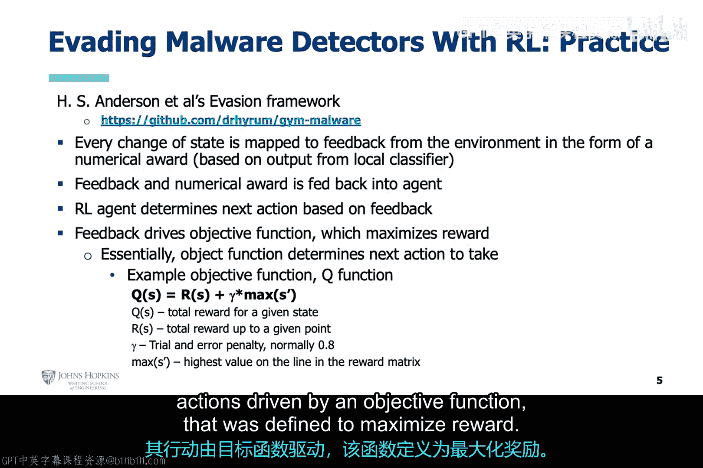

# 约翰霍普金斯大学《网络安全的AI｜ai for cybersecurity》中英字幕 p23 7_使用强化学习绕过恶意软件检测器.zh_en -BV1WQNzzUEU6_p23-

Welcome class to A Alpha S Security。Supervised neural networks are not the only source of AI attacks against AI。

 in some cases， reinforcement learning has proven itself to be an even more reputable challenger。

Let's think back to earlier discussions on adversarial attacks against AI models。

 attackers were all neuro network based and thus supervised machine learning。

 but here I want to introduce the notion of a reinforcement learning based adversarial attack。

As we mentioned before， the newer network based adversarial attacks。There were two types。 White hat。

 I'm sorry， white box and black box。The whitehite box requires full access to the target model and black box attacks。

 which require less access， but still access to some model information。

 specifically the attacking model must learn the feature space of the target model， target model。

Due to the way that reinforcement learning is set up with its ability to randomly interact with his environment and receive rewards and penalties all the while trying to maximize reward。

 it is。Able to learn how to evade a never before seen model detector without any knowledge of a structure or feature space。

The last slide we talked。At a high level about the potential for a reinforcement learning based attacker to evade other AI detection models without having any of the information that neural network based attackers require。

Here we would like to put the theory into practice。

 HS Anderson and co authorsors presented a reinforcement learning based adversarial attack approach that puts this theory into practice。

 they even produce an open source environment that allows others to be able to experiment with this approach。

Let us first focus on our black hat presentation。This is a very interesting。Paper andbo。

Results that are comparable。2， and in some cases， better than neural network based adversarial attacks。

If youll think back to our discussion on Windows PE file format and all of the applicable headers and sections within that format。

 certain fields from these headers and sections may really get features to build AI malware detectors So again。

 this is a typical approach used to create Windows malware detectors。

 So given such a model as a target and。As a target。

 the have no and authors have no interaction with such target。Instead。

 they train a local malware detection model using a large data set。

 and they use that as an environment for their reinforcement learning agent。But before they do that。

 they develop a set of functionality preserving modifications for specific pieces of malware。

Essentially these are modifications to the malware code that will not modify the actual functionality of the malware。

 but will alter its PE file format， essentially， the set of functionality preserving modifications。

Become the allowable states of the reinforcement learning environment。

So the reinforcement learning agent interacts with this environment。

 basically building new malware each time。It is malware with the same functionality。

 but its PE file format is new in some way。Each newly built malware is submitted to the local malware detector。

 and reinforcement agent gets rewarded accordingly based on the level of detection by this local model。

The goal of the reinforcement learning agent is to maximize its reward。

 which means it would need to build new malware just as functional as the old malware。

 But with a P E file format different enough as to evade the detection of the target malware detector。

 If the local malware detector was built well enough， it will be representative of the target。Now。

 were detector or better。And evading the local malware detector would also mean invading the target malware detector。

This was verified by the authors by them being able to use the process。

 this process to eventually evade publicly hosted Nowware detectors。

Not only did the authors present their findings at Black Ha。

 but they also released their own reinforcement learning Maware evasion framework。To the public。

Good impact of their work can be more greatly。Appreciate it since any user could download this framework and use it。

It also allows users more concretely， to understand extent。

A the state space of the reinforcement learning environment， which， for example。

 would be locations in the P E header。P section， import and export tables or ASI strings by the actions that a reinforcement learning agent could take。

Could take on， for example， would be。Adding new functions to the import address table。

 modify names of the exiting sections， adding new。Use sections are adding space at the end of sections。

Similarly， this evasion framework would also need to allow the environment to provide feedback for actions taking。

By the reinforcement learning agent as it traversed the environment state space。 Again。

 there should be proper reward to the agent for taking the proper action in a proper state space。

 This ties back。Enti our discussion earlier about having agents actions driven by an objective function that was defined to maximize reward。

Thank you。