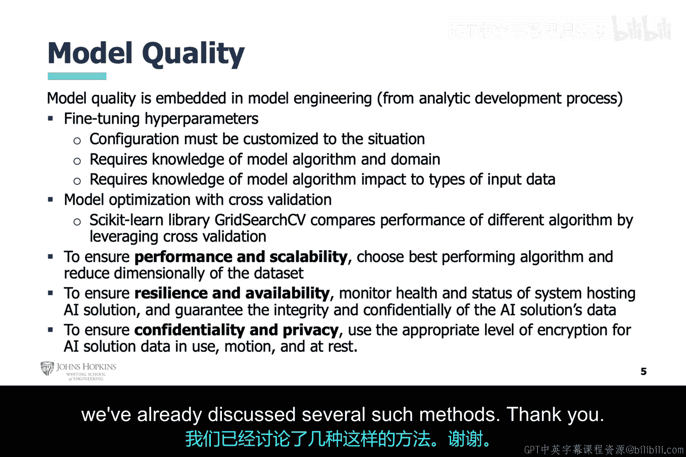

# 约翰霍普金斯大学《网络安全的AI｜ai for cybersecurity》中英字幕 p24 8_人工智能在网络安全应用中的挑战.zh_en -BV1WQNzzUEU6_p24-

Welcome class to AI for cybersecurity In this lecture we will talk through some of the challenges associated with using AI to solve cybersecurity problems。

Our original assumption was that AI could be used to help make the life of a cyber analystlyt easier by assisting with the triaging of alerts from intrusion detection systems。

But then we also branched out to other areas as well。

 essentially pushing AI into just about every facet of system and network detection。

In this lecture we would like to attempt to discuss some the challenges associated with suggesting this approach。

So let us start with triaging of alerts without the use of AI。

 a Tier 1 cyber analystlys would receive alerts in their instance。Of the security。

 information and event manager are seen。 these alerts will come from sensors throughout the network。

And systems within the organizations such as an intrusion detection system like SNorRT。

 a house intrusion detection system like semantic importm protection。

A host application whitelisting or black Ling system。Like Bi 9， which now is called Carron Black。

potentiallyti， many other senses。Let us assume these sensors are all non AI based instead they're statistical or signature based。

 This means the analyst knows。That decision signature based tools are going to work well for known threats。

 but will completely miss unknown threats， and that the statistical tools are going to have a certain level of false。

 positive and false negatives， which means that every alert would need to be vetted to determine its actual validity。

So the scope of the work is as follows。One， the cyber analystly will have zero initial suggested investigation pathways for each alert and will need to completely rely on the metadata from the alert。

2， analysts would need to follow their self-prescribe regimen of alert validation for nearly every alert。

3， analysts would would have to concede that unknown threats are completely undetectable。

 and they would not even have a suggested pathway to investigating the potential for such threats。

And for analysts， we need to put together a long term plan to keep out the threat moving forward and also a communication plan to share information internally and externally。

Now consider AI being used only to help the cyber analysts with their self prescribed regimen of alert validation。

So instead of the cyberanalyst having to do all the work。

 AI would be used to do an initial validation of the cyber alerts using a regimen of its own choosing。

 for example， if there was a network alert from SNort。

 the cyber analystly could drop the PAP or the flag network traffic into the AI tool and the tool will perform an analysis but the traffic and any files contained in the network traffic and render a decision。

This may include the tool performing anomaly detection on the network traffic。

He could perform several different types of malware analysis on the attachment。

 Then and cyber analysts would need to perform their own validation of the triage done by AI。

 which hopefully would be less worked than the original self prescribedscribed regiment。

Then there is a case where AI is used in all the sensors up front。If this is the case。

 it is likely that all of the before mentioned work is done on the front end and when the alerts reach the cyber analystlyt。

 all of the metadata produced by the steps performed by the AI。Can be included in the alert。

So now the cyber analystlys has a suggested investigation pathway for each alert。

 The cyber analystly does not really need to use his own selfprescribe regimen anymore。

 but could it preferred Also there would be there would have been a level of unknown threat analysis done upfront and there would be suggested pathway for further investigation of unknown threats。

 Finally， the feedback from AI could be used to quickly generate action plans and internal。

Or internal reports。Now， let us focus。AI and network sensors。

 One basic way of using AI in network sensors is through that of an anomaly detector。

 As I mentioned before， false negatives and false positives are always an issue with any AI tool and anomaly detectors are no different。

This just speaks to one limitation of AI tools。 however。

 this does not make all decisions made by those tools suspect。

 it really only speaks to the fact that human cyber analysts cannot be replaced by AI Instead the job of the cyber analyst becomes different。

As I mentioned in some detail in the previous slide。

 AI can do a lot to help make a cyber analystlyst more productive and their job easier； however。

 the job would be the job with the inclusion of AI is different since now a cyber analystlyst needs to be able to validate the findings of the AI。

Now let's talk more about the explainability aspect of anomaly detectors。

 as we mentioned in previous slide in previous slides。

 the use of AI tools upfront in sensors like anomaly detectors offer the benefit to the cyber analystlyts of providing metadata about the potential threat identified in their alert。

Here I am referring to initial tools that employ AI。

 such tools use AI to identify anonymous behavior and artifacts are created based on supporting technologies such as statistical analysis。

 indicators of compromise。Capture expert domain knowledge in others。

 which creates sort of a checks and balances to help validate the original decision by the AI。

 So the actual decisions made by the AI model itself may be a black box。 However。

 at artifacts such as network traffic visualizations， alert notifications。

 threat intelligence integration， policy violations。

 They are all concrete items that the cyber analysts can use to help validate the potential threat。

 until they build up a level of confidence that the tool。

Confidence with the tool and the NS validation may be required Having said that。

 the explainability and false positives and false negatives are still limitations and challenges。

We study explainable autonomic site security， which is positioned to provide lower false positives and false negatives and。

To that point where active responses to threats makes sense。

And more transparency in the decisions made by AI models。Outside of the network。

 AI can be used in other places to help cyberanas such as system level detectors。Back in。

 alert validators。Or or for some other purposes， Having said that。

 let us focus generically on AI models and challenges associated with them。 recall。

 we talked about the analytic development process in the AI model engineering step。

I mentioned at a high level， that。That here， an AI algorithm should。

We chosen to fit a classification problem and that the AI algorithm must be optimized。

This part can be complicated and can be more of an art than a science。

 I say this because there is no exact regimen that I can relate to help one to get this step perfect in every instance。

 Instead， expert knowledge is really the key。Not just knowledge of AI algorithm。

 but also knowledge of the specific domain and how specific algorithms behave or interpret different types of data。

Then there is ensuring that the performance and scalability of the AI model is set right for the application。

 as well as making sure the system that host AI model is cured from confidentiality， integrity。

 and also availability attacks。Finally， let us talk about the data quality。

This is the key to model quality because you can have so because you can not have one without the other and vice versa。

 even though the popular school of thought is that it is better to have good data。

Than a very good model。 One way of avoiding data quality issues is to avoid various types of bias。

 Another way is to avoid mislabeled data， unbalanced data sets and missing values。

 And when these situations occur， use appropriate methods to mitigate these situations。

 we've already discussed such several such methods。

Thank you。