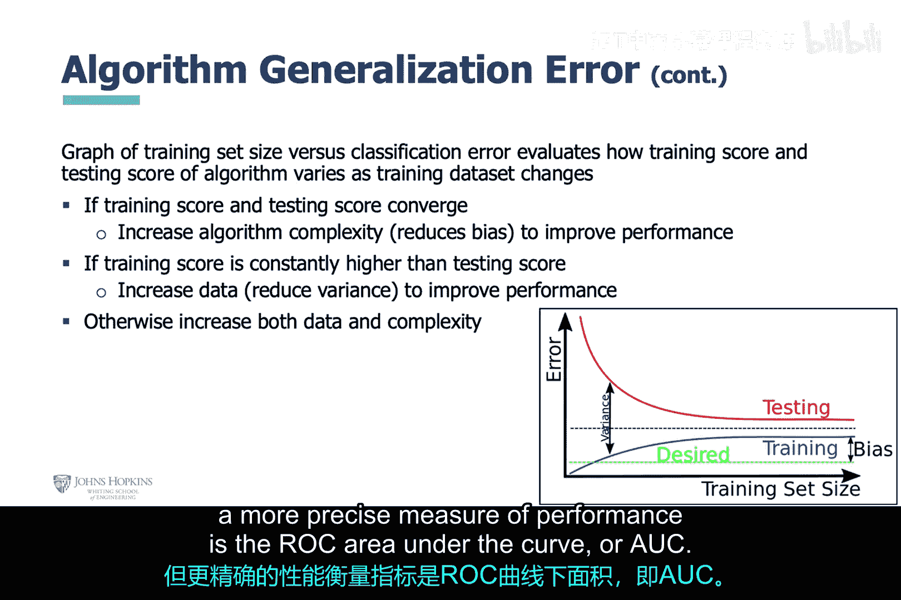

# 约翰霍普金斯大学《网络安全的AI｜ai for cybersecurity》中英字幕 p25 9_人工智能模型评估方法.zh_en -BV1WQNzzUEU6_p25-

Welcome class to AI for cybersecurity。In this lecture。

 we will discuss the evaluation of the steps of the analytic development process。In this slide。

 we will start our discussion with the use of。Data to train AI models。 This is a simple statement。

 however， there's a lot that goes on that goes into getting this just right。You can， you can do it。

You can overdo it and improply train your model in such a way that it appears to work well。

 But when the modelt is actually。Used on unseen data， it fails miserably。

 This situation is referred to as overfitting and can be the result of training with too little data or by having too many unnecessary features。

 If we pull this way further and discuss appropriate or proper。

Approaches to training AI models would have to mention。

Taking a sufficiently large data set and breaking it into two chunks， one shock。

 roughly 70% to 80% of the data should be used a trained AI model。

 and the remaining 20% to 30% chunk should be used to test the model。 However。

 if you didn't have a sufficient large data set， you could probably still。

Properly trained AI model by using Kfo cross validation。At a high level。

 you would essentially be training on 90% of the data and testing on 10% of the data K times using different folds of the data each time。

 then you would average the performance results to get an idea of how well the algorithm would perform on unseen data。

One final note， if there is ever a question between securing more data or a better algorithm。

 it is likely better in most situations to secure more reliable data。

We've gone through several weeks of studying this course， and I realize。

It can all be a little bit confusing。 Never fear， because the guiding light is the analytic development process。

 This process puts everything into perspective。 It also establishes a relationship between his various parts。

 So having said that， I can now say that。No one piece a part of this process is entirely useful by itself。

Data without the algorithm and features。If you're not using deep learning of course。

 it's useless and vice versa。To that point。And as we mentioned in previous lectures。

 deep Learn does not require features， so。We set we will set deep learning aside for now and just talk about machine learning。

She learningning algorithms require features to use a dataset effectively。

 So let us talk about what exactly are features。 I said before that feature engineering is a process of developing mathematical transformations that pull patterns out of the data。

 and that is true in most cases。 however， in some cases。

 features may just be column headings in a data and no mathematical transformation is needed。

Its really up to the data scientist to decide what is appropriate。

 assumingum mathematical transformations are needed。

Here we mentioned three basic ways to build features， data boization， data binning。

 and amic data transformation。Under a feature engineering process。

 there are many different types of mathematical transformations that can be applied to a data set to pull out patterns。

 The features require really depend on the data itself。 However。

 a couple good places to start could be the three basic feature transformations mentioned in this slide。

First is data byization， which is most。Which is likely most applicable in image processing。

 because it essentially converts raw data into binary binary numbers。

 which can later be visualized as an image。Next there is data binning。

 which is a way of grouping data into a range of sets。

That can be used to reduce the scale of the data， Similarlyly， logarithmic。

Can be used to reduce the scale of data。It also highlights the contributions of small values overdose with larger values。

Keeping with the theme of feature engineering。What do you do once you have identified the proper features to pull the necessary patterns out of your data。

 what is next？You may need to consider the scale of some features versus others。

 If you feel that all the features that you've identified are important。

 you may have to figure out how to protect some features from being overshadowed by others。

 One way of doing this is via feature normalization。

 This slide mentions two different approaches to doing so。

Not all data sets are composed of numerical data if you want to use an AI algorithm that requires a non numerical data set。

To be in the miracle form， then these are options。 Research options are listed in this slide。

 It really depends on the data set。Which choice used。

Now we pivot from a discussion on feature engineering to a discussion on model engineering。

Beganin this discussion， taking， talking about the learning process and the errors associated with it。

Here we discuss an AI algorithms generalization era， which are the errors it may experience。

When attempting to classify unseen data。There are three parts to this air， bias variance and noise。

 noise is something that。That you always want to get rid of， But for some reason。

 parts of it are always。Are always dear and just remain behind。 So let us focus on bias and variance。

 The more erroneous the assumptions made in your algorithm parameters， the the more。

Eor you will have due to bias in your generalization error。And a more overly sensitive your。

Algorithm is to。2 variations in your data， then the more error you have due to variance in your generalization error。

Model complexity can draw bias in various air as well。

 You're always looking for a middle ground as illustrated and fiby。

 the main goal of the model engineering step。Yeah。An analytic development process is to find optimizeize models。

 which speak to the model。With the right level of complexity。

 the right assumptions and the right level of sensitivity to the data in question。

This slide gives a viewpoint of the model engineering step or the analytic development process here to focus is on equating training performance to training set size The graphic in the slide also throws variance and bias into the mix as well again。

 the goal of the model engineering step。Its to produce an optimized model。

 and from this viewpoint we see this also includes having chosen the right size training set and achieve the right level of testing performance。

Speaking of AI model performance， as mentioned previously， metrics are used to evaluate。

AI model performance。 This slide mention several such metric metrics。

 I will focus on the receiver operating。Characteristic or rock curve。

 This curve illustrates the relationship between the true positive rate and the false positive rate。

 but a more precise measure performance is the rock area under the curve or AU。

Thank you。