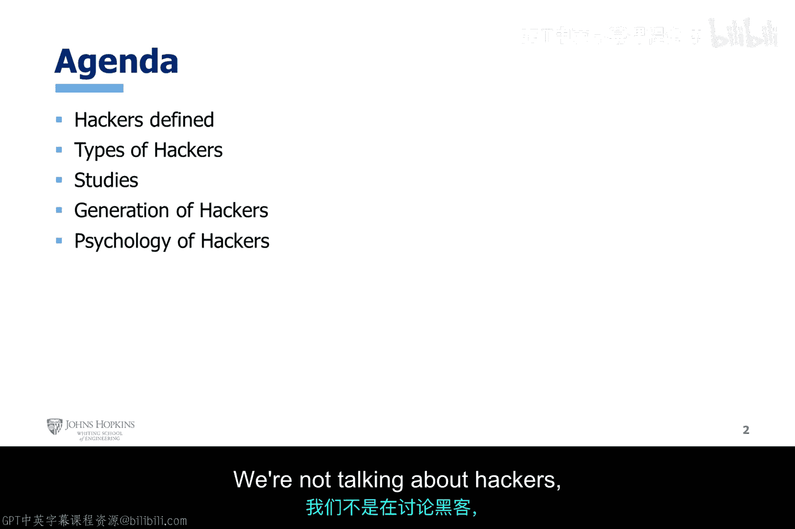
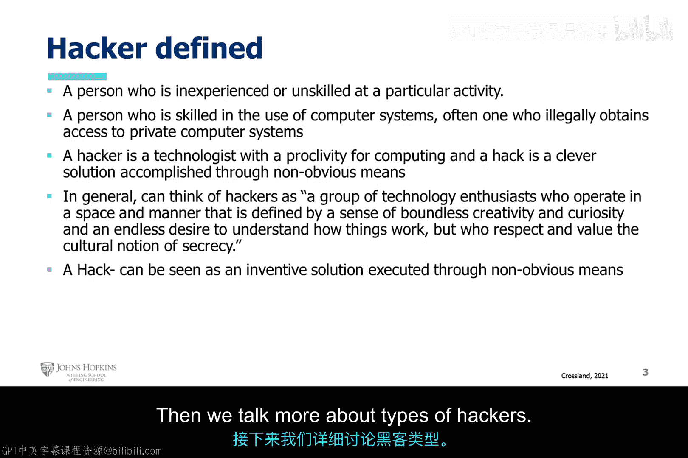
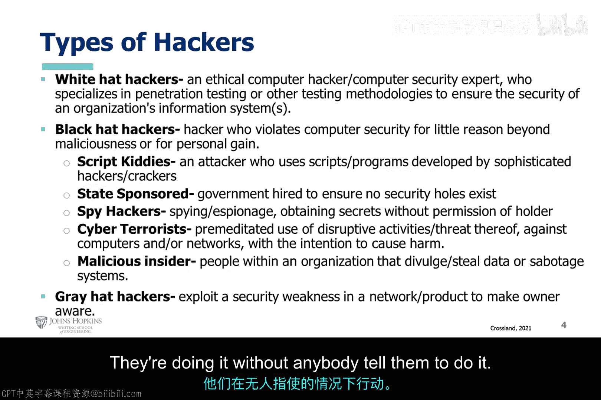
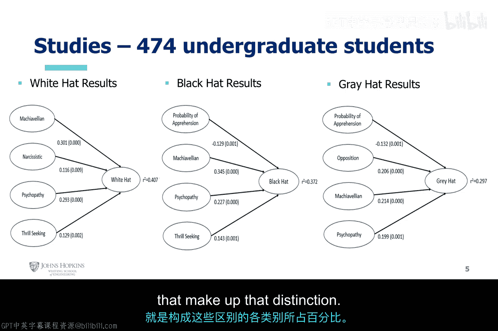

# 约翰霍普金斯大学《道德黑客入门｜Introduction to Ethical Hacking》中英字幕 p02 1_黑客群体综合研讨.zh_en -BV1xgu1z1Eau_p2-

So this is to be one of the videos for the first module。

We're going talk about hackers defined generation of hackers， types of hackers， studies。

 psychology of hackers。

So first off hacker is defined， so the first definition a person is experienced or unskilled at a particular activity。

That's the novice， the entry level， the individual that takes information that's been publicly available。

 that's been put through chat sites and forums。or underground type networks。

 whether they use information or use a skill that somebody you know communicates and provides how they attack something。

 what they use， what tools they use， what。The commands I use， the tricks of trade are provided。

 there's not a lot of additional knowledge on the person that does thats so very beginning level。

The second definition， that's a little more more involved and meaning the person that does't。

 they have to have a little bit of knowledge for computers。

 they have to have some trained either on their own。

 scly academic setting or they've had experience and they've grown in a mature their processes in order to attack something。

And then you have hackers technologiesnologist with a proclivity for computing。

So they have obviously kind of interest in wanting to do this and a hack is a clever solution accomplished through non obvious means。

So part of that， of course， is if you look about hacking。Usually sometimes you're taken。You know。

 a solution you're taking a reverse engineering an item and you're for creating a way to exploit a vulnerability or you're creating a configuration mismatch or misalignment in the architecture。

 and you or a you know flaw with the design development of a software hardware firmware implementation。

 and they're basically exploiting that。Using clever solutions， using out of box， kept thinking。

 reverse engineering。嗯。Knowledge that some else doesn't have。

 and they're expanding on that and building on that to attack something。And generally。

 you can think of hackers as a group of technology enthusiasts who operate in a space and manner that is defined by a sense of bound creativity。

Curiosity and endless desire to understand how things work。

But who respect and value the cultural notion of secrecy？So that's the fourth one， down。

 fourth bullet。 that's really kind of when we got talked later about what the differences between white hat。

 black hat and gray hat hackers。And that fourth definition is really the white hatt。

 the ones that are doing it professionally， legally， as a pen test living。

 they're actually doing it to help the organization or help an individual or system mission owner。

They understand kind of， you know， the balanced creativity， the out of the box。

 the here's your scope there's your boundary， but you go beyond that， you know。

 area and the kind of the outside in approach and they do it to help and develop kind of respect and value the culture normal of secrecy meaning that。

They want to provide information to a system owner or an information system security officer。

And help them understand kind of respect the fact that information needs to be somewhat secret。嗯。

In terms of people were proprietary。You know talking about vendors， if talking' about， you know。

 technologists， those people provide sources and provide computing technologies to the masses。

Sometimes those informations and when to get privates， kind of like Microsoft， Apple， the GuUI。

 how they do iOS， the software and that operating systems or certain platforms。

 they want to keep it kind of quiet。So that's kind of that fourth definition the game goes back to the white hat。

 the ones that are doing it out of respect for the you know of the data of the users of the system。

 they not trying to break something。Where the first part of those definitions of4 through three are more of a black hat。

And then last one， a hack and under the person， but the action can be seen as in an inventive solution executed through non obvious means。

So kind of again， you're going through ways if you're attacking something。Yous event solutions。

 doing things outside the box again， using kind of view what's this there。

 but you'll finding ways to go beyond that。Do advanced thinking。

 do out of box thinking and find ways that could be。Can break， can take advantage of。

coding practices， software practicing， hardware， integration， misalignments。

Are just things that people just sleep on ports， protocol services？

Actionions that they've gone that they don't realize are're doing or not changing passwords。

 you know， typicalable stuff that people do not just do cyber hygiene。

 typical normal stuff they should be doing， they don't do that and that becomes sometimes a。

Where they exceed or go be honest those obvious means and look for things that some of us would not think about。

To hack advice。

And then we talk more about types of hackers。 So we talked about， you know， white hat black hat。

 I was， again， more of the third generation clear distinctions of。

Having a distinction or separation between what kind of hackers may exist。The W hackers， again。

 are ethical， professional people that are doing it to help security。

 specialize the pen testing and other types of methodologies ensure the security of information system。

Black hat。You know， violate computer security little for little reason beyond maliciousness or personal gain。

You see someone there is all aspects of a types of black hack。

The Scriipites is a sponsor states by hackers， cyber terroristists， malicious insider。

Similar as we talk about the definitions， we first hackers define the first slide。I said like。

 you know， some of those definitions from top to bottom correspond to these when Scri Qs again just really taken things that are already out there not really adding any more sophistication to it。

As you go through state spied， cyber terrorists， those are getting more and more advanced。

 they're adding more and more of their capabilities。And gray hat hackers are like anonymous。

 They exploit security weakness in a product or in a network to make the owner aware。

 So they're not necessarily going to do it。 If they find out how to exploit。

 they're not going to attack。 They're not going to hold somebody ransom。

 They're going to put now or they're not going to do root kits。

 They're not going to do anything malicious。 They're not going steal down。

 but they're going to make somebody aware that this is a problem in terms of healthy organization。

 but they're also not being hired to do that。So there is no scope， there's no rules of engagement。

 there's no designatedny of tools or sign to use， they're kind of doing anonymously。

 they're doing it without anybody tell them to do it。

And then the next thing is a study， so there's a study done by the university for somebody doing under their PhD dissertation。

And it was 474 undergraduate students。And the main point of this slide is really。

 I'm just showing that there's there' three different kinds of white hat， black hat， Gr。

And what the 0。407 is that's a percentage off of， of course， one to 100% ratio。They're saying that。

40。7， roughly。Browund up to 41% our con of the 474 are thought to be white hackers。

Black hats are around 37%， which just get pretty high。

 considering the white blacks how much difference。And the gray is around 30%。

And those other left side through seeking psychopathpathy。Narciissist maalvollumvillian。

 those are all pro probability of apprehension， opposition。

 Those are all aspects that within those four of each of those correspond respectively to whether if your white hat you're considered of your ideology。

 you know， psychology of it of being one categorizes one of those four areas and that 30。

116 on the Y hat 293， those are the percentages that are associated with the kind of that make up that distinction。

