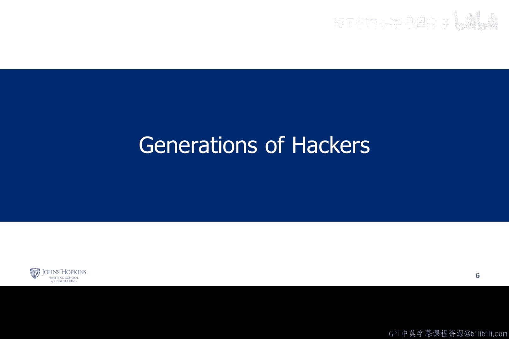
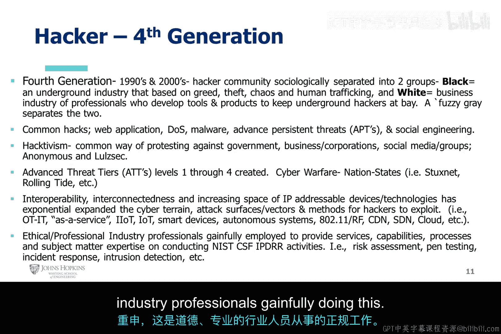

# 约翰霍普金斯大学《道德黑客入门｜Introduction to Ethical Hacking》中英字幕 p03 2_黑客世代划分.zh_en -BV1xgu1z1Eau_p3-

So now we're going to talk about the generations so there's four generations and kind of go through these are pretty interesting so the first generation was really in 1961 was a starting point。

 so that was really MIT acquired a program data processor PDP1 and that was created with being one of the accredited as being one of the first computers。

Now we're most instrument on the creation and proliferation of a hacking culture in MIT。So。

The first generation was really as an academia setting of a university type mindset， a Uarch。

 university affiliate Research Center， or a federally funded research center。

 and it was 100% focused on the pureness of the goodness of it in terms of obud creativity。

 open learning， continuous improvement of code of ideas。

 of development of computing technologies of interconnections， communications。

You've take the whole entireci layer。Our DCBIPSt is really one of those things where it was a creation of all this stuff and where how you can make it better。

 how can you make a creativity， how can you advance communication and technology， improve coding。

 approve the abilities to objects and subjects interact。

And make the architecture of security of computing better。

So the PDP program data processor was first embraced， first was first to embrace the term hacker。

ArRPNes， advanced research projects of agency network。

 a digital communication that connected hackers。So basically。

 again Haers' that point was meant to be somewhat pure and honest and non malicious。嗯。Virtually。

 was's a network that connected multiple universities across the entire United States。

Hackerers in 50s and 60s really was open learning environments。So university campuses， basically。

 everybody was look out a way to share it openly， creativity。

 having social social situation awareness。And a。Way to open form， communicate that or the A net。

And they kind of despise the notion of the government want to keep data secret。

This this case really from the secrecy of the government and the hackers the 50s and 60s on academia setting。

Wanting to keep things quiet。Was。From the distaste of things really led to more major advances hackers made in community labs in MIT and other universities。

And they did that not again， to be malicious or try to do something that was going to hack or break a system or steal data。

 but because the government at the time wanted to keep these data secret and felt like it was maybe a little control or a monopoly type thing。

The50s and 60s in academia setting started making different advances called freaking and lock panic picking。

Viner machine， manipulation。So doing。Payphone and slugs were invented。And then also from that。

 you had to free exchange information， but this whole purpose allowed from the creativity of advances and the open learning continuous dialogue。

Where he allowed great overall creativity so the goal was in this acadeia setting for the first generation was right Orig programs find ways to alter someone else's code。

 but not do it so you're trying to steal trying to have competition， trying to keep things secret。

 but really just to have again like you're in a classroom your learning。

 how to make programs run faster， more elegant， more efficient processes run quicker resourcing。

 be better， less resources， but more efficient in terms of how programs and how computers operated。

And at the same time， you have the military industrial complex。MIC became one of the primary funders。

For hacking culture。And from the academia setting and the Anet。

 more communication were sharing across the United States of all universities。You。

 a lot of more influence and outside kind of interactions where with people outside of them with academia towards the end of the 60s that cultivated a core element of thinking how it started becoming part of the Silicon Valley era。

So from the Silicon Valley area， you started having a kind of a spread from a first generation to a second generation。

Well the first generation， again， was open learning， collaborative。Creativity thinking。

 how to make things better。 You had that first generation mindset the transition in the Silicon Valley。

 which is again going back to， But when just talked about what the military industrial complex。

That second generation built basically industry operating kind of not like the MIT Harvard universities。

But because of that growth in the Silicon Valley LED to that creation of the co of the corporation organizations。

And the more of the rebellion against the 60s hack of that。

 meaning more of the rebellion against the this due creativity， this have a。Share the code。

 but also to make things better。That became more of a kind of a Silicon Valley cooperative。

Mindet of how you're going to grow， how you're going to basically make expand it so it becomes a competition really between entities of between organizations。

So that transitioned from an open learning environment much more into a competitive。

Marketing aspect of money making， you know how do you provide this and make money from it？

And that really began the computer industry， as we know today。 So that became a major catalyst。

To how personal computing in the world。Became， as we know today。

 And a lot of people think that the second generation of the hacker。Really。

 that did not evolve or not become what it is now that we might not be as far as long as we are with PCs and computers personal computers。

On your desk， at home， the， you know， smart devices， there are no things。

 phones to just the advancements we made and the better computing mainframes to to a very small。

 thin PC。 Those things would not have been as far along today if it wasn't for the second generation hackers。

So Bill Gates， Steve Jobs， Steve Wznik。A various instrument in the PC being a household name。

 and again， that made people not second generation hackers was the foundation of why we have personal computers today。

So Apple founders sold devices basically from used to hack telephone systems so originally。

Interesting enough， Steve Jobs wasn't always developing。

 say computers and phones and tablets and watches and so forth。

They actually took what John Draper's Captain Cruch discovery。Or that blue whistle。

That literally came out of Captain Cruch serial was a 2600 Hz tone。 And that was they could。

 And back then， they tested this and actually did bypass phone control systems。

That require payment from one distance calls。So。Apple basically copied John Draper's findings from the deputy on the Captain Cruch。

 and they copied that to make kind of a blue box。Device that Apple sold that actually again。

 hacked its telephone system。And that was kind of a first generation hacking innovation that came into like freaking。

 for example， we talked about a minute ago， became too where you had actually device that you can sell commercially that kind of led to that competition mindset of a second generation。

And then from there， Bill Gates and Paul Allen also took a computer language called Basic。

That was really primarily used for mainframe computers。And they use that software。

 They basically you know， was written， basic software was written。From hobbyists basically free。

 given away during a computer club meetings。So it's almost like the Anet。

 we have university connected through a network and you're sharing information。

 you're sharing your code， you're making them more efficient， making it better。

 you're grounding it growing your techniques。And that was kind of taken from that， again。

 open learning environment to a。Close competitive nature。And from open sharing that。

 Bill Gates and Paul Allen Ash adopted that and modify the code and took that basic first programming language software and put it into their computer called Altar。

Information sharing was a core element of the hacker ethics for second generation and the information sharing basically。

A bag is kind of a core element of Haer ethics。AndMean that when you build and share code ti bid information to improve efficiency。

That was part of the core kind of element of the information shared aspect is that you have type of information。

 you share it kind of for generation now and second generation。

 and you improve that efficiency or approved the code to make it more efficient。

They took that to kind of expand into a competitive environment。

And became kind of a creation for a competition with peers within the marketplace。

 just like from Paul Allen， Bill Gaates， Steve Jobs， for example。

And as you became more competitive and became more of a money making and marketing aspect of how can you advance。

 and in terms of a， I had the best thing to provide to the economy and mass produce that。

 that became more of a secrecy and maintained the sense of wanting things to be secret。

So that transition point from the old school of the 60s， open freely sharing。

 not worrying about competition， doing it basically just to make things better。

 and hopefully sharing that to everybody open source became a 70s mindset when you had competition that created the hackers of the 80s and '90s because of that competition。

So third generation。Is really when he became the white hat， black hat mindset。

And the minds of Steve Jas， Bogesti Wasznik， all those。

 just like the minds of the hacking aant created the sexual generation。

The second generation of those individuals， Microsoft， Apple， those foundation companies。

They became the catalyst of generations of a third。S your generation。

And the third generation was really the first to be associated with the hacking and hacking is a sense of being a criminal behavior。

And that basically led to the black hat and the white hat。So Chandler 1996。

 hacking can be defined as a breaking of copyright protection code。Thus。

 enabling the games program to be refined and altered or simply facilitate the piing of the game。

 so black hat。And then the council said too， same individual Chandler in 1996， said that basically。

 though also you had to referred， sometimes as the third generation as a time consuming process of writing a Ti program。

Spin hours。Its in front of a computer to be bug home written codes。So that became the Y hat。

 so he kind of noted that there was a generation divide or an ideology breaking between the two。

Of the good and the bad or， you know， I guess the Star Wars here。

 black and the dark side and the white side。Blockout being kind of the criminal， the mischiefs。

 the ones that are going to break things， they're going to do it for can say just a personal gain。

 they're going to see the boundaries of a system and what can be broke。

And got the white hat that actually doing it basically to help kind of kind of the first generation。

 I would think that the white hat kind of be more of the open source。

 know collaborative learning academia might say， you know。

 the pureist and the black hat would be proud of those individuals that are kind of doing it for the malicious purpose or competition。

 maybe。Several movies were created， obviously from that just showing the dynamics and complexities。

Of hacking in general， on the mindsets。And the pivot point for hacking really became to uneththuck hacking。

 as really was a third generation。 that was really the big cuilulative effort。

OfThe pivoting point of breaking a。Categorizing and hacking into two really groups of people。

So 19898 to Robert Morris。This is pretty interesting as well， a Corner University student。

Andleshed the first internet worm。 So room worm replicated faster than intended。And。

He was the first person really charged under the Comp Fraud Abuse Act。

And he was also the first person to event a worm that went viral on the Internet。

So Morris Besles said his motive。Was it demonstrate the inadacy of current security measures on a computer network by exploiting。

The security defects he had discovered。So if you think about it， that's really what pen testing is。

And that's really what ethical hackers。Doing pen testing or trying to do their business showing that their security measures。

That are supposed to be in place that aren't。Are not in place because in aequs of design development requirements not being right in the implementation。

 the delivery deployment of a hardware software for system integration。

And they're exploiting those security exploits their deficiencies because， again。

 they're trying to hopefully do it for a good thing。 write a pen test reports echo to summaryine。

 provide that data to somebody system owner system administrators so they can actually patch。

 They have， know， exploit。 They can eventually say these are vulnerabilities。 And help exploit them。

 That's what you need to do。So he was doing it not necessarily be malicious。 Morris was。

 He was just doing it like he said， too。 So there's inadequacies and security designs。

And on computer networks， and he showed that by basically exploiting security effects。

So Morris W was a first situation that really spurd societal fear。

And debate over the impact of hackers on society。And also ignite a concern of how this new technology。

As the white hat black hat hacker can be used for criminal purposes。

So that was huge and pivotal point， not a generation of the distinctions between white and black。

 but on the mors and the worm that was released and really people starting to kind of be concerned。

About。You know what has become of the hacker where the second generation is really， again， kind of。

You know， I'm moving it out to。The way of competition of it。

 the third generation became now you have a deviation between the two of those and you have a categorization。

And also on the third generation。You know， killer distinctions between both the second third generation is as the second generation really can say it contributed to bringing computer technologies to the masses for efficiencies in fast with society。

So think of， you know， Microsoft， think of Google， Think of Apple， Think of IBM。

 all those individuals that did that。 Bill Gates， Steve Jo， for example。

 they were doing it not necessarily。Say here's your computer and I want people to break into it。

 I want to have interconnected and IP to addressable devices and expand everything where data is your fingertips all the time and you have all these the tax services and vectors and I want to manipulate your data manipulation and I want to you know have confidential integrity availability。

And break those principles。They' were doing it because he saw how technologies can help society and advance society and make things better and make us more of a more power。

 per se。And have more of convenience and flexibilities and just their creativity in them and the evolution of technology to better society and people。

That was what they're try and do， efficiencies， advancements in society was a second generation。

 I second our contributions。From Apple and Bill Gates and Steve Wask that we talked about。

And then the third generation， though， was really the contribution they saw with the article what you provider saw when you guys take for module one。

Is that exploring the boundaries and he saw Moore said he was trying to show the security weaknesses in the the network architectures and network in all systems。

By showing how ye vulnerabilities or how misconfigurations on the security boundaries can be exploited。

Or it can be weakened based by showing vabs are and how you can exploit them。

So the third contribution of really was exploring the boundaries's limitations。

The reads of technology。And by how by seeking ways to exploit loopholes and configurations and design hardware。

 software weaknesses when loops， you know， in the design of the software and hardware。

How those can be exploited。So some generation hackers say that the fourth generation hackers。

 which we haven't got to yet， but were the underage underdeveloped。

And displayed in negative social attitudes and degene hacking。

From a collective mission of exploration into an onslaught of self indulgence。

So if evidenced by computer programming， focus on exploit kids， worms， etca。A lot of people， again。

 on the second generation， again， first was the academia open second generation was a competitive。

 you know how can I keep this more secret， How can I be competitive and take this and monopolize it and make money。

The third was， how can I bring this out， how can I provide。

 and while the second also was only can be competitive， but it was Silicon Valley。

 it was a cooperative corporation organizational， mindset of the business of providing computer technologies to the masses。

Which they have very purest and good intention of doing that。Third generation， as you can see。

 was life from the Morris worm was what are the boundaries， what's limitations。

 how can I exploit those loophole configuration weaknesses？

So in terms of the second of the third generation， really。

 Lao described a third generation as electronic cowboys， outlaws， reneggades。

A lot of people say similar to the American Wild West。You know， ability a kid， so forth。

 the lack of a cyberspace regulations， accountability。

And all that provided avenues and opportunities for first and gen second generation hackers to create their own code of conduct。

And that really led to serious technical skills to earn respect underground。

 never stole money and done malicious implants or abused。PI credit card。

So that's why you had the third generation， like I was saying the difference between those you really want to do things for the right reason。

 why hat and those who do not want to do things， the black hat。And as you went further along。

 third generation into the fourth you had 80s and 90s。

 where they betraying the industry as victims of hackers activities。And now currently。

 did you see that from the colonial pipeline where solar ones attacks？

Multiple attacks are constantly news。The increase of subcur professionals and just the pen testing and ethical hacking and all different cybersecurity jobs that they're proliferating like crazy。

Those are all one， because of。The hacking， the mindset， the evolution of it， of the generations。

 and also what industry has done。Reinforcing the fear of cyber attacks， ransomwarees。You know。

 domestic critical infrastructure be intact？嗯。All from need for increased funding。

 resources and ethical pen test support。And the last generation was the fourth generation。 So really。

 this was the。The generation of the sociologically and the psychological behaviors motives and kind of the more of a in ground and foundational。

 concrete distinctions between black， white and even fuzzy gray hackers or gray hackers。

So common hacks。Web application， dos， ABT， social engineering。You had activism。

 which come away at protesting against governments。

 A lot of people did it because they didn't believe in ideologically reasons。

 They didn't believe in what certain stances governments had。

 They didn't believe in business corporations。 They didn'tt believe in policies。

Lots of times people did to get back to employers， they were happy with the normal situational norms that were going on and they basically wanted you know voicer。

Theyre just distaste or。They're non alignment and divergence to things。 And as part of it。

 social media groups， anonymous Lesnik， for example， those are all thou were really the fuzzy gray。

Hackers， which really were not doing things to do ransomware like Colial Pipe did or like commands N states。

Or like the white hat， you know， hiring somebody as a professional that should come and do pen testing with scoping rules of engagement。

 all those things they were doing to really point out， you know， flaws and distinctions。

But necessarily attack and put that kind of on a forumear like anonymousy does to talk about it。

And then you have more inopilities， interconnectiveness。

 increases space of P addressable devices technologies， as some of those elicit there。

 all of them expanding the cyber terrain and the attack services and the vectors and methods。

For hacking are becoming more and more diverse and more sophisticated and more advanced。

 and a lot more T T P is being used because you have more technologies embedded and more inocerabilityities between devices。

So the bottom part there， ethics professional industry professionals gainfully employed to provide services。

So。So really capabilities， processes， and so much matter of expertise usually used in conducting this。

 so you have a lot now of capabilities guidelines， standards。

Lots of different pen testing frameworks and ideologies used。

And that's one of the modules and next one or within this module。

 there's a video I'm going to talk about also that can provide kind of why we do pen testing。

So resistance assessments， pin testing， incident response， those are all。

Kind of the move to the fourth generation， again， ethical。

 professional industry professionals gainly doing this。

