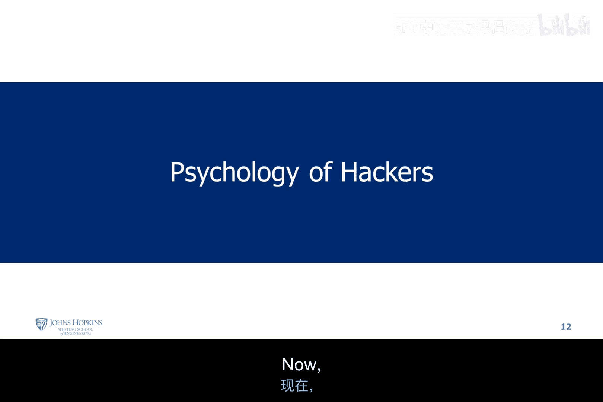
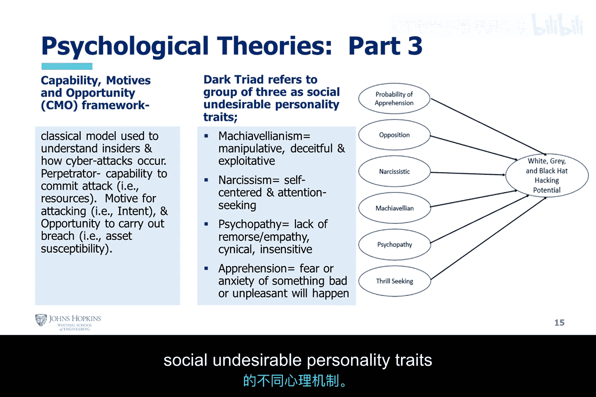
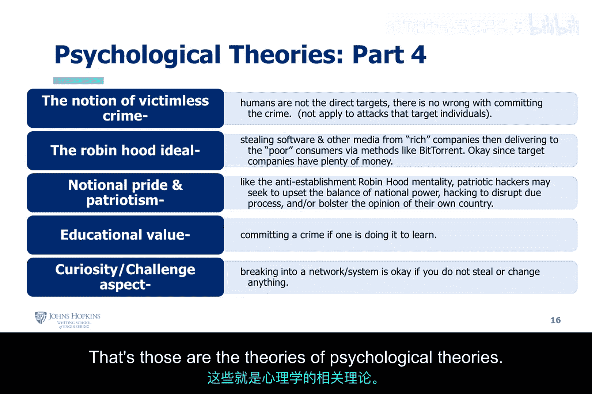

# 约翰霍普金斯大学《道德黑客入门｜Introduction to Ethical Hacking》中英字幕 p04 3_黑客心理学研究.zh_en -BV1xgu1z1Eau_p4-

So next I went was talking about psychology theories。So there's about。

 I think two or three slides on those。So cycleanalylect theory， Freud。

Kind of a coritis three parts of an ego psychoea and I'm sure many of you take number courses。

 you know psychology to say a little bit that've kind of looked at this。

 but the reason I'm bring it up is because。The three of those Id Eagle， super e。

 all of them kind of relate to8。If you have more than one or the other。If you more than one or other。

 you're going to have kind of a ability to gravitate this say to a black hat or white hat。

And what he was saying is that black hat hackers basically equate to more of a weak super ego。

And more of a no normal grounds with activity。Super ego is， you know。

 reconciled between practical and the world， super ego。

Values and ethics of society topped by parental figures。

An I represents distinctiveive primitive desire。 So what he's saying is that really black hat really looks less at the super ego。

So they don't really like asno norms， ethics values。Of parental figures。

 what that was taught with you know through your parents or your friends， relatives。

 they don't really identify themselves as that。 So of course。

 with no parental figures in the societal ethical boundaries。

 they pretty much would do things maliciously or without any intent of the system of the users on the system and sometimes have the safety of the individual。

3 of moral development was Klberg stages of cognitive development。

So people move successively to build more reasoning and basically without that crimes。Without that。

 crimes are done without caring about consequences。 So if there is no。You know。

 psychological aspect theyre a person when they build the more reasoning。And they， you know， grow。

 grow， grow successively to a more strong or moral compass。And no logical， a supereago reasoning。

An analysis of why they do what they do。If they don't have that， they don't have that compass。

 if you will， mindset or kind of， you know， guiding light in their mind。

Then they will more or less not have any care about consequences。

 and they're going to basically go to more of a black hat。And another aster of inferiority complex。

So that was something where you socially， they say somebodys really good at something they say they're you know a hacker。

 but they're ethical hacker or they're really good at computers or they're really good at you know programming。

 and just say they're kind of for the corner， they're picked on。

 they're a little bit excluded socially， just you know know hangouts from people because they're looked at as babies being a nerd or being。

You know， labeled， stereotyped。 Sometimes those individuals havevoc， they'll compensate。For thatity。

 inferiority and be acting in ways that show dominance。

So to do that and to show kind of a competent you know， inferiority and like they belong to say。

 to a certain group。They'll sometimes levitate to a black hat。

Hacker community because they want to show that they have value and kind of， you know。

 compensate for the fact that they've excluded from a social， you know。

 endeavor from a social interaction。And then。The other theory or other theories for part3 two this is theory of cognitive behavioral psychology。

 so a student study basically studies human conduct and creates inner sessions that improve the human condition。

So underneath this， you have four different kind of key areas， operant conditioning， reflex pavon。

 social learning and kptomania， so opera conditioning really is learning processes in which behavior is sensitive to controlled bias consequences。

So hot stove。I your kid。 You touch on stove。 You know， obviously， you don' touch again， right。

 So here kind of the other opposite end of that is hacking。People that whether' blackout， gray。

 white hat， they get， you know， they think of the hack something。

 they're going to get what's what is desired。 So if you want to do it for ide reasons。

 you want to do it because you don't believe in corporate。

 you know mindset or a business continuity or a， you know， policy in place。

 security policy in place information security policy。

If you don't like certain decision that ever made or you know a state ever made or just somebody work with and say you want to say you can get active of something。

Then lots of times'm tacking， you feel like if you do this， you're going to get what you wanted to。

 which is they say your revenge or you want to state your viewpoint or you want to provide your thinking or ideological or you have financial reasons or。

Economic reasons for it， or are you being put in the corner in terms of what we just talked about a minute ago。

About the inferiority complex。 So you're basically doing it because you get what you desire。

 So you basically you do that to。Again， behavior is sensitive to controlled bias its consequences。

 so you're doing that to get what you desire， you and you finally get what you desire so you go ahead and do your action。

Refllectex Paavion Paavbionion is really the condition stimulus and unconditioned stimulus。

So what this talks about is hackers can be sometimes think about as looking at two different stimuli。

And you have the condition sound of tuning for， for example， that exactly when you do this。

 you're going to get a Pacific reaction。And then the unconditioned stimulus。

 which is kind of more subjective， which is like you taste of food， for example。

 so you may like experience as a kid as you can order， you may not like it。

 you may not like qualifiers as a kid as you go know or you do like it。

Or know sweep potato out of fries， basically taste of food。

 you kind of grow and your stimulus gets change over time as it becomes a condition unconditioned。

And that is lot sometimes of hacking。Think can apply to hacker when discover vulnerability。

So they keep penetrating， even though they don't have any profit from it， I don't believe anything。

 they're not going to receive anything from it。So that's part of I thing in the social learning。

Coordinate behavior and cognitive interactions with the community kind of use both of those to hack again。

 this could be for both blackout Y hat or gray as a coordinated behavioral cognitive interactions。

A klypttomania really is the inability to refrain from a urge of steel。

Te for reasons other than personal use for financial gain。So sometimes again， its just。

 it's a these are our psychological mental kind of conditionings。You can't refrain from urge still。

 you do something because your mind can't differentiate in bad。

Or you do eventually for reasons other than a personal use or financial gain。

And then the last thing I want to talk about， I think this is actually three more。

 two more is the last one， two more is that the compatibility motive is and opportunities framework。

So this goes back to the study we just talked about 474 undergraduate students and really or quickly the D triad refers to the three social undesirable personality traits。

And all the fors you can see are dark because they're all not good things you want to be doing any and not good things you want to interact with or have it as a descriptions of a person。

And those are used， again， you know， some of these throughlic， for example。

People can be pen testing and do it ethically and they can filter still be a thrill seeker。

Some of these is narcissists。Psychchopathy obviously are not good。Opposition。

F probability apprehension。 So somebody these kind of go both sides。

 but really the point of this is that these are definitions and kind of the under the capability motives and opportunities framework looking at different。

idea of psychology reasonings for why only might fall under some type of social。

 undesirable personality traits and what those traits might be。

And then another thing I want to talk about real quick is last part of psychological theories is a notion of victimist crimes。

 Robinhood ideal and curiosity， challenge aspect and deprive of patriotism。 So these again。

 could be for both good and bad and。 So notion of victim crime。So obviously， you know。

 humans are not direct targets， sometimes they'll say， well。

 there's no wrong with committing the crime。Robin Hood ideal is like the movie rich steal from the rich gear to the poor。

If you know， okay， since a chart companies have plenty of money， so they may do it anyways。

Because they have plenty of money， they feel like， you know， they're not going to lose anything。

 So somebody who's less。On a privilege， they should give it to them。

National Pri patriotism this kind of goes back to we talked about you know ideological reasons。

 cultural norm type reasons， you basically anti-estlishment of the Robin Hood mentality。

 you know you don't believe in what's going on in the world。

 you don't believe in the opinion of your country， you don't believe in the balance of national power。

 you don't really believe in the due process aspects so something's going on。

 you want to make a point or you want to provide what your viewpoint is。

Educational value can a crime as long as one is doing it to learn。

And curiosity and challenge really just kind of， am I able to do this to have a skill set。

 am I skill enough， am I able to you know。To do this， break into something， kind of steal something。

And that's kind of， you know， those are the theories of psychological theories。

So that ends this video。And this would be part of the module 1。

 and I want to do another recording on a different bit as well that be you'll have for the module one for the International ethicalical hacking course。

