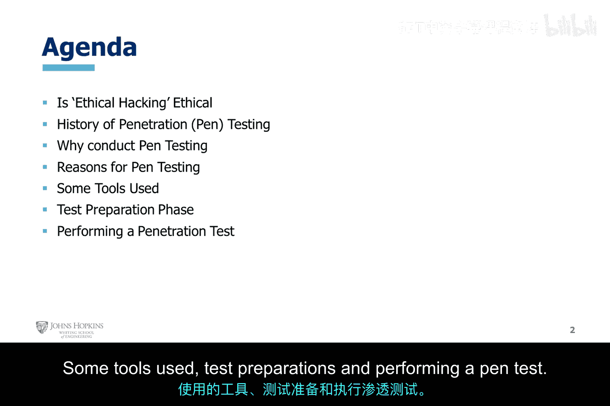
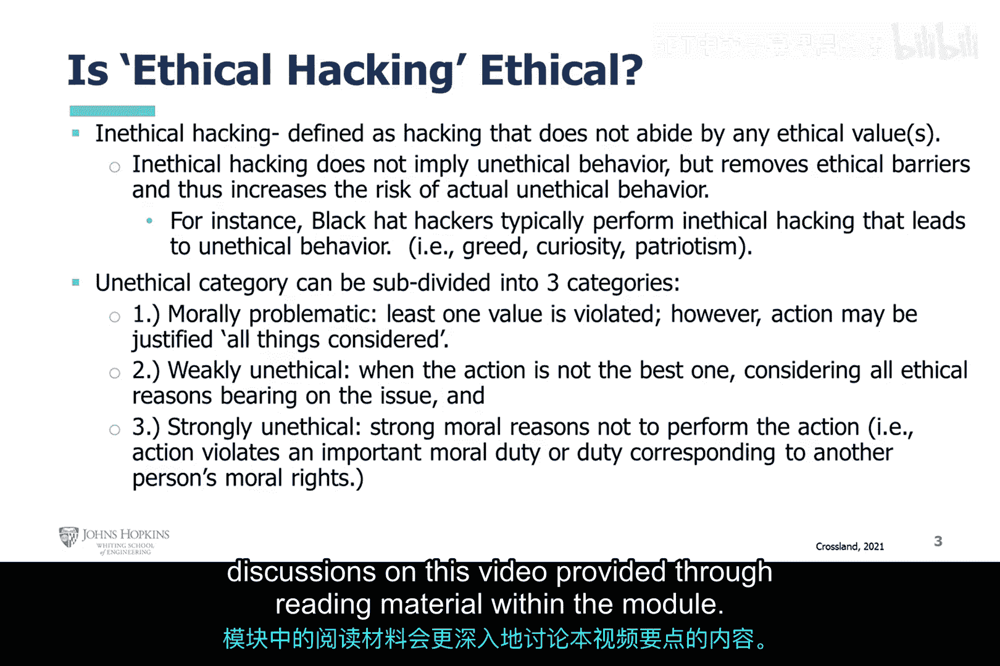
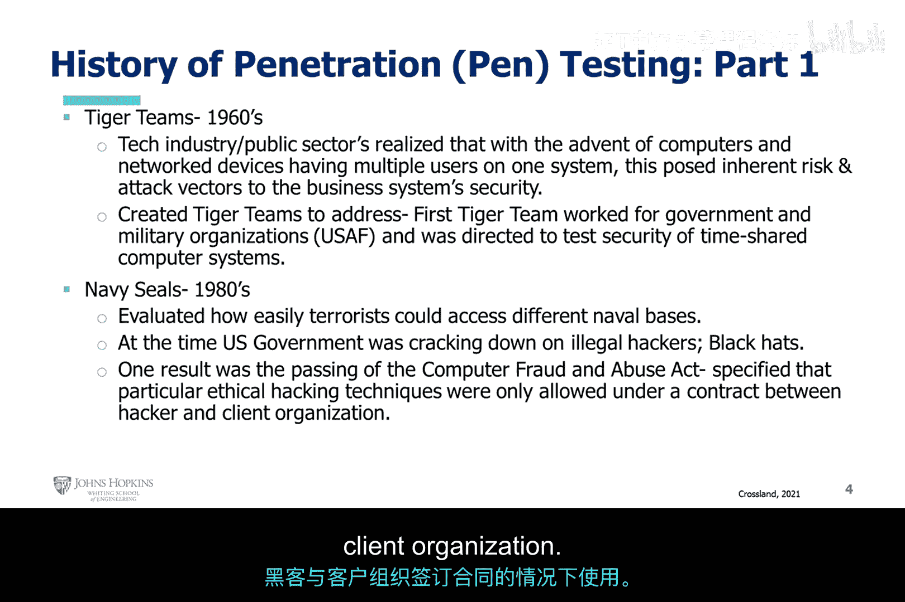
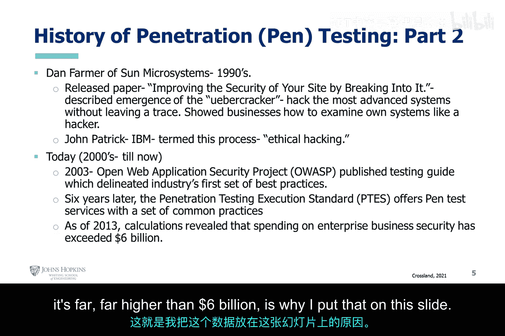

# 约翰霍普金斯大学《道德黑客入门｜Introduction to Ethical Hacking》中英字幕 p05 4_渗透测试全面探讨.zh_en -BV1xgu1z1Eau_p5-

So this is going to be a video for module1 as well。Talking about is ethical hack and ethical。

 history of penetration or pen testing， why conduct pen testing， reasons for pen testing。

 some tools use， test preparations and performing a pen test。

So inethical hacking。Defined as hacking that is not abide by any ethical values， which makes sense。

 Aneth hacking does not imply an ineth unethical behavior。

Bn moves ethical barriers and thus increases the risk of actual unethical behavior。

 So why bring that up is because when you encounter about black hat hackers， which again。

 those individuals out are doing it for malicious or personal gain you know reasons that are not ethical reasons that are not professional for what they're trying to do。

Usually black hat hackers typically perform in ethical hacking。That leads to unethical behaviors。

So for example， patriotism， we talked about curiosity， greed， the Robbbahhood， ideal。

 the Fud with the eyed ego， super ego， narcissistics， behavior， psychopathy。

 those are all things we just talked about or you'll see in the ethics bonus video。

That they're doing it。In ethical hacking， they're doing things they're not supposed to be doing because they're not following。

 but lieeutenant Commandments that should out steal those type of things。

 They're not following behavior that's ethical。And obviously， that leads to then。

Performing inethical hacking activities based on those motives and ideologies and reasoning that they feel should justify。

So another go category basically can be divided into three。Subcategories。Morally problematic。

 weakly unethical and strongly unethical。So morally problematic at least one value is violated。

However， action can be justified， all things considered。And this is again， mindset of black hackers。

 kind of we continuation a little bit of ideologies and。

Psychological reasonings for why they do what they do。

Weakly uneth goes when the action is not the best one to do。

 but consider all ethical reasons bearing any on the issue。So basically it's not the best idea。

 but they look at ethical reasons bearing on the issue and they patient perform that action as black hackers doethical。

 acting that leads to unethical behaviors and strongly unethical for more reasons not to perform the action。

So again， action violates an important moral duty， an ethical compass。

 or duty corresponding to another person's moral rights。

And that's kind of the breakout when you talk about ethical hacking being ethical and the difference of kind of inethical and unethical hacking attitudes and behaviors and this slides and these slides presentations are going to be more reading。

Yes， you could go more in depth about the。The more content of these bullet points and discussions on this videos are provided through reading material within the module。

So history of pin testing， again， penetration testing， pin testing。Is that in 1960s。

 kind of tiger teams， tech industry， public sectors。

 it's like we had four generations of hacker communities now we're going to have kind of a little bit of history of pen testing。

Tech industry， public sectors realize that with the adventent computers。

And network devices having multiple users on one system， and of course。

 I talked about increased attack services and vectors this pose an inherent risk and attack vectors to the business system's security。

So kind of we talked about with the Morris worm that was done kind of not maliciously。

 but as I just you testest that there are security boundaries in place。

 but those security boundaries are not strong enough and not encompass all the aspects of computer hardening and network security that they need to encompass。

 so there is ways you can exploit vulnerabilities due to hardware software misconfigurationations and development。

And then from the 1960s， that entire team。嗯。That you know， understanding history in public sectors。

 they've created tire teams and the tire teams was specifically used and basically hired by the government。

And first， Tiger team was worked for the government military organizations。

 specifically US Air Force。To do direct tests test the security of time， shared computer systems。

And that was the whole reason behind why， you know， because of that inherent risk and tax vector。

 two business security systems， that computers。From the second generation。

 the mass proliferation of computers to van society。

And then the third generation talking about how they do。

 theres some batteries and they want to go beyond the scope。And you know。

 else thinking of ways you can expand the typical boundary related to computers and there's other ways in which you can test the limits of the configuration of the architecture behind them。

They knew that kind of coming in for our pretty history of this。

 so they entire teams and kind of show that and really to really figure out ways to test the security of it。

So not necessarily maliciaious， so it's kind of， like said like ethical hacking what Penn testers do today。

And then you had Navy Ses in 1980s。Valuate how easily terrorists connect access different naval bases。

And at the time， the US government was cracking down on legal hackers， black hats， which again。

 was a third generation， clear distinction between a white and black and the fourth generation now kind of proliferating in the fear factor of what hacks can do and the continuing augmenting and growth of app penice in community。

So one result was passing the Computer Fronign Abuse Act。Which we saw that the Morris。Worm。

Was from the university， he was actually the first person that was actually convicted tried on a tribe but basically was the first one that was。

Guilty of a computer fraud abuse act or basically found guilty of that act。

And the Comp Fronud Abuse Act specified that particular ethical hacking techniques were only allowed under a contract between hacker and client organization。

So。Following up to history again， you have from 1990s do a damn farmer of some microsystems。

So he released a paper， improving the security of their sight by breaking into it。

And described basically the emergegnce of the Uber cracker， and that's the cr。

Chris Billing word of Ubercracker hacked the most advanced systems without leaving a trace。

Show businesses how to examine one， examine what own systems like hacker。 So basically。Job Patrick。

IBM。Kd of obviously taken from the you Dan Farmer and the improving the security of his side by breaking into it kind of termed the process of ethical hacking so the 1990s was actually the first time in the process and ethical hacking and that philosophy and this the mindset of the white hack and what does it mean to ethically hack something and what the processes is what's the tools。

 how do you go about doing it。He actually turned this process ethical hacking。

From the Ubercracker again showing businesses how to examine own systems like a hacker。

And a lot of it， too， on defenders aspects， a lot of people who are defenders。

Whatever number of defenders， anybody， you know， defense continuity or events cyber maneuverbilities inter turn events measures。

Defense sub operationss， At defenseense measures， DCCO IDM。

A lot of people that are defensive the mindset and do cyber Korea as a living on the defensive time。

They're usually better defensively if they understand the mindset of a hacker。

 so a lot of times defense people also do offense and offense sometimes also do defense。

Because if you understand the mind of a hacker， if you understand what they look at。

 how they look at things， you will become a better defender as well。So today，2 thousands0s。

 you until now。So basically 2003， the Open Web applicationpplication security Project， OWSP。

 which is very much in live today。And been used extensively today， published Test guide。

Which delineated industry's best set about first set of best practices。And again， as you use today。

 followed very strictly and very religiously by a lot of organizations。Obviously。

 people with web applications， As， application program interfaces。They use that。 And again。

 delineates industry's first set of best practices。Six years later。

 the penetration testing is execution standard， PTS。

Came out and that's what we're going to be actually using on the second third moduled。

 we actually talk about the Pis。And that offers Penn test services with a set of common practices。

So that's going to be used。The Ps， we're going to use that a lot in this class。And as of 2013。

Which is dated by 2013， calculations revealed that spending on enterprise business security has exceeded $6 billion。

So the reason why I say this is dated is because it's 2021， eight years later。

 saw I was $6 billion in 2013 and silver winds， colonial pipeline。W to cry， Mors virus。

 all these different malwarees， worms， frozen horses， root kits， ransom wares。

H big coming out exponentially。More and more and more。 so if it's 6 billion2013。And it's years later。

 and it's far， far higher than $6 billion is why I put that on this slide。

