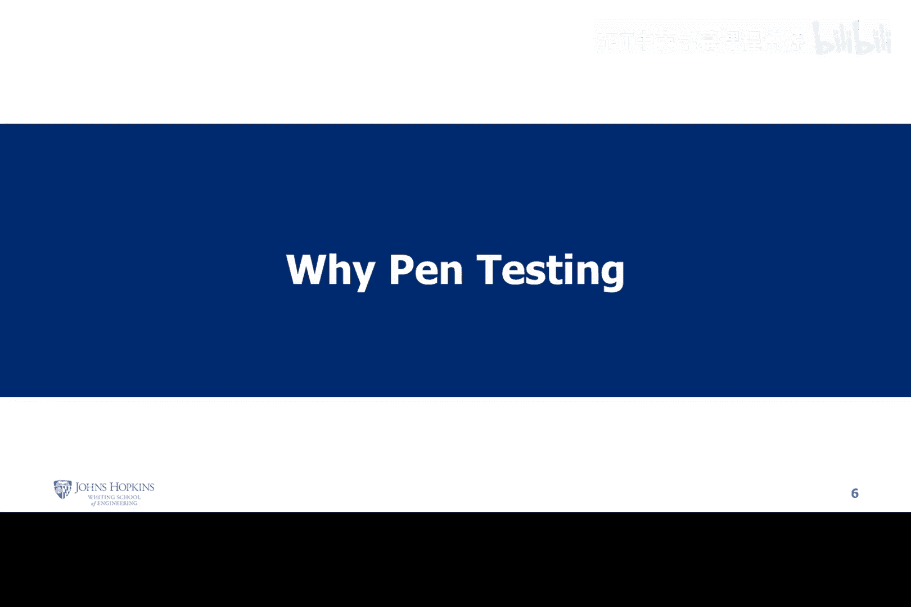
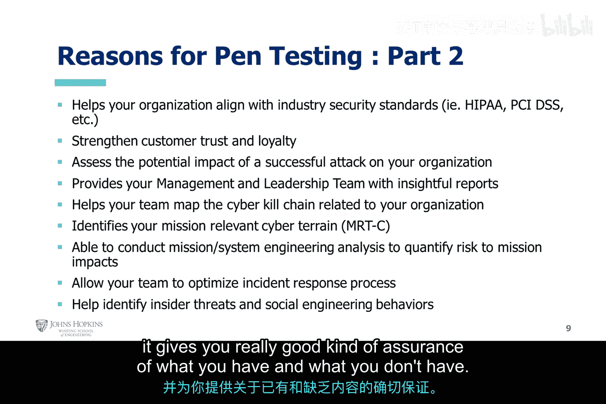

# 约翰霍普金斯大学《道德黑客入门｜Introduction to Ethical Hacking》中英字幕 p06 5_渗透测试必要性分析.zh_en -BV1xgu1z1Eau_p6-

So kind of go into why so you know， the whole reason part of this class is I want people understand taking this course。

 why do you conduct pin testing？Why would you， what's the reason for it， what's the purpose of it。

 Why do you do it？And really， the main goal is to identify security vulnerabilities under controlled circumstances。

So that you can be so that such that be， they can be eliminated before unauthorized users exploit them。

So again， it's skill into where you were doing it for white hat hacker。A do it under， you know。

 ethical reasons and you have rules of engagement and you have a scope。

And you're doing this because you are trying to help organizations identify security flaws of weaknesses and lack of controls。

In their environment or misconfirationations or lack of documentation， in physical controls。

 technical controls， administrative logical controls。All the things within 8553。Or the 882。

 if you're talking about control systems。You're trying to find those vulnerabilities way before anybody who's not supposed to find them does ensure you're trying to minimize the risks you're trying to minimize the damage to mission and to no organization。

Penetration testing is a valid assurance， accessible tool that benefits both businesses and its operations。

So recent SCSI study。Asst as businesses and operations， and this is pretty current。

Business and operations recovery efforts。And cost in total。It67 thousand7 or13 per incident。

And multiple organizations。 and that's per incident。 So every fear， every organization might have。

 let's say 15 or you know incidents。 and a lot of the incidents are things they don't even hear about。

 So a lot of things are in the news a lot of things you read about。

 a lot of them organizations that ISO system administrators won't necessarily divulge everything that's going on。

So CIO of a company isn't necessarily going to say to everybodys what's going on why because they lose trust。

 they lose any type of confidence reputational risk， all those things related to the economy。

 and consumers are not going to want to go and use their products or go to their websites or access their use their products if they know they're be being attacked。

So obviously they do that and they're not going to tell everything going on so other ones I do talk about and say they have 30 of them I'm going talk about five each one of them is $167713 to recover from that。

So another reason wise is no thy enemy。 So it turns of， you know， art of war。

Is better to know your enemy。 You know， keep your keep your enemies closer than your friends。

 If you know what they're doing， youre understand why they're doing it or if you understand kind of what your're。

You who your threats are， who your adversaries are。

 and what their potential and capabilities are or how what they can possibly do。

 then you're probably going to be more inted to what they're doing and how they're doing it and know where to put your protective measures better。

Helps you identify cause and effects。You know between negligence。

 you know whether it's misconguration setting because you have misconfigurations。

 you have wrong settings， you have defaults， settings， Port protocol services that are not you know。

 set up correctly， you have negligence， you have poor security policy violations， you know。

 bevolent user， somebody who doesn't know what to doing or somebody just you know， bad， you know。

 frame of mind or bad judgment to say at the particular time。

They do something they're not supposed to be doing malicious a， events threat tiers。

 now there's five of them， used to be before， those malicious entities inside our threats。

 whether nation states or scriities， sc kidities or terrorist organizations or state sponsored。

All those things are A T。 So you identify college， you identify effects。

 you draw correlations between those。And another reason wise industry has mandated regulatory security requirements。

 audits for computing systems。So it's required。 It's of law federally required that you will do audits。

 You will do pen testing， and you will make sure your system is secure。

 and you will employ white hat hackers， ethical pen testers to do this。 So if you not compliance。

 you can result organizations receiving heavy fines， imprisonment。

Or even failure meaning fair the system， federal an organization， loss of tons of money。

 loss of field capital， loss of revenue， and your company and itself can fiscally no longer operate。

So continuing on with the reasons。 that's kind of why。 So more specifically， there's。

 I think two slides here I'll talk about the reasons。 a lot of these， you know。

 all very good reasons but cover major vulnerabilities。

 prioritize vulnerabilities in terms of what's low， what's， meaning what's high in terms of risk。

Smart identifies best allocation resources， show strengths and weaknesses。

 train your security team how to better detect， respond。

Inform governance and compliance improvementss。So strength weaknesses identify security controls that are lacking。

 protect the most critical assets improve your business continuity。

 provides unsens sable data to help businesses meet auditing compliance aspects and regulate regulations。

So all those things are extremely important。I think probably each one of those really is not more important of the other。

 but they all are extremely reasons why you should do pen testing。

 why not only is required legally and by law， but it's also something that each one of those gives a lot more secure a mindset to anybody working from the company or anybody owns a company or in any consumer that uses this products or services。

And then， the last one。Is reasons for pen testing is again you have well all these are good reasons then the other is it helps your organizations align with industry security standards。

 so HIPAA， PCI DSSS， RMF， CyberSafe， all those ones。

Strengting consumer trust loyalty provides your management and leadership team insightful reports。

 assess the bonal impact of successful tax， understise your mission relevant terrain。LTT maps。

 cyber kill chains related to your organization。Able to conduct mission system engineering analysis allows your team to optimize incident response processes。

A process and helped identify certain threats。And social engineering behaviors。

 So all these are extremely important， I think。You know in terms of the management Le team and Cypher reports。

 that's one reason why and of course if you do a pen test and you have a report and you have a executive summary。

 all those areciful and required in terms of a pen tester because it gives them something they can look at later。

 it gives something can pass along， it's concrete， it's written， it's easily shareable。

 it's a timetamp in history， it can do metrics compared to where they are down the road。

It allows you identify a lot of different threats and it gives you really good kind of assurance。

What you have， what you don't have。