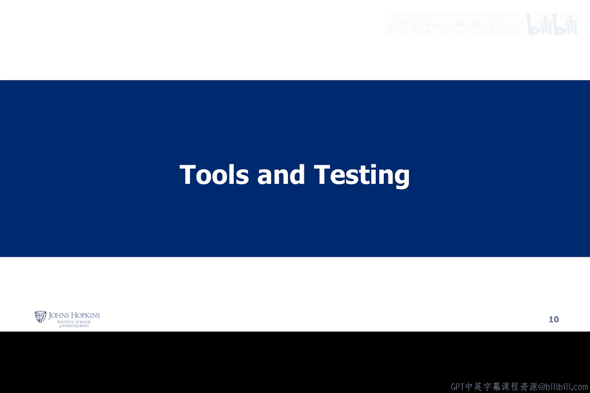
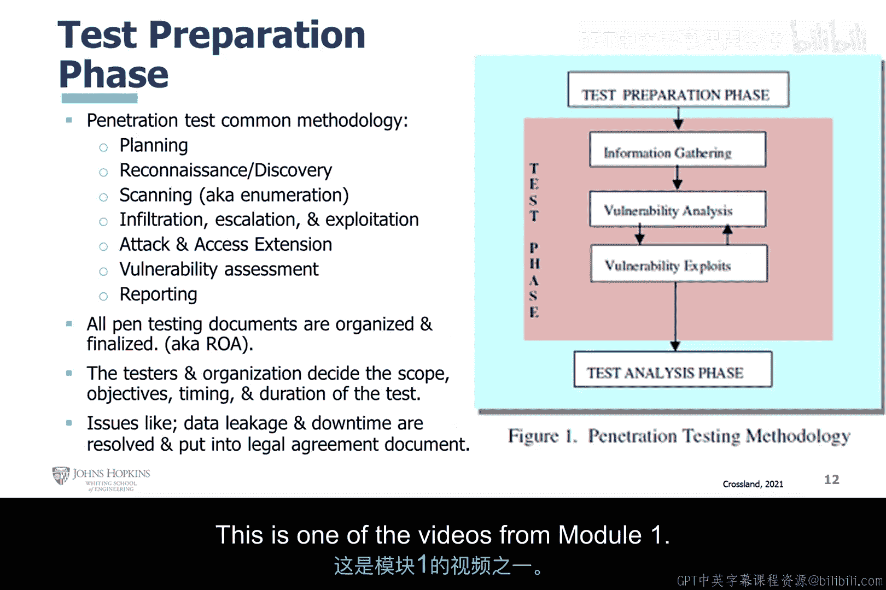

# 约翰霍普金斯大学《道德黑客入门｜Introduction to Ethical Hacking》中英字幕 p07 6_渗透测试工具链.zh_en -BV1xgu1z1Eau_p7-

And then some tools use。 So these are not exhaustive lists。 There are several tools。 Call Linux。

 again， which is a suit suite of software tools， all for defensive and even for offensive operations。

But they're used by， again， it can be used by ethical people， white hat。

Four ways and methods are due types of Linux Uni operating systems， even on Windows。

To do different operations and and。Use the tools to do pen testing。

So somebody these is probably familiar with and map NeEus， for example。

 that's been around for a long time， X probe 2， and these were all free， you notice Neest'。

 of course free for a personal edition。Not an enterprise edition though。

 and you have all of different phrase so Brutus was it's interesting。

 basically telling it of the PHP Passure cracker。There's also Abel in Kain。

 there's lots of different password cracking type devices or tools， X probe 2。TC P OS fingerprint。

 porch scanner， scanner。H H T T print， web server finger printing， SS。

 L secret socket layer and detection and detect web enabled devices。 So that's pretty interesting。

 So W wireless access wireless access point， router， switch modems。

All those devices are tools can be used for those different purposes。And that's just some of them。

 There's many others out there， too。So test preparation。

 so this one here what I want to do is a figure in the right kind of talks about the process and the steps The main thing is like you said。

 for test phases is you're kind of going through the information gathering phase reconnaissance decision you know discovery。

做。Geting information doing kind of a。Understanding of data collection and what's out there。

 Reconnaissance because you also have to know your target。 You have to know what you're going after。

 You have to understand why are those weaknesses， what does configurations， What does it have。

 What does it not have， What's the areas， what's the tax services， what is vectors， How can I get in。

 where can I get in。What TtP is I to use， what kind of tools that I do I need to use。

 what tools do I to use you need to do the reconnaissance。

 you need your surveillance to kind of figure that out and that's information gathering the vulnerability analysis piece is that scanning so enumeration infiltration kind of the analysis of it you have your attacks。

 what kind of implants you want to use how you going to infiltrate how you're going to go after what system are're going to go after how you' going to deliver that implant。

 youre going have delivery aspects of you going to attack， you have a delivery。

 how you going delivery it。How are you going to push it through？

And then the vulnerability to exploit is that infiltration， the escalation， the exploitation。

 you know， the attack the access extensions， the persistence， the emration， the pivoting。

And when you come out of that whole thing， you have a before test preparation phase。

 which is the planning and the test analysis phase， which is bottom half that。

 which is the vulnerability assessment， the pen test report， executive summary。

All those things can correlate to the sub bullets of that penetration test common methodology within figure 1。

And then all pen testory documents need to be organized， finalizeds kind of， you know。

 the rules of engagement， you know， ROA。嗯。Basically how you do it and the rules of access， you know。

 ROAs， those rules of engagement OOE， you apologize for that and rules of access。ROA for access。

 how you're going to get into it and this has to be documented or has to be obviously agreed upon。

Because you're also doing it through a scope， a controlled environment so they know your system owner Na on knows you're doing it。

And you know， everything's laid out and how long you're going to be in there and what you're going to be doing。

The test organization decides the skill， like it said。

 objectives and timing and duration of the test。And any type of issues so any type of legal。

 you data leakage downtime， business， you know problems if they have peak time during a day and they have different users have capabilities。

 it's a system that has to be up all times， availability is very high whether they run critical services。

 critical business capabilities。You have to figure out when you're going to be able to actually have the time to do that。

 So that always be resolved。Legally written down a great upon documents and signed before you can do anything。

And then performing a penetration test。So on the right side again， you have additional discovery。

 so it kind of goes back a little bit to figure one。You you have， I'll go back to that real quick。

 you have the information gathering， you have， you know， the analysis， you have the exploits。

 you have everything under on the penetration test common methodology。And you have preparation phase。

 and you have the analysis phase。So really the plan phase is the preparation。

 the vulnerability assessment and the reporting is really the test analysis phase。

 and then the four bullets， there were inconogniissance scanning the infililtration。

 attack is all within that test phase of that pink。Yale Square area。

So when you talk about the performing and penetration test， the NIS SPs。

 National Institute Standard Technology， security， Special publication。S P 80，8001 15。

Decrise Penestine as if forced that process and that forced that process as a figure on the right。

We talk about planning discovery attack reporting and that discovery attack is a conditional kind of loop that goes kind of around on a circle because as you learn more things on attack。

 you say this doesn't work， this doesn't work。You got to go back to discovery and you kind of constantly figure out。

 okay what is my enumeration or what's my reconnaissance？What's my surveillance。

 and then what's my delivery， what's my implant， how my attacks going to work。

 and then you do the you know， the implant， the enumeration。The items in here。

 the you know access extension， escalation， pivoting， et cetera on the attack piece。

 so that all goes around。That full circle loop there。And then the reporting。

 it becomes a bottom again， when you get out of that， you're going to do a pen test report。

 a vulnerability assessment report executive summary。 So during planning。

 certain questions should be asked。 So only your rules of engagement or your rules of attack or O A or Os。

You're going to have those questions。 So each of these， you know， if you look at them。

 they're all very good questions， each one should really be addressed。Cost， the budget。

 the resources available， how long it going be tests， who the data owner is。

 data services will be tested， you know， what's the rules， what's the limitations。

What can you can not do is something critical is this tool， you you're knocking off completely。

 is it something that's too aggressive because you can't use？

They function in the business organization， because obviously， that tells you。

If you have vulnerability and they do a lot of this， say web Gui interfacing。

 then any type of crossa scripting or type of SQL injection or any crossa request forgeries is going to be huge if they don't have a lot of web services。

 they don't have a lot of things that are web enabled and to say everythings through a host then any type of data manipulation or spoofing or middle tax is going to be something you want to look at So it depends on what you're doing if they need a lot of w-fi。

 you know web， if you need a lot of mobile devices。

 if everything through a network everything through a web you know access。

All those different things if you have a lot of coding where you buffer of flows。

 if you a lot of things where you want to know。About say root kidss or their vulnerable for root kidss。

 those are all different aspects that you want to understand what the mission is。

 what the systems are。And then again， you want to know what the cost of the budget is and what are you allowed。

 what actions are will be allowed as part of the test。You know， rules of engagement， rules of access。

 Can I do this， Can I not do this， You need to identify those before I should go into it。

So with this module here， what I want to do， I think the last one is yeah， as the very end。

 So this one really， the purpose of module is I wanted to talk about why we depend testing。

Because to go to this course is very， you know， this is it's interesting。 Yes。

 it's very awesome be able to do these types。Ethical contest actions。

But when you get done and when it's finished， you're going to know what the history is。

 what the generations are， what the history of pen testing is， why do you do this， what the tools。

 what's the test phase？What's it， what's the process。

what's preparation is what the performing test performing test penetration test are。

why do you do pen testing， what's important， what's or so what app pen testing。

 And I think going back to this。嗯。TheRe for thinking on this one here part 1， part slide 7。

 probably the。Your eyes most form， but protect your most critical data。 Its huge。You know。

 identify security controls that are lacking or need to be implemented as huge。

 smartly identify best allocation and resources and mitigation strategies is huge。

Prioritize your vulnerabilities into low medium high risk is huge because again。

 you need if you only have so much amount of money。When you're in a fixed strain environment。

 resource wise， you don't want to identify， you don't want to mitigate something that is low in terms of risk。

 and that does not get you the most return investment or bang for the buck。

You want or you want to be able to put in the save $50。

000 for something that that mitigates 10 vulnerabilities。At the same time。

 which which is from one mitigation， then you want to do one mitigation strategy rather than doing。

You know， say $70，000 only fixes two things。So you want to allocate it smartly and then other part of this too is understanding strict weaknesses makes you a lot better instant response handling it gives you a lot better defensive measures and you can do a lot of things and then train your security team。

The better how to better detect and respond is huge。

Because if you have innate and assets that are within your company。

 it's lot cheaper to do that than to hire third parties and hire different people outside that are going to leave or have a service level agreement contracts and you can't provide your own knock or sock capabilities。

And then lastly in this I want to say probably identify mission relevant cyber terrain， it's huge。

 it goes back to the first one we talked about， you know， know your strength， your weaknesses。

 know your assets， know your mission mapping， understanding the you know dependencies。

Another part of this also would be strengthening， customer trust and loyalty。

And then able to conduct mission system major analysis to quantify risk to mission impacts。

That's huge。 I mean， if you can't do if you can't conduct your mission that they can't provide services capabilities and provide what you the business model to your consumers。

 then you're never going to stay in business and you're going have major issues of dis able to perform or provide any type of operation continuity or strategic assets or any capabilities。

So last this is one of the videos from module1。

And some of this， of course， will be in ratings we have for this module。So I hope you enjoyed it。

